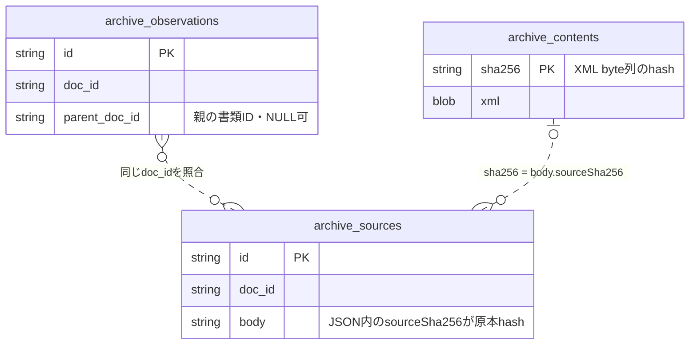
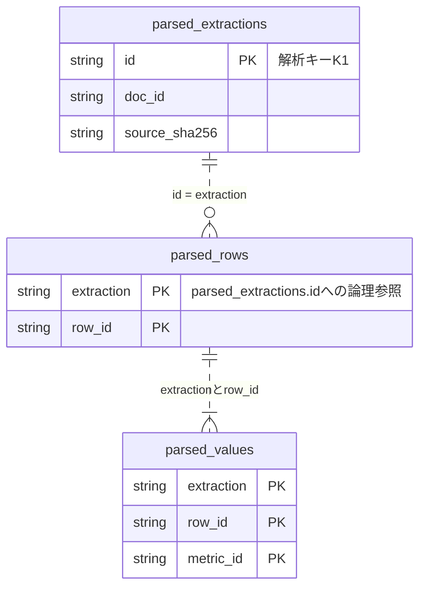
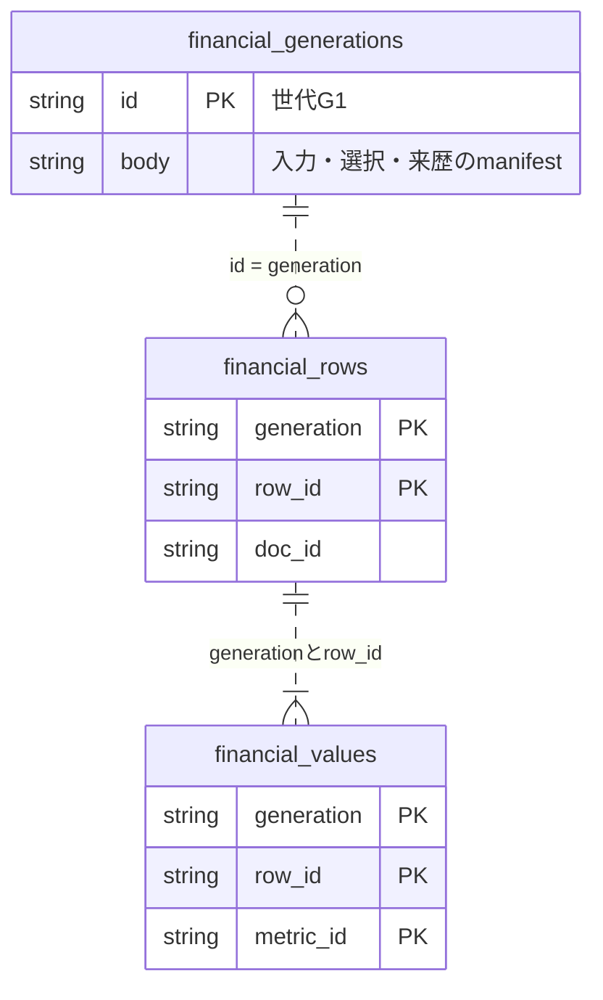
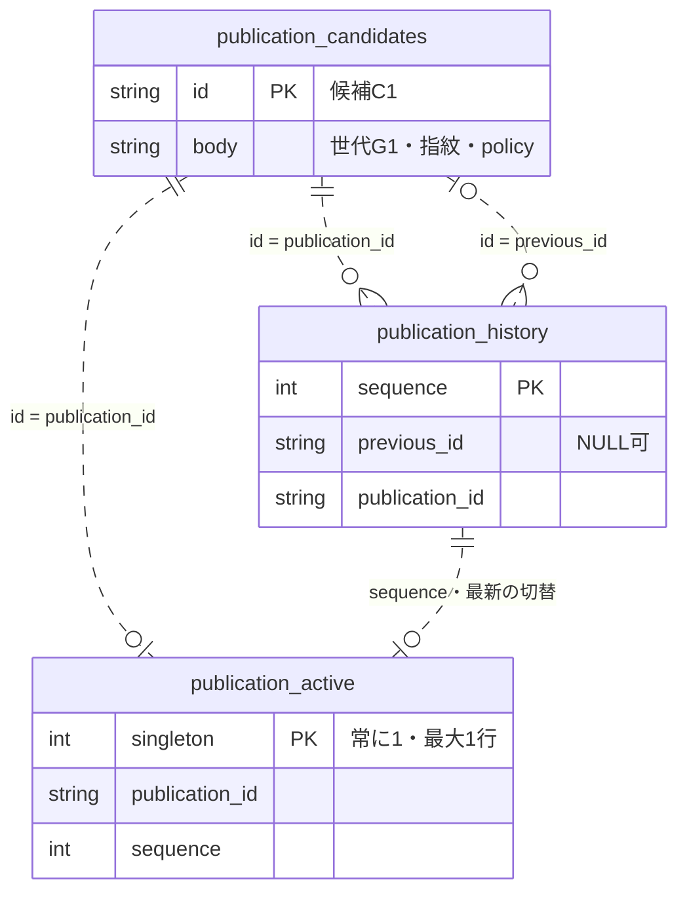

# 財務データはどこに、どんな形で保存されるか

2026-11-03時点の実装に沿った説明です。以下の会社・金額・短いIDは説明用の架空例です。実際のIDやhashは長い文字列になります。表では主な項目だけを示し、JSON内の項目も見やすく展開しています。

## 最初に、保存したいものを一つに絞る

例えば「A社の2025年度、連結、日本基準の売上原価は12億円」という情報です。

| 項目         | 例                          |
| ------------ | --------------------------- |
| 会社         | A社、EDINETコード `E00001`  |
| 提出書類     | `D1`                        |
| 期間         | 2025-04-01〜2026-03-31      |
| 会計基準     | 日本基準（`J-GAAP`）        |
| 連結区分     | 連結（`Consolidated`）      |
| 財務グループ | 明細（`details`）           |
| 指標         | 売上原価（`costOfSales`）   |
| 値           | `1200000000` 円             |
| 出典         | 書類D1の対象期間のXBRL fact |

会社・期間・会計基準・連結区分・財務グループをまとめたものが「財務行」です。その下に売上原価、税金などの「指標値」が並びます。同じ会社でも、期間や連結区分が変われば別の行になります。

```text
財務行 R1：A社／2025年度／日本基準／連結／明細
  ├─ 売上原価     12億円     出典あり
  ├─ 売上総利益   値なし     対象タグなし
  └─ 法人税等     0円        出典あり
```

「値なし」と「0円」は別の状態です。

## 図の読み方

以下のER図は主要な業務テーブルのキーを示し、format表や構築jobの表、JSONの全項目は省略します。PKはDDLの主キーです。複合主キーでは複数の列へPKを付けています。

点線は保存・読取処理が照合する**論理参照**です。ここに示す4組のDDLには `FOREIGN KEY` 制約はありません。SQLの外部キーが参照先の存在を自動保証する図ではなく、内容hash・親子の件数・JSON/SQL列の一致をSDKが検査します。DBをまたぐ参照も設定・manifest・原本hashで結び、SQLで直接joinする前提にはしません。

## 1. 原本：提出されたXMLそのものを残す

原本SQLiteには、書類の一覧・観測履歴と、取得したXMLを保存します。圧縮形式ではXMLはgzip圧縮したBLOBです。内容hash `H1` は展開後のXMLのbyte列に対するSHA-256です。

| 実際の表               | 主な内容                                                   |
| ---------------------- | ---------------------------------------------------------- |
| `archive_observations` | 書類ID、会社、訂正元の書類ID、いつその一覧情報を確認したか |
| `archive_sources`      | 書類ID、原本をいつから利用できたか、XML内容hashなどの情報  |
| `archive_contents`     | XML内容hashとXML本体                                       |



同じ書類に複数の一覧観測・原本宣言を持てます。宣言だけ保存され、XML内容がまだない場合もあります。訂正元の `parent_doc_id` は観測の一意キーではなく、親の観測が未取得の場合もあるため、外部キーではありません。原本宣言の `sha256` 列は宣言JSONの検査用で、XML内容hashとは別です。

例を縮めると次の関係です。

```text
書類D1の原本情報 ── 内容hash H1 ── 圧縮XML
                                    └─ 売上原価のfact「1200000000」
```

この段階では、どの書類の値を検索結果に採用するかは決めません。訂正前後の原本も残します。

## 2. 解析済みSQLite：XMLを読み取った結果を再利用する

XMLから値・期間・単位・出典を取り出して保存します。

| 実際の表             | 主な内容                                                         |
| -------------------- | ---------------------------------------------------------------- |
| `parsed_extractions` | 解析キー、書類ID、原本hash、解析日時、成功／失敗、結果全体のJSON |
| `parsed_rows`        | 解析キーごとの財務行。会社・基準・期間・連結区分など             |
| `parsed_values`      | 財務行ごとの指標値。原文字列・検索用数値・状態・理由・出典など   |



解析失敗や採用可能なgroupがない結果では、解析記録だけで財務行がないことがあります。作成された財務行は1件以上の指標選択を持ちます。原本への参照は `doc_id` と `source_sha256` で照合する論理参照です。同一内容を異なる時刻に取得した原本宣言と、解析結果のキーは別物です。

解析キー `K1` は、書類ID・原本hash・解析版・対応表版・source commit・対象項目から決まります。

```text
書類D1 ＋ 原本H1 ＋ 解析版などの条件 → 解析キーK1
                                      └─ 財務行R1
                                           ├─ costOfSales
                                           ├─ grossProfit
                                           └─ incomeTaxes
```

`parsed_values` の一部を表にすると次のようになります。

| extraction | row_id | metric_id   | raw_text       | numeric_value | available | status   | reason     |
| ---------- | ------ | ----------- | -------------- | ------------: | --------: | -------- | ---------- |
| K1         | R1     | costOfSales | `"1200000000"` |    1200000000 |         1 | selected | selected   |
| K1         | R1     | grossProfit | NULL           |          NULL |         0 | missing  | tag-absent |
| K1         | R1     | incomeTaxes | `"0"`          |             0 |         1 | selected | selected   |

`raw_text` は元の数値文字列、`numeric_value` は安全に扱える場合の検索用数値です。大きすぎる数値などを検索用数値へ無理に変換せず、元の文字列と利用できない理由を保持します。出典のタグ名・context・単位・精度などは結果JSONにも残ります。

同じ解析キーで結果が保存済みなら再利用できます。解析条件が変われば別のキーを作り、以前の結果も保持します。

## 3. 検索用DuckDB：採用した財務行を世代にまとめる

検索用DuckDBには、固定した対象時点・会社集合・訂正系列・採用条件に従って選んだ財務行と値を保存します。この一まとまりを「世代」と呼びます。

| 実際の表                | 主な内容                                         |
| ----------------------- | ------------------------------------------------ |
| `financial_generations` | 世代ID、対象時点、母集団、入力・採用・来歴の情報 |
| `financial_rows`        | その世代に採用した財務行                         |
| `financial_values`      | その世代の財務行に属する指標値                   |



対象会社に採用行がない場合もあり、世代の存在と全社・全項目の利用可能は別です。解析済みSQLiteと検索DuckDBの間には物理FKを張らず、固定入力・解析版・選択根拠と転記した内容を世代manifestで検査します。

例えば世代 `G1` で書類D1を採用した場合です。

**financial_rowsの例**

| generation | row_id | edinet_code | doc_id | standard | scope        | period_start | period_end | group_id |
| ---------- | ------ | ----------- | ------ | -------- | ------------ | ------------ | ---------- | -------- |
| G1         | R1     | E00001      | D1     | J-GAAP   | Consolidated | 2025-04-01   | 2026-03-31 | details  |

**financial_valuesの例**

| generation | row_id | metric_id   | numeric_value | status   |
| ---------- | ------ | ----------- | ------------: | -------- |
| G1         | R1     | costOfSales |    1200000000 | selected |
| G1         | R1     | grossProfit |          NULL | missing  |
| G1         | R1     | incomeTaxes |             0 | selected |

検索では `generation` と `row_id` でこの2表を結び、会社・期間・基準・指標・数値条件などで絞ります。通常検索は保存済みの値と根拠を読み、原本XMLの展開・解析は行いません。

解析済みSQLiteは解析結果の再利用に使い、DuckDBは固定した採用集合の検索に使います。

## 4. 正式catalog：公開する候補を一つ選ぶ

正式catalogは小さな管理用SQLiteです。候補 `C1` に対して、世代G1の指紋・品質・公開policyなどを保存します。

| 実際の表                 | 役割                           | 例                   |
| ------------------------ | ------------------------------ | -------------------- |
| `publication_candidates` | 候補の世代・指紋・品質・policy | C1は世代G1を参照する |
| `publication_active`     | 現在の正式候補                 | C1                   |
| `publication_history`    | 切替の順序と直前候補           | 1回目：参照なし→C1   |



初期状態ではactiveも履歴も空です。公開後はactiveを最新の履歴1件と一致させます。候補の世代ID・索引の場所とhashはJSONや公開設定で結び付けて検査し、catalogから別ファイルの世代表への物理FKはありません。[catalog保存処理](../../src/db/financial-index-publication.ts)が候補・履歴・pointerの整合性を検査します。

索引ファイルの場所は公開設定で指定します。catalogの候補と実際の索引が一致することを確認してから読みます。同ホストの本番設定と保存先は[本番運用](DUCK_FINANCIAL_PRODUCTION.md)を参照してください。

```text
正式catalog：現在は候補C1
                    └─ 世代G1の指紋
                           └─ 指定したDuckDBの世代G1と一致を確認して利用
```

## 訂正書類が来たらどうなるか

新しい書類D2と原本H2を保存し、新しい解析キーK2で解析します。訂正対象と採用条件を確認してから、新しい世代G2を構築します。

```text
以前：原本H1 → 解析K1 → 世代G1 → 公開候補C1
追加：原本H2 → 解析K2 → 世代G2 → 公開候補C2

正式参照：C1 → C2
```

原本H1・解析K1・旧世代G1は保持します。切戻す場合は、対応するSDK・原本・照合記録を確認して正式参照を旧候補へ戻します。

## 再利用とやり直しの境界

ここで「再解析」はSDKの抽出結果を作る処理を指します。公開前の独立原本照合は別工程であり、下表を理由に省略しません。

| 変わったもの                              | 取得・解析                                                                       | 世代・公開・reader                                                                                        |
| ----------------------------------------- | -------------------------------------------------------------------------------- | --------------------------------------------------------------------------------------------------------- |
| 原本XMLのbyte列                           | 新原本が未保存なら取得。異なる内容hashとして残し、新しい解析キーで解析           | 新しい入力・採用結果を別世代にする。旧原本と旧解析結果を上書きしない                                      |
| 解析版・source commit・対応表版・対象項目 | 同じ原本を再取得せず、変わったidentityの別解析キーで結果を作る                   | 新結果を使う別世代を構築し、検証後に別候補として公開                                                      |
| cutoff・対象会社・訂正の採用条件          | 必要な原観測・原本が揃っていれば再取得不要。同じ解析identityの結果を再利用できる | 固定入力を変えた別世代を構築する。既存候補の入力を編集しない                                              |
| 公開する候補                              | 検証済みの候補を使う切替自体は、原本取得やSDK抽出をやり直さない                  | 期待する直前候補・品質・照合記録を確認してcatalogを切替。既存readerは明示reloadで新候補を検査してから切替 |

原本のキーと時刻は[原本アーカイブ](../../src/db/observed-financial-archive.ts)、解析identityは[解析済みStore](../../src/db/parsed-financial-store.ts)、構築入力の固定は[DuckDB cycle](../../src/pipeline/build-duck-financial-cycle.ts)、readerの切替は[公開reader](../../src/db/duck-financial-publication-reader.ts)に実装されています。再開・保持の検証例は[解析Storeのテスト](../../test/parsed-financial-store.test.ts)と[公開readerのテスト](../../test/duck-financial-publication-reader.test.ts)を参照してください。

## 「原本との独立照合」で比較しているもの

検索DBの「書類D1の売上原価1200000000円」という値と、原本XMLの対象factを、DBを作った抽出関数とは別の処理で読み比べます。会社・期間・連結区分・単位・出典の対応も確認します。

これは抽出時の誤りを保存先へ引き継いでいないか調べる検査です。言語を変えることが独立性の条件ではありません。TypeScriptでも本体の抽出関数を呼ばない検査処理で実現できます。

2026-11-03の最初の公開では、一時SQLiteへ転記してPythonで照合しました。現在のソースはTypeScriptの照合器がDuckDBを直接読む構成です。本体とは別のXMLパーサーを使い、原本の値・単位・期間・訂正関係を検査します。同じ本番用DBの7,408文書・14,816行・38,598採用値で旧照合結果と値のhashが一致しました。mainへのマージ後、稼働中の固定runtimeもTypeScript版へ更新しました。Nodeだけで原本照合と日次処理を実行し、旧照合記録と旧runtimeは切戻し用に保持しています。

## テーブル定義をコードで確認する

財務データの主要DDLは [`src/db/schema/`](../../src/db/schema/) にあります。[原本](../../src/db/schema/observed-financial-archive.ts)、[解析済み結果](../../src/db/schema/parsed-financial-store.ts)、[検索用の表](../../src/db/schema/financial-search-index.ts)、[DuckDBの構築記録](../../src/db/schema/duck-financial-build.ts)、[正式catalog](../../src/db/schema/financial-index-publication.ts) を分けています。定義を使ってDBを開く処理は `src/db/` の保存クラスです。

各フォルダと処理の対応は[ソースコードの読み方](../development/SOURCE_LAYOUT.md)を参照してください。

## ファイルが多い理由と、日常的に見るもの

上記のデータ以外に、取得・解析・構築をどこまで進めたかを保存する進捗DBやcheckpoint JSONがあります。再開するための運転記録です。検証用コピーや過去の実験も別に残っています。

日常の確認は、次の順に見ると整理できます。

1. **日次バッチの結果**：取得・解析・構築のどこまで進んだか。
2. **正式catalog**：どの候補が現在の正式参照か。
3. **検索DuckDB**：その世代の値・出典・欠損理由。
4. **原本SQLite**：値の根拠まで確認するときに読む。

実装の詳しい契約は[解析済みStore](PARSED_FINANCIAL_STORE.md)、[検索reader](DUCK_FINANCIAL_SEARCH_INDEX.md)、[公開・照合](DUCK_FINANCIAL_VERIFICATION.md)を参照してください。
