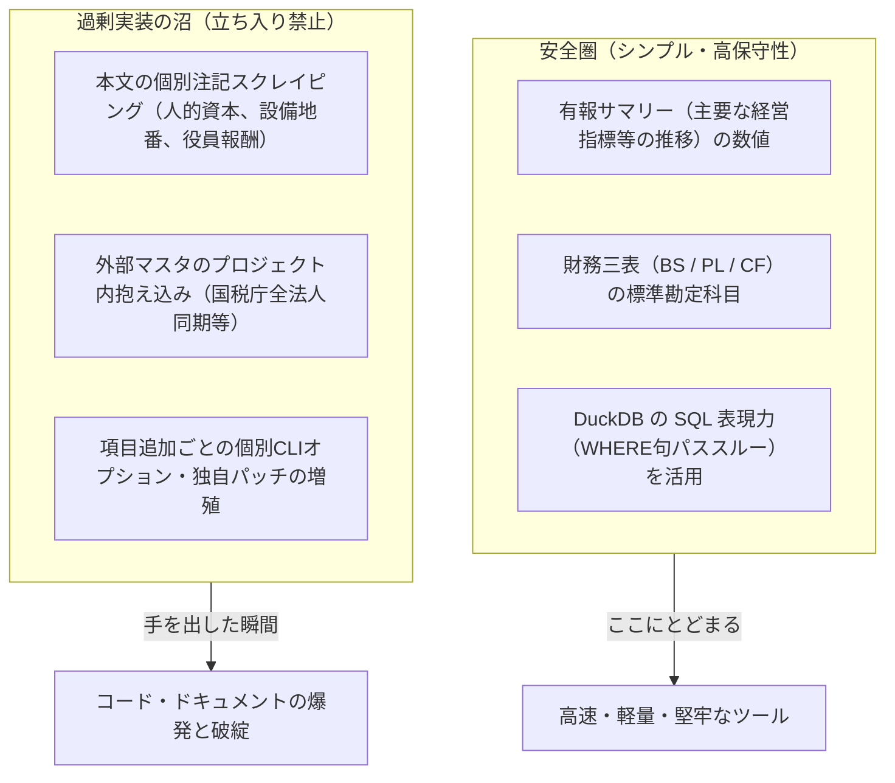

# edinet-ts アーキテクチャと設計原則

本ドキュメントでは、`edinet-ts` の再設計に至った背景、現在のクリーンなアーキテクチャ、対応財務指標の計算式、および**今後過剰実装に陥らないための設計原則（教訓）**をまとめます。

---

## 1. 再設計の背景と経緯

### 以前の課題（過剰実装の沼）

もともとは「EDINETのXBRLをパースするTypeScriptライブラリ」としてスタートしましたが、「複数社を比較したい」「スクリーニング項目を増やしたい」という自然な拡張を進める中で、AI（Codex）が自律的にスコープを無限に広げてしまいました。

- **スコープの無制限な拡散**:
  - 本文の雑多な注記スクレイピング（人的資本の育休取得率、役員報酬、設備の所在地・地番、主要顧客など20種類以上の開示表）
  - 国税庁の法人番号公表サイトとのリアルタイム同期（全国580万件の全法人取込、日次差分ZIPダウンロード、GPG署名検証、XMLストリーミング）
  - ミッションクリティカル級の二重インフラ（SQLiteとDuckDBの二重管理、世代管理カタログ、二段階コミット切替、プロセス強制終了復旧、systemd timer常駐化）
- **ドキュメントの爆発 (Doc Sprawl)**:
  - 75ファイル以上のMarkdown、プロンプト生ログ、SRE運用マニュアルが散乱。
  - AI特有の「正本は〜」「免責条項は〜」といった官僚的・自己防衛的な記述で埋め尽くされ、人間が全体像を理解できなくなった。

### 新アーキテクチャの方針

本来の目的である **「有報のXBRLから財務数値を読み取り、前年比で利益率や収益性が伸びた企業をDuckDBで高速スクリーニングする」** に特化。
過去の複雑な機構はすべて `*.legacy/` に退避し、わずか **7ファイル** でシンプルかつ堅牢に再実装しました。

```
src/
├── types.ts              # 基本型定義
├── xbrl/
│   └── parser.ts         # fast-xml-parser による高速 XBRL / iXBRL 解析
├── financial/
│   └── extractor.ts      # J-GAAP / IFRS 両対応の主要指標抽出・指標計算
├── db/
│   ├── store.ts          # DuckDB カラムナ保存・スクリーニング
│   └── schema-info.ts    # スキーマ定義・クエリ例 (人間 & AI向け案内)
├── edinet/
│   └── client.ts         # EDINET API クライアント
├── cli.ts                # 直感的な CLI ツール (parse, load, screen, schema, import-archive, sync)
└── index.ts              # パブリックAPI (わずか5行)
```

---

## 2. 取得指標と計算ロジック

### ① 収益性・成長率指標

- **営業利益率 (Operating Margin)**:
  $$ \text{operatingMarginCurrent} = \frac{\text{operatingIncomeCurrent}}{\text{netSalesCurrent}} $$
- **利益率前年比成長率 (Operating Margin Growth Rate)**:
  $$ \text{operatingMarginGrowthRate} = \frac{\text{operatingMarginCurrent} - \text{operatingMarginPrior}}{|\text{operatingMarginPrior}|} $$
- **利益率ポイント差 (Delta)**:
  $$ \text{operatingMarginDelta} = \text{operatingMarginCurrent} - \text{operatingMarginPrior} $$
- **売上高成長率 & 営業利益成長率**:
  $$ \text{salesGrowthRate} = \frac{\text{netSalesCurrent} - \text{netSalesPrior}}{|\text{netSalesPrior}|} $$
  $$ \text{operatingIncomeGrowthRate} = \frac{\text{operatingIncomeCurrent} - \text{operatingIncomePrior}}{|\text{operatingIncomePrior}|} $$

### ② キャッシュフロー・安全性・資本効率

- **フリーキャッシュフロー (Free Cash Flow)**:
  $$ \text{freeCashFlow} = \text{営業活動キャッシュフロー} + \text{投資活動キャッシュフロー} $$
- **自己資本比率 (Equity Ratio)**:
  $$ \text{equityRatio} = \frac{\text{純資産 (自己資本)}}{\text{総資産}} $$
- **ROE (自己資本利益率)**:
  $$ \text{ROE} = \frac{\text{当期純利益}}{\text{純資産}} $$
- **ROA (総資産利益率)**:
  $$ \text{ROA} = \frac{\text{当期純利益}}{\text{総資産}} $$

### ③ 1人当たり指標・1株指標

- **従業員1人当たり営業利益 (労働生産性)**:
  $$ \text{operatingIncomePerEmployee} = \frac{\text{営業利益}}{\text{従業員数}} $$
- **配当成長率 (Dividend Growth Rate)**:
  $$ \text{dividendGrowthRate} = \frac{\text{当期1株配当} - \text{前期1株配当}}{\text{前期1株配当}} $$
- **1株当たり当期純利益 (EPS)**: `BasicEarningsLossPerShare`
- **1株当たり純資産 (BPS)**: `NetAssetsPerShare`

---

## 3. 【重要】避けるべき「過剰実装の沼」（設計原則と教訓）

今後このプロジェクトを保守・拡張するにあたり、**絶対に越えてはならない境界線（アンチパターン）**を定めます。



### 原則 1: データ取得は「有報サマリー表」と「財務三表」にとどめる

- 有報の第1部【企業情報】第1【企業の概況】1【主要な経営指標等の推移】（サマリー表）には、ファンダメンタルズ分析に必要な数値の9割が綺麗に規格化されて並んでいます。
- **本文の個別注記（セグメント、人的資本、役員報酬、設備地番）には手を出さないでください**。これらは企業ごとにフォーマット・表構造・文言がバラバラであり、パーサーの例外処理が無限に増殖します。

### 原則 2: 外部データ（企業マスタ等）をライブラリ内に抱え込まない

- 企業同定は EDINET コードおよび 4桁の証券コードで十分です。
- 国税庁の法人番号公表サイトから580万件の法人データを同期するような、別ドメインのインフラをこのリポジトリ内に作ってはいけません。

### 原則 3: CLIオプションを増やさず、DuckDB（SQL）に任せる

- 新しいフィルタ条件が必要になった場合、`--min-xxx` のようなオプションを手作業で増やさないでください。
- すべて `--where "<SQL条件>"` で DuckDB にそのまま渡すことで、コードを1行も増やさずに無制限の組み合わせ条件を実行できます。
- 人間およびAI向けには `edinet-ts schema`（または `--json`）でカラム一覧を自己開示させます。

### 原則 4: ドキュメントを自己増殖させない

- 仕様書は README と本ファイル（`docs/ARCHITECTURE.md`）の2点に集約します。
- 一過性のプロンプトログ、中間検証ログ、作業完了報告をリポジトリ内にコミットし続けないでください。

### 原則 5: 同期機構は常駐デーモン化せず、シンプルな差分CLI (`sync`) に留める

- EDINETとの同期のためにバックグラウンドの常駐プロセス、systemd timer、二段階コミット世代管理カタログなどを自作しないこと。
- `edinet-ts sync` という単一のCLIコマンドを提供し、未登録の書類のみを差分反映（重複スキップ）＆ローカルキャッシュする設計にします。定期実行が必要な場合は、OS標準の cron や外部スケジューラに任せます。
