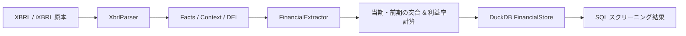

# アーキテクチャと計算ロジック

本ドキュメントでは、`edinet-ts` の内部処理フロー、財務指標の抽出規則、および利益率・成長率の計算ロジックを説明します。

---

## 1. 処理フロー



---

## 2. 財務指標の抽出規則

### 会計基準とタグ対応

有価証券報告書のサマリー（主要な経営指標等の推移）および本声明細から、以下の優先順位でタグを検索します。

| 指標 | J-GAAP タグ | IFRS タグ |
| :--- | :--- | :--- |
| **売上高** | `NetSalesSummaryOfBusinessResults`<br>`NetSales`<br>`OperatingRevenue1` | `RevenueIFRSSummaryOfBusinessResults`<br>`Revenue` |
| **営業利益** | `OperatingIncomeSummaryOfBusinessResults`<br>`OperatingIncome` | `OperatingIncomeIFRSSummaryOfBusinessResults`<br>`OperatingProfitIFRSSummaryOfBusinessResults`<br>`OperatingProfit` |
| **経常利益** | `OrdinaryIncomeSummaryOfBusinessResults`<br>`OrdinaryIncome` | （該当なし） |
| **純利益** | `ProfitLossAttributableToOwnersOfParent`<br>`NetIncome` | `ProfitLossAttributableToOwnersOfParentIFRSSummaryOfBusinessResults`<br>`ProfitLoss` |

### 連結・単体の判定
- 当期（`CurrentYearDuration`）において、連結コンテキストの売上高または営業利益が存在する場合は **連結（Consolidated）** を採用します。
- 連結データが存在しない（単体決算の企業）場合は、自動的に **単体（NonConsolidated）** を採用します。
- 前期の数値も同一の区分（連結なら連結、単体なら単体）から取得し、スコープの不一致を防ぎます。

---

## 3. 計算ロジック

### 営業利益率 (Operating Margin)
$$ \text{operatingMarginCurrent} = \frac{\text{operatingIncomeCurrent}}{\text{netSalesCurrent}} $$
$$ \text{operatingMarginPrior} = \frac{\text{operatingIncomePrior}}{\text{netSalesPrior}} $$

### 利益率成長率 (Operating Margin Growth Rate)
前年同期比で利益率が何%伸びたか（比率変化）:
$$ \text{operatingMarginGrowthRate} = \frac{\text{operatingMarginCurrent} - \text{operatingMarginPrior}}{|\text{operatingMarginPrior}|} $$
*(例: 前期 10% → 当期 15% の場合、成長率は +50%)*

### 利益率ポイント差 (Operating Margin Delta)
前年同期比でのパーセンテージポイント差:
$$ \text{operatingMarginDelta} = \text{operatingMarginCurrent} - \text{operatingMarginPrior} $$
*(例: 前期 10% → 当期 15% の場合、+5.0%pt)*

### 売上高成長率 & 営業利益成長率
$$ \text{salesGrowthRate} = \frac{\text{netSalesCurrent} - \text{netSalesPrior}}{|\text{netSalesPrior}|} $$
$$ \text{operatingIncomeGrowthRate} = \frac{\text{operatingIncomeCurrent} - \text{operatingIncomePrior}}{|\text{operatingIncomePrior}|} $$

---

## 4. DuckDB スキーマ

```sql
CREATE TABLE financial_summary (
  edinet_code VARCHAR,
  security_code VARCHAR,
  company_name VARCHAR,
  period_end VARCHAR,
  is_consolidated BOOLEAN,
  net_sales_current DOUBLE,
  net_sales_prior DOUBLE,
  operating_income_current DOUBLE,
  operating_income_prior DOUBLE,
  operating_margin_current DOUBLE,
  operating_margin_prior DOUBLE,
  operating_margin_growth_rate DOUBLE,
  operating_margin_delta DOUBLE,
  sales_growth_rate DOUBLE,
  operating_income_growth_rate DOUBLE,
  PRIMARY KEY (company_name, period_end)
);
```

DuckDB のカラムナストレージとベクトル化実行エンジンにより、数千社・数万件の決算データであっても瞬時に絞り込み・ソートが完了します。
