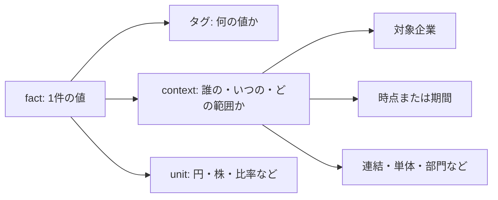

# 用語集

API名や財務用語で迷ったときに参照するページです。すべてを覚える必要はありません。まず「値の対象」「原本の構造」「取得できなかった理由」を区別すると、返値を読みやすくなります。例の数値は説明用です。

## 最初に押さえる関係

XBRLの1件の値を **fact** と呼びます。値だけでは意味が決まらず、項目名、対象企業・期間・範囲、単位を合わせて読みます。

たとえば「売上100」でも、連結の通期と単体の半期では比較できません。[指標の選択](financial/METRIC_SELECTION.md)では、これらの条件を指定して候補を選びます。

## 日付が同じでも期間は違う

3月決算の会社を例にすると、9月末を含むデータにも次の違いがあります。

| 種類 | 対象 | 値の例 |
|---|---|---|
| 時点（instant） | 2025-09-30の1日 | 総資産の残高 |
| 年度初めからの累計（YTD） | 2025-04-01〜2025-09-30 | 上期の売上 |
| 単四半期 | 2025-07-01〜2025-09-30 | 第2四半期だけの売上 |
| 事業年度 | 2025-04-01〜2026-03-31 | 年度の区切り |

書類一覧の期間が、そのまま財務値の集計期間とは限りません。半期・四半期の照合は[書類と原本の接続](pipeline/DOCUMENT_PIPELINE.md)を参照してください。

## 財務データの対象と比較

| 用語・コード上の名前 | 意味と例 | 読むときの注意点 |
|---|---|---|
| 連結・単体（`scope`） | 連結は企業グループ全体、単体は提出会社だけの範囲。例: `Consolidated` / `NonConsolidated` | グループ全体と会社単独の売上を混ぜない |
| 会計基準（`accountingStandard`） | 財務諸表を作る際のルール。例: `J-GAAP`、`IFRS`、`US-GAAP` | 同じ名前の項目でも意味が違わないか確認する。定数があっても全基準の抽出対応を意味しない |
| 期末・時点（`instant`） | ある1日における残高などの対象日。例: `2025-03-31`の総資産 | 貸借対照表などの残高を選ぶ |
| 期間（`startDate` / `endDate`） | 値を集計した開始日から終了日まで。例: `2024-04-01`〜`2025-03-31`の売上 | 終了日だけ同じ半期と通年を混ぜない |
| 通期・年初来累計・単四半期（`annual` / `ytd` / `quarterly`） | 集計期間の分類。年初来累計は対象年度の開始から途中まで、単四半期はその四半期だけ。例: 通期売上と半期累計売上 | 保存データの比較条件を揃える。自動分類ではない |
| 財務諸表 | 会社の資産・負債・収支などを示す書類。例: 貸借対照表や損益計算書 | 数値が何を表すか確認する |
| 財務指標（metric） | 売上や資産など、取得・比較する項目。例: 売上高のIDは`netSales` | 読みたい値や検索条件を指定する |
| BS・PL・CF | 貸借対照表・損益計算書・キャッシュフロー計算書の略。例: BSの総資産、PLの売上高、CFの営業活動による資金の増減 | 残高と期間中の収支を区別する |
| 組替え・表示方法変更 | 比較しやすくするために、前の年度の項目の分け方や表示先を変えること。例: 合計は同じでも内訳の表示を変える | 前年の報告書と翌年の前年列を比べるとき、金額の差と表示の差を分ける |
| 訂正 | 公表した資料の内容を修正すること。例: 決算短信の顧客別売上表を直す | どの資料・期間・項目の訂正かを確認する。有報の訂正と短信の訂正を混同しない |
| 表示単位・丸め差 | 資料の表で使う金額の大きさと、端数処理で生じる差。例: 百万円の表示値は円へ換算して比べる | 単位の違いを不一致と混同せず、丸め方が不明な差を勝手に一致扱いしない |
| 横断検索（screening） | 渡した複数企業のデータを条件で絞り、並べ替えること。例: 売上が指定値以上の企業を並べる | 保存済み集合を比較する。全市場のデータが自動で揃う意味ではない |

## 取得結果と数値の表現

| 用語・コード上の名前 | 意味と例 | 読むときの注意点 |
|---|---|---|
| 近似値・厳密な分数 | 近似値は表示に使うnumber、分数は報告された十進値の商を保持したもの。例: `1/3`の表示は`0.3333333333333333`だが同じ値ではない | 流動比率の条件や並べ替えで、表示の丸めにより境界を取り違えない |
| 欠損（missing） | 指定条件で値を採用できなかった状態。例: タグ不在、期間不一致、`nil` | 値のない項目を実際の0と区別する |
| 未対応（unsupported） | 基準や単位などを安全に扱えない状態。例: 未対応の会計基準 | 取得できた文字列を無理に比較値へ変えない |
| 曖昧（ambiguous） | 候補を一つに決められない状態。例: 同じ期間・範囲に複数の適合factがある | 書類内で先に出た値を黙って採用しない |
| 抽出根拠・来歴（`source` / `evidence`） | どの値を、どのタグ・対象期間・単位から選んだかの記録。例: `source`は採用元、`evidence`は探索時点までの候補と理由 | 値を元データと突き合わせる。全候補の網羅監査や原本の真正性証明とは異なる |
| 正規化（normalization） | 元の項目名・表現を、決めた共通項目へ対応させること。例: 元タグを`netSales`という共通IDへ対応させる | 同じ意味の値を同じ名前で扱う。別の意味の科目を一緒にすることではない |
| raw・decimal・`safeNumber` | この指標APIのrawは解析後の元の数値文字列、decimalは十進数表記。safeNumberは文字列へ戻しても値が変わらず、所定範囲内の場合のnumber。例: rawの`"123.4500"`とsafeNumberの`123.45` | 大きな整数や細かい小数の桁を落とさず保持する。原XMLのバイト列そのものではない。numberでの計算精度は別途確認する |
| unit・`decimals`・`nil` | unitは単位、decimalsは精度を示す属性、nilは値がないことを示す指定。例: JPY、`decimals="-6"`、`nil=true` | 単位・精度・欠損を区別する。decimalsを値の倍率と解釈しない |

## 財務・人的資本の項目

| 用語・コード上の名前 | 意味と例 | 読むときの注意点 |
|---|---|---|
| 流動資産 | 財務諸表で流動資産として分類された資産の合計。例: 現金・売掛金・棚卸資産などを含む区分 | このAPIでは会社が報告した`CurrentAssets`の値を読み、内訳から合計を作らない |
| 流動負債 | 財務諸表で流動負債として分類された負債の合計。例: 買掛金や短期借入金などを含む区分 | このAPIでは会社が報告した`CurrentLiabilities`の値を読む |
| 負債合計 | 財務諸表に記載された負債全体の合計。例: 流動負債と固定負債を含む報告値 | このAPIでは`Liabilities`の値を直接読み、他の項目を足して補わない |
| 流動比率（`currentRatio`） | 流動資産を流動負債で割った比率。例: APIの`2`は200%。流動資産120・流動負債40なら`3` | 保存書類の同じ日付・範囲の会社を比べる。計算方法と除外理由は[流動比率](financial/BALANCE_SHEET.md#ratio)を参照 |
| 社債・リース債務 | 社債は会社が発行した債券に関する債務、リース債務はリースに関する支払債務。例: 1年内償還予定の社債、流動/固定のリース債務 | 元タグごとに区別する。借入金と合わせた総額を無条件に作らない |
| 平均年齢・平均勤続年数（年） | 原本の年タグに記載された提出会社単体の平均。例: `averageAgeYears`、`averageLengthOfServiceYears` | 月との合算や対象社員の範囲を推測せず、元書類の表記・注記も確認する |
| 従業員数 | 原本の`NumberOfEmployees`に記載された人数の値。例: `numberOfEmployees`は単体・全社・指定期末の直接値。XBRL単位は`pure`、表示用の単位は`people` | 正社員だけ、特定の表由来、労働時間による換算人数とは推測しない。小数も原値のまま保持する |
| FTE（労働時間による換算人数） | 働いた時間などを一定の基準時間で割り、人数へ換算する考え方。例: 短時間勤務者を基準時間に応じて換算する | この機能の従業員数をFTEだと決め付けたり、自動で換算したりしない |
| 平均年間給与 | 原本で開示された提出会社単体の平均給与額。例: `averageAnnualSalary`の原値は円 | グループ全体の平均や人件費と混同せず、対象社員・賞与等の注記も確認する |
| CFの減価償却費 | 現金支出を伴わない費用を営業CFで調整する項目。例: 原本の`DepreciationAndAmortizationOpeCF` | 販管費の減価償却や累計額と区別する |
| 有形固定資産の取得支出 | 設備などの取得に使った現金。例: 設備だけの支出と、無形資産を含む合計支出は別タグ | 支出額を勝手に合算・代用しない |
| 営業利益 | 主な営業活動で得た利益。例: 日本基準の`OperatingIncome`の直接記載 | 売上の増減と、利益の増減を分けて比べる。別の指標やセグメント値を合算しない |
| 前年比 | 前年の値を基準にした増減の割合。例: `(当年−前年)/前年`。小数0.2は20%増 | 単なる金額差と増減率を区別する。この機能の率は前期が正の場合だけ計算 |

## 原本の構造

| 用語・コード上の名前 | 意味と例 | 読むときの注意点 |
|---|---|---|
| EDINET・XBRL | EDINETは開示書類の提出・閲覧の仕組み。XBRLは財務情報などに項目名を付けるデータ形式。例: 保存済みの`.xbrl`ファイル | 書類をプログラムで読む |
| DEI・企業コード | DEIは提出会社や書類の基本情報の項目群。企業コードは会社を識別する記号。例: EDINETコードと証券コードは別の制度 | 会社名の似た別会社を混ぜない。コードは文字列で保持する |
| XML | 名前付きの要素を入れ子にするデータの書式。XBRLの基礎。例: `<要素名>値</要素名>` | XBRLの構造を確認する |
| DOCTYPE（文書型宣言） | XMLの外部定義や独自の文字参照を宣言する記述。このライブラリの原本解析では受け付けない。例: XMLの先頭付近の`<!DOCTYPE ...>` | 解析前に対応外の入力を止める |
| 文字参照 | そのまま書けない文字などを記号や番号で記す方法。例: `&amp;`は`&`を表す。`&#65;`は文字Aを指す | 本文とXMLの記号を区別する。数値参照の返却表現は既存parserの仕様に従う |
| MiB・UTF-8 | MiBは1,048,576byte。UTF-8は文字をbyte列にする方式。例: 漢字1文字は通常3byte。64MiBは67,108,864byte | ファイルの大きさと文字数を混同しない |
| タグ・taxonomy（タクソノミ） | タグは項目名、taxonomyは項目やその意味などを定めた体系。例: `jppfs_cor:NetSales` | 元データの科目を識別する |
| fact | XBRLに記録された1件の値。例: 売上のタグに記録された値 | 元の候補値を調べる |
| context・`contextRef` | contextは対象企業・期間・範囲などの定義。`contextRef`はそれを参照するID。例: `CurrentYearDuration` | どの時点・範囲のfactか確認する。ID名だけで条件を推測しない |
| entity | contextに記録された対象企業の識別情報。例: `identifier`と`scheme`の組 | 別企業の値を混ぜない |
| dimensions | 全社・単体の区分や事業部門など、値の対象を細かく分ける情報。例: セグメントのメンバー | 部門の値を全社合計として採用しない |
| namespace（名前空間） | 同じ項目名を別の定義と区別する情報。URIで定義元を識別する。例: `jppfs_cor`というprefixと対応するURI | 同名の会社独自タグを標準タグと混同しない |
| registry（辞書） | 指標IDと元タグ・単位・期間型などの対応を並べた定義。例: `METRIC_REGISTRY.netSales` | 指標をどの条件で読むか確認する |
| fallback | 第一候補が使えないときに別候補を探すこと。例: 上位タグから下位タグへの探索 | 許された代替範囲を確認する。厳密選択では連結から単体や前期へ切り替えない |

## 保存・更新・版の比較

| 用語・コード上の名前 | 意味と例 | 読むときの注意点 |
|---|---|---|
| SQLite | ファイルなどにデータを保存して検索できるデータベース。例: ダウンロード済み書類の一覧を保存 | 保存済み情報を繰り返し使う |
| snapshot | ある書類・対象時点の値と識別情報をまとめたデータ。例: `FinancialSnapshot` | 明示したデータ集合を検索へ渡す |
| 原本一覧（manifest） | 保存元の書類情報・内容ハッシュ・解析版をまとめた一覧。例: 同じ書類IDのXBRLとSHA256の組 | 新規・再解析・処理不要を判断する |
| 指紋（fingerprint） | このAPIは保存IDと内容ハッシュの一覧から求める比較値。例: 計画時と保存直前の指紋を比べる | 別処理の更新を見落として保存しない |
| 差分取り込み・batch | 差分取り込みは必要な分だけ処理すること。batchは一度に扱う有限のまとまり。例: 10書類中、解析版が変わった2書類を処理 | 再実行時の重複と一部だけの保存を防ぐ |
| 再解析差分 | 同じ原本を解析し直した2つの保存結果の違い。例: 数値は同じで採用タグだけ変わった | 数値変更と出典変更、解析版だけの変更を区別する |

## 通信とファイルの保護

| 用語・コード上の名前 | 意味と例 | 読むときの注意点 |
|---|---|---|
| パストラバーサル | ファイル名に親フォルダなどを指定し、想定外の場所へ出ること。例: ZIP内の`../outside.xbrl` | 保存先の外へ書き込ませない |
| staging（一時保存領域） | 完了するまで利用者向けの保存先へ公開しない作業場所。例: 全項目を読み終えてから書類フォルダにする | 途中失敗のファイルを完成品と混同しない |
| CRC32 | 内容の破損を調べる検査値。例: 展開したbytesとZIP記載値を比較 | 壊れた展開内容を成功にしない。署名や原本認証とは異なる |
| timeout（時間制限） | 指定時間に通信が終わらなければ止める仕組み。例: `requestTimeoutMs: 30000` | 本文を受信できず待ち続ける処理を区別する。この機能の設定は1回の通信ごと |
| AbortSignal | 利用側から中断を知らせる標準の合図。例: controllerの`abort()`で`signal`へ通知 | 待ち行列・再試行待ち・本文受信を利用側から止める |
| retry（再試行） | 一時的な通信失敗の後、もう一度取得を試すこと。例: `maxRetries: 2`は最初を含め最大3回 | 中断・壊れたデータと、繰り返してよい失敗を分ける |
| Retry-After | サーバーが次の通信まで待ってほしい時間を示すHTTP応答項目。例: `5`は5秒。現行HTTP日時形式もある | サーバー指定より早く再送しない。上限超や認識できる非対応形式は自動再試行を止める |
| jitter（追加待ち） | 再試行の待ち時間へ加えるランダムな短い待ち。例: 独自の指数待ちへ0〜25%を追加 | 同時に失敗した処理の再送が集中するのを減らす。全処理の時間上限ではない |

## プログラムと開発

| 用語・コード上の名前 | 意味と例 | 読むときの注意点 |
|---|---|---|
| Node.js・npm・TypeScript | Node.jsはJavaScriptを動かす環境、npmは依存パッケージの管理ツール、TypeScriptは型で入力などを検査できる言語。例: このリポジトリの指定バージョンで開発する | 利用・開発に必要な実行環境を揃える |
| API・CLI | APIはプログラムから呼ぶ入口、CLIは端末へコマンドを入力して使う入口。例: `selectMetric()` / `edinet-ts screen` | 自分のコードへ組み込むか、端末で操作するかを選ぶ |
| 型・union型 | 入力や返値の形を表す約束。union型は許す候補を列挙した型。例: `"asc"`または`"desc"` | TypeScriptで書き間違いを検出する。JSONの実行時検査は別に必要 |
| 定数・member | 定数は名前で参照できる決まった値。memberはその中の項目。例: `SortOrder.Descending`のmemberは`Descending`、値は`"desc"` | エディターの候補から入力を選ぶ |
| `as const`・readonly・freeze | `as const`/readonlyは型上の変更制限、freezeは実行時の変更制限。例: 入力定数の定義をfreezeする | 定義が書き換わることを防ぐ。データ内容の正しさを保証する仕組みではない |
| JSON・wire値 | JSONはデータを文字列で保存・受け渡す書式。wire値はその受け渡しで実際に使う値。例: `ComparisonOperator.GreaterThanOrEqual`のwire値は`"gte"` | コード上の定数名とJSON内の値を対応させる |
| branch・commit | branchは変更を進める作業系列、commitは変更を記録した時点。例: 文書だけを変更するbranchとそのcommit ID | 作業を分離し、変更を特定する |
| PR・merge | PRは変更を見てもらう提案、mergeはその変更を対象branchへ取り込む操作。例: Draft PRは確認途中の提案 | レビューと取り込みを区別する。PR作成だけでmainへ取り込み済み・配布済みにはならない |
| CI・テスト・build | CIは変更時などに検査を自動実行する仕組み。テストは期待する動作の確認、buildは配布に使うコードなどの生成。例: テスト・型検査・buildの成功 | コードの検証状態を確認する。全市場の値の正しさを証明する意味ではない |
| fixture | 繰り返し検証に使う入力データ。例: 合成XBRL、保存済みXBRL | 同じ条件でテストを再現する |

## 書類一覧の観測と親番号

| 用語 | 意味 | 注意点 |
|---|---|---|
| 観測 | ある時点の一覧に載っていた書類情報 | 同じ書類でも、後の一覧で状態や親番号が変わることがある。取得時点ごとに残す |
| 親書類番号（`parentDocID`） | 提出時に関連付けられた書類の番号 | 訂正以外に取下書などでも使う。親番号だけで最新版を決めない |
| cutoff | どの時点までに分かっていた情報を使うかの境界 | その後の観測・取得結果を混ぜない |
| knownAt | その結果を判断する情報が揃った時刻 | 提出日・決算日とは別。対象APIの定義に従う |
| 世代（generation） | 同じ計画・条件で保存した検索データのまとまり | 作成中の世代と公開中の世代を分ける |
| cohort | 比較条件が揃ったデータのグループ | 期間・基準・連結区分・通貨などを揃える |
| 書類種別コード（`docTypeCode`） | 書類の種類を示す3桁のコード | 有報は120、半期は160。6桁の様式コード `formCode` とは別 |

書類のつながりは[書類関係](pipeline/DOCUMENT_RELATIONS.md)、コードの指定は[一覧APIの説明](pipeline/DOCUMENT_LIST_VALIDATION.md#通知書010と有価証券届出書030の指定)を参照してください。

## 表の行を区別する指定

| 用語 | 意味 | 注意点 |
|---|---|---|
| 軸（axis）・メンバー（member） | 軸は「何で分けるか」、メンバーは「どの対象か」 | 表の行や部門を区別する。略号だけで判断しない |
| QName | `a:Row1Member` のような略号と項目名の組 | 同じ略号でも宣言先のURIが違う場合がある |
| DTS | XBRLが参照する定義ファイル一式 | 名前の宣言先を読めることと、定義に照らした妥当性検証は別 |
| 会社ラベル | 表の会社名欄に書かれた文字列 | 同名だから同じ法人とは限らず、全子会社の一覧とも限らない |

[次元の出典API](disclosures/CONTEXT_DIMENSION_TRACES.md)で宣言先を追跡できます。会社ラベルの用途は[子会社人的資本](disclosures/SUBSIDIARY_HUMAN_CAPITAL.md#labels)を参照してください。

[ドキュメント案内へ戻る](README.md)
