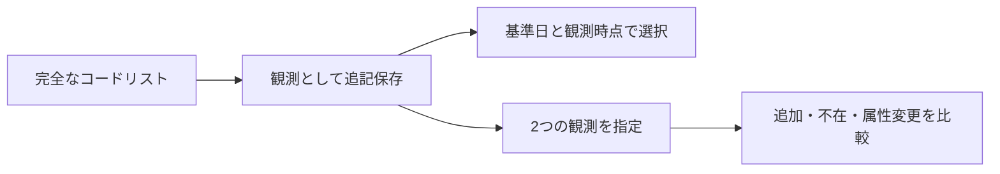

# 企業マスターの観測保存と差分

企業コードリストを取得時点ごとに保存し、以前の一覧から何が変わったかを調べます。会社名の変更が観測できても、その変更が法的に発生した日までは分かりません。

## 保存と比較の流れ



- [企業マスター観測の永続保存](#store)
- [企業マスター間の観測差分](#changes)

各節のAPI・入力条件は区別します。検証件数と配布物の記録は実施当時のもので、現在の全体検証や稼働状態を示しません。

<a id="store"></a>

## 企業マスター観測の永続保存

`CompanyMasterStore` は、完全なコードリストの観測を専用SQLiteへ追記保存します。既存の財務DBやメタデータDBとは別形式です。会社ごとの法的イベント履歴や発生日の再構成とは区別します。

```ts
import {CompanyMasterStore} from 'edinet-ts';
const store = new CompanyMasterStore('company-master.sqlite');
try {
  const saved = store.put(snapshot); // fetchEdinetCompanyMaster()等の完全な観測
  const result = store.query({
    sourceUrl: snapshot.sourceUrl,
    asOf: '2026-10-29',
    knownAt: '2026-10-30T00:00:00Z',
    listingStatus: 'listed',
    industry: '建設業',
  });
  const observations = store.history(snapshot.sourceUrl);
  const original = store.snapshot(saved.observation.id);
} finally { store.close(); }
```

- `put()` は会社の安定EDINET IDと全属性、CSV/ZIPのhash・出典URL・基準日・観測時刻を保持します。原CSV/ZIPのbyte列は別途保存してください。時刻は同じ瞬間をUTC ISO表記に正規化し、会社行はEDINETコード順に保存します。
- 同じ出典・基準日・観測瞬間を観測IDとします。同内容の再投入は `unchanged`、異なる内容は競合で停止します。同じCSV hashを異なる基準日/会社集合へ付け替えることも拒否します。訂正は別の観測として保存し、過去の内容を上書きしません。
- `query()` は出典を明示し、as-ofと観測cutoffの両方を満たす最新の完全リストを選びます。既存の `queryCompanyMaster()` と同じ検索規則・返値で、将来観測の属性を過去へ遡及しません。
- `history(sourceUrl)` は検査した全観測の来歴・行数・snapshot hashを返し、`snapshot(id)` は完全な観測を返します。`compare(previousId,currentId)` は既存の[観測差分](COMPANY_MASTER.md#changes)を再現します。フィルタや同一証券コードだけで別EDINET IDを統合しません。
- 本文とSHA-256、本文/索引の一致、検索前の全観測の時点索引を検査します。SHAは内部整合の検査で、外部署名や原CSVとの再照合ではありません。検索対象として選ばれない観測の本文検査は `history()` 等で明示できます。
- `{readOnly:true}` は専用DBの固定した私有コピーを読みます。通常ファイル・固定schemaだけを受け入れ、リンク・副ファイル・未知のDB形式を拒否します。読み取りで元DBを書き換えません。

1観測は最大100,000行・正規化JSONで64MiBです。`put()` の既存内容検査と `history()` は観測本文を一観測ずつ走査し、全本文を同時にメモリへ保持しません。日次巡回・CLI・世代削除・圧縮・法的履歴/法人記録との一体保存は残工程です。

<a id="store-検証"></a>

<a id="検証"></a>

### 実施した検証と確認範囲

> 以下は各検証を実施した時点の記録です。件数・配布先・未確認範囲を含めて読み、現在の稼働状態とは分けてください。

公式マスターの2026-10-27/29の2観測・合計22,865行を別々の専用DBへ保存・再読込し、8検索と全9差分がsource/built/CommonJS・独立Python/SQLite処理で一致。全本文・hash・観測ID・索引列と元ファイル不変を確認しました。原CSVの再取得や法的イベントの検証ではありません。

全139ファイル/3,757テスト、型・build・公開NodeNext型が成功。履歴の本文保持量を一観測に制限する8件目の試験を加えるため初回の全回帰を停止し、修正後に全件を再実行した結果です。固定配布物3cc4618と利用先のvendorへ反映済みです。利用先での履歴保存・表示運用は残工程です。

後続の評価指標実装時に、初回配布型の推論で`import("..")`が残る不具合を検出しました。共通ビルド後処理を修正し、ビルド後の全141ファイル/3,786テストと、`--types node`を明示して型定義の検査を省略しないNodeNext検査で解消を確認しました。以前の公開型検査は型定義検査の省略を含んでいたため、この問題を見逃していました。

<a id="changes"></a>

## 企業マスター間の観測差分

`compareCompanyMasterSnapshots(previous, current)` は、完全なEDINETコードリスト二つを検査し、EDINETコード順の差分を返します。既存の `queryCompanyMaster` の入力検査を共有し、入力を固定してから比較します。

- `record-added`: 前のリストにない行。
- `record-absent`: 次のリストにない行。上場廃止や法人消滅とは断定しません。
- `attributes-changed`: 証券コード、法人番号、名称、提出者種別、上場区分、業種、決算日原文/月の変化。

各行はEDINET安定ID、変更属性、変更前後の行を持ち、結果は両snapshotの基準日・実観測時刻・出典URL/hashを保持します。`dateMeaning: "snapshot-boundaries"` は観測の両端です。

改称・上廃・合併等の正確な発生日や法人同一性を認定する情報ではありません。証券コードの再利用によって別EDINETコードを結合しません。

同じ出典URL、基準日と実観測時刻の昇順が必要です。同一時点で異なるhash、同一hashで異なる行/基準日は拒否します。同じ基準日に後から観測した訂正リストは比較でき、同じ観測の再投入は空の差分です。行順や属性のキー順だけの差は変更にしません。出典hashは呼出元の宣言であり、このAPIは元CSVの真正性を認証しません。

市場区分、法的イベントの一次出典、別EDINETコード間の法人結合は後続工程です。観測のDB保存は[Store](#store)を使います。

実観測の確認: 2026-10-27基準の11,433行と、公式URLから再取得した2026-10-29基準の11,432行を比較し、追加3・消失4・属性変更2の計9件を確認。全行を別のPython処理で比較した差分と両端の出典が一致し、source/buildの出力も完全一致しました。

上場区分の行数は3,813→3,812ですが、この差を特定日の上廃数と読み替えません。進行中の財務取得jobは元の3,813社を固定した計画として維持しています。

検証: 全134ファイル/3,651テスト・本体型検査・build・配布用NodeNext型使用例・CommonJSの実9差分が成功。既存のCSV/保存snapshot/knownAt検査が存在しない暦日（例: 2026-02-30）をDate.parseで補正していた不具合も修正し、分単位の有効な時刻の受入れは維持しました。

この追加は53eb2adより後に実装し、現在の固定配布物3cc4618へ反映済みです。

完全な観測の永続保存・再読込検索・観測ID指定の差分は[企業マスター観測Store](COMPANY_MASTER.md#store)を利用できます。法的イベントの日付確定は引き続き対象外です。
