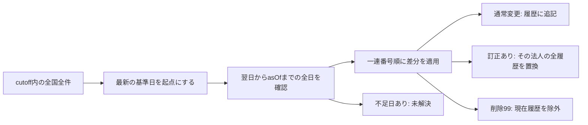
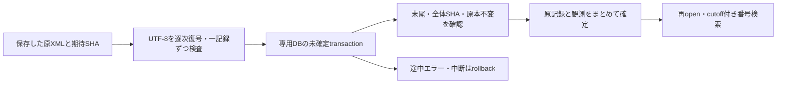
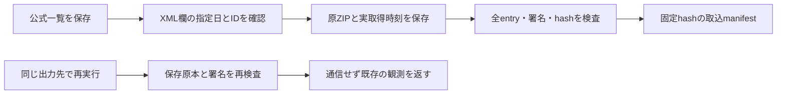

# 法人番号公表データの原記録

法人番号公表サイトのXMLを読み、番号で原記録を探します。EDINETマスターからの番号参照と、全件・日次差分による状態再構成を説明します。原記録をそのまま返す入口と、差分を適用する入口は別です。


目的に応じて入口を選んでください。

| 目的 | 入口 |
|---|---|
| 原記録を探す | この節のXML検索、または[保存DB](#大容量xmlのストリーミング保存) |
| 差分から状態を求める | [XML入力](#全件と日次差分からの状態再構成) / [保存DB入力](#保存した記録から状態を再構成する) |
| 原本を検証する | [XML署名](#保存済みxmlの署名を確認して取り込む) / [ZIP全entry](#保存zipの全エントリを検査する) |
| 差分を取得する | [一日](#指定日の差分を取得し検証して保存する) / [期間指定](#複数日を計画し予算内で取得再開する) |
| 全国の全件原本を取得する | [全国XML](#全国全件のxml原本を取得する) |

`parseCorporateRegistryDownloadXml(xml, source)` と `queryCorporateRegistryDownloads(inputs, query)` は、国税庁の30項目のダウンロードXMLを読みます。既存のXML安全検査を共有し、外部参照/DTDを拒否、1 XMLは64MiB以下・10万記録以下、検索は100入力/合計256MiB以下です。

大容量UTF-8 XMLは[ストリーミング保存](#大容量xmlのストリーミング保存)を使います。この文字列APIの上限は維持しています。CSV・Web-API応答の取込は後続です。

```ts
const source = {
  sourceUrl: 'https://www.houjin-bangou.nta.go.jp/download/',
  observedAt: '2026-10-29T12:00:00Z', // 実際にこのデータを得た時刻
  dataDate: '2026-10-28',           // 全件の基準日。diffではファイル作成日を確認して宣言
  kind: 'diff' as const,
  purpose: 'download' as const     // 公式の架空サンプルは必ず sample
};
const document = parseCorporateRegistryDownloadXml(xml, source);
const result = queryCorporateRegistryDownloads([{xml, source}], {
  corporateNumber: '1010001001202', knownAt: source.observedAt
});
```

sourceは呼出元の宣言です。URLやhashだけで提供者の真正性を認証しません。

`inputXmlSha256` は入力文字列のUTF-8 hash、`recordNumber` はそのXML内の1始まりの記録位置です。公式の一連番号とは別です。

検索は13桁の法人番号を完全一致させ、sourceの実観測がcutoffより後なら `excludedSources` へ分けます。名称一致による名寄せや、過去時点の会社状態の認定はしません。

各記録は30項目すべてを `values` の文字列で返します。変更年月日・更新年月日・閉鎖年月日・指定年月日を混同せず、空欄、先頭0、外字イメージID、訂正/最新履歴/検索対象除外のフラグ、承継先番号を保持します。数値変換・住所の結合・外字の推定補完は行いません。

削除99も原記録として返し、空欄の会社情報を補いません。削除で本来空欄とされる列が非空なら `deletionExtraFields` に残します。

現行処理区分表にない2桁コードは `processKnown:false` とし、既知コードへ置換しません。公式サンプルには処理区分31と、削除行の検索対象除外フラグ0が含まれました。

サンプルと定義書の相違を無言で補正しないための診断です。

差分ファイルには同じ法人の過去履歴や訂正一式が含まれます。このAPIは原記録の検索であり、訂正/削除を適用した最新状態の合成器ではありません。`latest:1` を入力群全体の最新として選択せず、承継先をたどって別法人を自動統合しません。EDINET番号参照・状態再構成・保存には後述の入口を使います。全国全件と定期巡回の実運用は残工程です。

## 出典と利用条件

出典: [国税庁法人番号公表サイト](https://www.houjin-bangou.nta.go.jp/download/)を加工して作成。形式は[リソース定義書4.1版](https://www.houjin-bangou.nta.go.jp/pc/download/images/k-resource-dl.pdf)、検証入力は同ページの令和4年4月サンプルを参照しました。

[利用規約](https://www.houjin-bangou.nta.go.jp/riyokiyaku/)は出典と加工の明示を求めており、出力sourceにもその文言を保持します。第三者の権利に係る情報は規約に従って扱います。

取得・API認証・課金・公表はこの読取APIから実行しません。検証で取得したのは公開仕様書と公式サンプルです。サンプルは実在企業の照合や最新データの検証に使いません。

独立Python/XML処理で、全件/差分の公式55 XML・5,208記録・156,240項目、原XML hash、未知処理区分と削除追加列の診断が一致しました。これは公開サンプルによる形式検証です。

検証: 全135ファイル/3,671テスト・型・buildが成功。source/built/CommonJSで全55入力と法人番号検索6件が一致し、6検索の行/順序/出典も独立処理で照合。配布用NodeNext型検査も成功しました。この時点では固定配布物53eb2adへ未反映でした。現在は3cc4618と利用先vendorへ反映済みです。

## EDINETマスターからの番号参照

`linkCompanyMasterCorporateRecords(snapshots, inputs, query)` は、会社マスターのas-of/knownAt検索と同じ条件に、必須の `registryPurpose: "download" | "sample"` を加えます。選択した企業の法人番号を完全一致で照合し、元のEDINET ID・会社行、NTA原記録の出典/位置を保持します。

名称の類似度や承継先への追跡では結合しません。結果の `query` にcutoff・基準日・フィルタも残します。

`number-matched` は単一の原記録に番号が一致したという意味です。法人の最新状態や名称・住所の一致、上場の継続、同一法人の認証ではありません。閉鎖等の記録であっても原処理区分/日付を保持します。EDINET側の名称等はNTA値で上書きしません。

番号なし/入力内に記録なしは `unavailable` とし、法人の不在とは断定しません。EDINET側の番号共有・NTA複数記録・削除・未知処理・訂正/過去記録は理由付きの `unresolved`。最新フラグや配列順で勝手に一件へ絞りません。番号共有の検査は検索フィルタ外も含めた同じmaster全体を使い、別EDINET IDを統合しません。

目的が違うsource、実観測がcutoffより後のsource、基準日がas-ofより後のsourceは、それぞれ `excludedSources` へ分けます。架空サンプルはsample目的で分離し、download目的へ混ぜません。日次差分を完全な企業集合や会社状態へ読み替えない入口です。

### 実データの限定照合

公式の2026-10-28日次差分を取得し、[公開PGP鍵](https://www.houjin-bangou.nta.go.jp/download/kokaikagi/)のフィンガープリントとの一致と署名の検証に成功しました。SDKの全XMLに署名検証を自動実行する機能ではなく、この検証入力に対して行った確認です。

独立XML処理で全2,181記録/65,430項目と原本hashが一致。2026-10-29基準のEDINET master全11,432行と照合し、候補あり9提出者（単一番号一致7、訂正/過去記録1、複数記録1）を確認。

番号なし4,154・入力内に記録なし7,269は補完しません。上場区分3,812行中では4提出者に候補がありました。

全行と上場のみの行・順序・各候補・両出典が独立処理と一致しました。

これは当日差分への原記録参照の確認です。全国全件masterの構築・完全履歴の再構成、すべてのEDINET法人番号の検証や本番反映は残工程です。

番号参照追加の検証: 全136ファイル/3,683テスト・型・build・公開NodeNext型が成功。実データの全master/上場のみの結果はsource/built/CommonJSで完全一致しました。

初回回帰は結果へquery条件の保持を追加するため停止し、追加後に全件を再実行した結果です。番号参照は固定配布物3cc4618/利用先vendorへ反映済みです。状態再構成は後続で追加しました。完全な法人結合・利用先の実運用は残工程です。

## 全件と日次差分からの状態再構成

`reconstructCorporateRegistryState(deliveries, query)` は、全国全件データを起点に、指定した法人番号の記録へ日次差分を適用します。提供済みのXMLだけを使い、通信・保存・EDINET企業属性の上書きは行いません。



```ts
import {reconstructCorporateRegistryState} from 'edinet-ts';

const result = reconstructCorporateRegistryState([
  {scope: 'national', expectedParts: 1, parts: [fullInput]},
  {scope: 'national', expectedParts: 2, parts: [diffPart1, diffPart2]},
], {
  corporateNumber: '1010001001202',
  asOf: '2026-10-29',
  knownAt: '2026-10-30T00:00:00Z',
  registryPurpose: 'download',
});
```

各 `parts` 要素は既存の `{xml, source}` です。`expectedParts` は呼出元が確認した全分割数、`scope: "national"` は全国の全ファイルを揃えたという宣言です。同じ配布単位の全partは基準日・full/diff・sample/downloadが一致する必要があります。全件では法人番号、差分では一連番号の重複を拒否します。全件の地域別ファイル間で一連番号が同じことは許容します。

この宣言は全国網羅性や配布者の真正性を自動認証するものではありません。地域ファイルを一つだけ全国全件と宣言したり、取得できなかった日を空のXMLで補ったりしないでください。全件/分割一覧・取得完了・署名等の確認は呼出元の責任で、後続の取得・保存運用にも接続する必要があります。

### 時点と適用順序

`asOf` はデータ対象日の上限、`knownAt` は実際に得た時刻の上限です。変更年月日を使って、後日知った訂正を過去へ遡及させる入口ではありません。分割の一つでもcutoff後なら、その配布単位全体を除外します。目的違い・対象日超過も `excludedDeliveries` に分けます。

適格な全件のうち最も新しい基準日を起点にし、その翌日からasOfまでの各日を確認します。配布日はXML、未作成日は保存した公式カレンダーを使います。全件はその基準日の更新を含むものとし、同日以前の差分を重ねて適用しません。カレンダーを省略した場合は、従来どおり一日の欠落でも停止します。実際の空XMLは入力できますが、未取得日を架空の空XMLで補いません。

国税庁は[差分データの案内](https://www.houjin-bangou.nta.go.jp/download/sabun/)で、休日・祝日および12月29日〜1月3日はファイルを作成しないと説明しています。[未作成日カレンダー](#未作成日カレンダーを付ける)を明示すると、保存した方針と祝日CSVでこの空白を確認できます。保存・取得/署名監査との接続には後述の入口を使います。実全国全件の運用照合は残っています。

同じ対象日・full/diffで複数の観測があれば、cutoff内の最新観測を使います。同じ観測瞬間に内容が異なる配布がある場合は、入力順で決めず未解決にします。

日内では一連番号順に処理します。通常変更は提供行を追記し、訂正区分1を含む法人は、その日の当該法人の全履歴で置き換えます。原属性を行ごとに継ぎ合わせません。最新フラグ1が複数、または最後の行が最新でない場合も未解決です。過去の観測に付いていた最新フラグは原記録として保持し、書き換えません。

### 結果の読み方

| `selection.status` | 意味 |
|---|---|
| `available` | 指定対象日まで差分を適用できた記録。`record` に出典位置と30項目を保持 |
| `deleted` | 削除99を適用した状態。削除の原記録を保持し、`history` は空にする |
| `unavailable` | 適格な全件がない、または全件・適用差分に対象番号がない |
| `unresolved` | 日付の欠落、同時点の衝突、未知処理、分割内の状態矛盾等で確定できない |

`available` は法人の存続や法的同一性の認定ではありません。閉鎖21の記録も原文の閉鎖日・事由・承継先番号を持ったまま返します。復活22も同じ法人番号の記録として扱い、承継先の別番号へ自動統合しません。削除後にデータがない日を経ても復活させません。

`coverage` は確認できた起点日と適用済み日、`appliedDeliveries` は適用順の入力位置です。未解決時の `history` は停止前までの記録であり、要求asOfの確定状態として利用しないでください。全件には月末の最新行しかないため、起点より前の全変更履歴を復元した意味でもありません。

`deliveries` は対象法人の原記録と配布単位、`sources` は全入力の出典・hashです。訂正や削除で現在履歴から外れた記録も、ここに監査用として残ります。削除に非空の追加属性がある場合は、既存パーサーの診断を保持して未解決とします。

### CLI

```sh
edinet-ts reconstruct-corporate-registry \
  --manifest deliveries.json --query registry-query.json --pretty
```

`deliveries.json` は上の配布単位の配列で、各partを `{file: "relative/path.xml", source: {...}}` とします。パスはmanifestの場所を基準に解決します。`registry-query.json` はAPI例のqueryです。

API・CLIとも最大100配布・合計100ファイル/256MiB、各XML64MiB/10万記録という既存の読取上限を使います。CLIのmanifest/queryは各2MiB以下です。実際の全国全件がこの上限を超える場合は、上限を緩めて読み込まず、後述のストリーミング保存入口を使います。現行入口だけで全国の本番マスター構築が完了したとは扱いません。

仕様根拠: [国税庁リソース定義書4.1版](https://www.houjin-bangou.nta.go.jp/pc/download/images/k-resource-dl.pdf)の一連番号・処理区分・訂正区分・最新履歴。訂正時の全履歴提供と削除99の意味に従っています。原記録検索と既存のEDINET番号参照の挙動は維持しています。

### 再構成入口の確認範囲

関連54テストで通常変更、訂正時の全履歴置換、削除・閉鎖・復活、分割順、日付欠落、同時点衝突、未来観測とsampleの分離を検証しました。既存検索の番号検査も、文字列プリミティブだけを受け付けるよう修正しています。

公式サンプルの全国全件48ファイル・5,126記録を解析し、7番号の選択・原30項目・出典位置・hashを独立Python/XML処理で照合しました。サンプルの日次差分は起点との間に未提供日があるため、その不足日範囲を返して未解決になることも一致しました。CLIとAPIの結果も一致しました。

保存済みの実日次差分2,181記録については、XML hashを元の取得記録と照合し、全件起点がないため状態を返さないことを確認しました。この実データに架空の起点や空の日を補っていません。訂正・削除の適用そのものは合成境界テストでの確認であり、全国の実全件・連続日次差分による本番再構成とEDINET法人同一性の確認は残工程です。保存・取得監査との接続は後続で追加しました。証跡は `data/roadmap/corporate-registry-state-real-20261030/` に保存しています。

隔離コピーでNode 26.12.1の全165ファイル・4,337テスト、build・本体/公開型・ESM/CJSが成功しました。並行作業の分割換算とdataflow変更はこの検証の対象外です。

## 未作成日カレンダーを付ける

第3引数に、保存した国税庁の差分案内HTMLと内閣府の祝日CSVを渡します。APIはネットワーク取得せず、CSVは呼出元でShift_JISから復号します。

```ts
import {reconstructCorporateRegistryState} from 'edinet-ts';

const calendar = {
  policy: {
    html: savedNtaHtml,
    sourceUrl: 'https://www.houjin-bangou.nta.go.jp/download/sabun/',
    observedAt: policyReceipt.observedAt,
  },
  holidays: {
    csv: decodedCabinetCsv,
    sourceUrl: 'https://www8.cao.go.jp/chosei/shukujitsu/syukujitsu.csv',
    observedAt: holidayReceipt.observedAt,
  },
};
const result = reconstructCorporateRegistryState(deliveries, query, calendar);
```

`parseCorporateRegistryPublicationCalendar(calendar)` で入力だけを検査することもできます。保存したHTMLが対応中の未作成日方針を含み、CSVが所定の2列・有効日付・昇順・重複なしであることを確認します。列や方針が変われば、推測で読み続けず拒否します。年の途中を現在の暦から自動計算することもせず、CSVの年範囲だけを使います。

### 未作成日の扱い

| 条件 | 処理 |
|---|---|
| 12月29日〜1月3日 | 年末年始の未作成日として確認 |
| 土曜・日曜 | 週末の未作成日として確認 |
| 内閣府CSVに記載された祝日・休日 | 記載名を保持して確認。振替休日・国民の休日・特例移動もCSVを使う |
| それ以外でXMLがない | 取得漏れの可能性を残し、`coverage-gap` |
| 未作成日なのにdiff XMLがある | `delivery-on-non-publication-day`。配布日・対象日の指定や例外の確認が必要 |

未作成日は会社の変更や削除として数えず、`nonPublicationDays` に日付・理由・必要なら祝日名を残します。これは停止前までに確認した日で、未処理範囲全体の休日一覧ではありません。元の記録と履歴は維持し、`coverage.through` だけを進めます。

`calendar` には対応ルール版・年範囲・両出典URL・観測時刻・復号後テキストのhashを返します。HTML/CSVの元byte列は別途保持してください。hashは内部整合の指紋であり、国税庁・内閣府による提供者認証ではありません。全国全分割の宣言や取得監査を置き換える機能でもありません。

どちらかの実観測がknownAt後なら `calendar-after-cutoff`、対象期間がCSVの年範囲外なら `calendar-outside-coverage` で未解決にします。日本時間でknownAtより後の日をasOfに指定した場合も `as-of-after-cutoff` とし、予定上の休業日で未来状態を確定しません。後日取得したカレンダーで過去に知っていたことにはできません。

### CLIのカレンダー指定

```sh
edinet-ts reconstruct-corporate-registry \
  --manifest deliveries.json --query registry-query.json \
  --calendar calendar.json --pretty
```

`calendar.json` は `policy` と `holidays` を持つJSONで、両方に `{file, sourceUrl, observedAt}` を指定します。相対パスはcalendar.jsonの場所を基準にします。policyのfileは原UTF-8 HTML、holidaysのfileは原Shift_JIS CSVです。各ファイルは1MiB以下で、不正な文字コードも拒否します。この2ファイルはXMLの合計256MiB上限とは別に制限します。

### 公式入力との照合

2026-10-30に取得した公式方針と祝日CSV（1955〜2027年・1,067日）を独立Python/CP932/CSV処理で照合しました。国税庁の実配布日一覧の40日と、間にある未作成日20日も一致しました。この日程のAPI/CLI検証は**合成の空XML・sample目的**で行っており、実全国の会社状態を再構成した結果ではありません。

別に、公式の全件サンプル48ファイルをそのまま使い、従来は日付欠落としていた2017-04-29〜30の週末を確認して、元の原30項目・出典hash・履歴を維持できることを独立XML処理で照合しました。平日2017-05-01等の取得漏れは解消した扱いにせず、後日観測のカレンダーも過去cutoffから除外しました。記録は `data/roadmap/corporate-registry-calendar-source-20261030/` と `corporate-registry-calendar-real-20261030/` です。

保存・署名/取得監査との接続は後続で追加しました。実全国全件・連続差分での運用照合とEDINET法人同一性の確認は残っています。

カレンダー追加の隔離検証: Node 26.12.1で全167ファイル・4,356テスト、関連73テスト、build・本体/公開型・ESM/CJSが成功しました。並行中の分割換算・dataflow変更はこの結果に含めません。

## 大容量XMLのストリーミング保存

`CorporateRegistryStore` は、XMLを一記録ずつ読んで専用SQLiteへ保存します。全文を文字列や配列にしてから渡す必要はありません。既存の財務DB・企業マスターDBとは別形式で、原記録の保存・検索を担います。



```ts
import {CorporateRegistryStore} from 'edinet-ts';

const store = new CorporateRegistryStore('corporate-registry.sqlite');
try {
  const imported = await store.importFile({
    file: 'diff_20261028.xml',
    source,                 // 実際の取得時刻・対象日・full/diff・sample/download
    part: 'diff_20261028.xml', // ZIP内の元entry等、同じ出典内のファイル識別子
    sha256: expectedXmlSha256,
  });
  const receipt = store.file(imported.file.id);
  const audit = store.audit(receipt.id);
} finally { store.close(); }
```

期待SHAは取得監査の原XML byte列のSHA-256です。取込完了時に全byteを照合し、読取中の書換え・パス置換・リンク・ディレクトリ等を拒否します。XMLの末尾が切れていた場合や、一連番号が重複した場合も、そのファイルの途中記録を確定しません。既に完了した別ファイルの観測は保持します。

同じ出典URL・part・データ対象日・kind・purpose・観測瞬間への再投入は、原本を再検査して `unchanged` になります。同じ観測点で異なるSHAは競合です。同じbyte列を別の観測で保存する場合は、記録本文を共有し、出典と観測時刻だけを別に残します。UTC正規化は観測時刻に行い、XML内の原日付・名称・住所等は上書きしません。

原ZIP・原XMLのbyte列はDB外へ別途保持してください。DBには原本SHA、版、元part、観測、原30項目と記録位置、保存本文/索引の指紋を保存します。SHAは提供者の署名認証ではありません。

### 保存後の番号検索

```ts
const reader = new CorporateRegistryStore('corporate-registry.sqlite', {readOnly: true});
try {
  const result = reader.query({
    corporateNumber: '1010001001202',
    knownAt: analysisCutoff,
    registryPurpose: 'download',
    offset: 0, limit: 100,
  });
} finally { reader.close(); }
```

結果の各行は `file` に観測・原本SHA・part等、`record` に元の30項目と位置を持ちます。`total` はページ指定前の原記録数です。同じ内容を複数回観測していれば、それぞれの観測に属する行として数えます。企業数や最新状態の数ではありません。sample/downloadと実観測cutoffは必須で、既定100行・最大1,000行を返します。

検索前に、保存本文・索引・件数・集約指紋を一記録ずつ全体検査します。索引の改変を「番号が見つからない」という空結果へ隠しません。readOnlyでは固定私有コピーの不変を確認し、検査済み状態を同じ接続内で再利用します。書込接続では検索ごとに検査します。大容量では最初のコピー・検査に時間がかかるため、検索用接続を使い回してください。

`verification: "all-records"` は保存整合の検査です。元の全国データの網羅性や法的状態を認証する意味ではありません。訂正・削除の行も検索対象として保持し、この検索だけで現在状態へ合成しません。保存した記録からの状態再構成は、次の `reconstruct` を使います。

### 上限と中断・復旧

| 対象 | 上限・扱い |
|---|---|
| 元XML | 1ファイル8GiBまで。文字列APIの64MiB/10万記録上限とは別 |
| 一記録 | UTF-8換算64KiBまで。30項目の既存パーサーで検査 |
| 低水準の入力chunk | 最大1MiB。ファイル取込は64KiBずつ読む |
| XML形式 | UTF-8、任意のBOM/XML宣言、属性なしのcorporations/corporationと原30項目。DTD・CDATA・コメント・追加処理命令等は非対応として拒否 |
| 取込中の接続 | 同じ接続の検索・再取込・closeを拒否。完了・失敗後に再利用可 |

APIのAbortSignalとCLIのSIGINT/SIGTERMはrollbackへ渡します。強制終了でhot journalが残った場合は、元DB・journalを消さず、`recoverDedicatedSqliteSnapshot` の `kind: "corporate-registry-store"` で別候補へ復旧できます。汎用復旧のschema検査だけで利用せず、復旧後にStoreで本文/索引を検査してください。DB・journal・検査用私有コピーの容量計画も必要です。

低水準の `streamCorporateRegistryRecords(chunks, source, options)` はAsyncGeneratorです。自然なiterator完了時に、全体SHA・byte数・記録数のreceiptを返します。途中でyieldした行は未確定で、一連番号の全体重複検査も保存側の責任です。完了前に公開せず、通常は上の `importFile()` を使用してください。

### CLI

```sh
edinet-ts import-corporate-registry-file --db corporate-registry.sqlite --manifest file.json --pretty
edinet-ts query-corporate-registry-store --db corporate-registry.sqlite --query query.json --pretty
```

file.jsonはAPI例の `{file, source, part, sha256}`、query.jsonは検索例のJSONです。fileの相対パスはmanifestの場所を基準にします。入力JSONは2MiB以下、元XMLは一括読込せず逐次処理します。

### 確認した範囲

公式サンプル55ファイルと保存済み実差分の計56ファイル・7,389記録を保存・再openし、全221,670項目、原XML SHA、保存本文/索引/集約指紋、25検索、CLIの結果が独立Python/SQLite/XML処理と一致しました。原XML・元DBの読取による変更はなく、再投入で本文も重複していません。実差分の署名確認は以前の取得監査で行ったもので、Store自身がPGP署名を検証する機能ではありません。

別の合成負荷試験では、113.7MB・100,001記録をNode 26.12.1のJavaScriptヒープ128MiB上限で取り込み、再open後の末尾ページを検索しました。プロセス最大RSSは約198MiBで、ヒープ上限と全メモリ量は別です。取込129.4秒・初回検査付き検索87.5秒・同じ接続の次回検索0.73秒でした。一回・共有hostの測定で、実全国データの速度保証や状態再構成ではありません。34GiBの空き容量留保も維持しました。

証跡は `data/roadmap/corporate-registry-store-real-20261031/` と `corporate-registry-store-stress-20261031/` に保存しています。全国全件・連続差分での運用照合、取得/署名監査、配布と稼働環境への反映は残工程です。

保存追加の隔離検証: Node 26.12.1で全170ファイル・4,389テスト、build・本体/公開型・ESM/CJSが成功しました。日次CLI試験の子時計固定後の再実行で、並行作業の分割換算・dataflow・busy timeout変更は含めません。


## 保存した記録から状態を再構成する

`store.reconstruct(deliveries, query, calendar?)` は、保存済みファイルのIDを使って全件・日次差分を適用します。原XMLを再読込せず、保存時の原XML SHA-256とファイル内の記録位置を返します。切り出したXMLを作り直したり、そのhashを原本hashとして返したりしません。

```ts
const store = new CorporateRegistryStore('corporate-registry.sqlite', {readOnly: true});
try {
  const result = store.reconstruct([
    {scope: 'national', expectedParts: 1, fileIds: [fullReceipt.id]},
    {scope: 'national', expectedParts: 2, fileIds: [diffReceipt1.id, diffReceipt2.id]},
  ], {
    corporateNumber: '1010001001202',
    asOf: '2026-10-29',
    knownAt: '2026-10-30T12:00:00Z',
    registryPurpose: 'download',
  });
  console.log(result.selection);
} finally {
  store.close();
}
```

配布の全パートを取得したことは呼出元が確認して宣言します。`expectedParts` とID数の一致だけで全国の網羅性を認証するものではありません。同じ配布の各パートは対象日・full/diff・目的が一致する必要があります。

訂正・削除・cutoff・未作成日の判断はXML入力の再構成APIと共通です。検索対象外の法人を含む配布全体を検査するため、別法人だけにある重複や配布内容の矛盾も見逃して対象法人の状態を確定することはありません。

`storage.verification` は `all-records`、`storage.files` は保存時の受領記録です。`sources` と同じ順序で並び、各記録の `sourceIndex` から元ファイルのID・SHA-256・パート名へ戻れます。既存の保存形式v1をそのまま読めるため、DBの移行は不要です。

### CLI

manifestの各配布を `{scope, expectedParts, fileIds}` で記述します。queryと任意のcalendarはXML入力の再構成CLIと同じ形式です。

```sh
edinet-ts reconstruct-corporate-registry-store \
  --db corporate-registry.sqlite \
  --manifest deliveries.json --query query.json --pretty
```

保存カレンダーを使う場合は `--calendar calendar.json` を加えます。manifestとqueryは各2MiB以下です。

### 上限と検証範囲

最大100配布・合計100ファイルです。対象法人の候補原記録は合計10,000件・16MiBまでで、超過時はエラーになります。一部だけ返して状態を確定することはありません。配布全体の照合はSQLカーソルで逐次処理します。同じreadOnly接続では、改変を監視する私有コピー上の検査結果と配布指紋を再利用し、指紋キャッシュは最大1,024件に制限します。

Node 26.12.1で、公式サンプル全件・休日・通常日の欠落・未来観測カレンダー・実差分のみの5ケースが、XML入口と変更前SDKの結果に一致しました。CLIも一致し、元DBのhashは変化していません。

別の合成試験では100,001件・113.7MBの保存済み差分と、小さな別法人の全件起点を使用しました。JavaScriptヒープ128MiB上限で状態再構成に成功し、最大RSSは約186MiB、初回159.4秒・同じ接続の再実行0.12秒でした。候補件数上限の拒否も確認しました。共有hostでの一回の測定であり、全国の実データの状態や速度を保証する結果ではありません。

証跡は `data/roadmap/corporate-registry-stored-state-{real,large}-20261031/` です。全国の実全件と連続差分、署名・取得監査との統合、EDINET法人同一性、固定配布物と実運用への反映は残ります。


## 保存済みXMLの署名を確認して取り込む

Linux上でPython 3とGnuPG 2を使える場合は、`scripts/roadmap/verify-corporate-registry-signature.py` で保存済みのXML・分離署名・公開鍵を照合できます。ネットワーク取得やユーザーの鍵環境は使いません。公開鍵を取得しただけで信用せず、[国税庁の公開鍵ページ](https://www.houjin-bangou.nta.go.jp/download/kokaikagi/)等で確認した完全なフィンガープリントを指定してください。

入力JSONの例です。ファイルの相対パスは、このJSONを置いたディレクトリから解決します。

```json
{
  "file": "diff_20261028.xml",
  "signature": "diff_20261028.xml.asc",
  "publicKey": "nta-public-key.asc",
  "fingerprint": "F4109E821F0DE67C4BA1947C4BCD87A24D615230",
  "sha256": "c29b0724eccdda7023f538731203f6e773322d7f9a98d6d04cad0f1a93fb9329",
  "source": {
    "sourceUrl": "https://www.houjin-bangou.nta.go.jp/download/sabun/",
    "observedAt": "2026-10-29T12:58:31.721Z",
    "dataDate": "2026-10-28",
    "kind": "diff",
    "purpose": "download"
  },
  "part": "diff_20261028.xml"
}
```

このhash・取得日時は検証に使った保存原本の例です。別の取得物へコピーせず、自分の取得記録を指定します。鍵更新時も、信頼するフィンガープリントを別途確認します。

```sh
python3 scripts/roadmap/verify-corporate-registry-signature.py \
  --manifest signed-input.json --out verified-delivery
edinet-ts import-corporate-registry-file \
  --db corporate-registry.sqlite --manifest verified-delivery/import.json
```

検証が成功すると、新規ディレクトリへ `receipt.json` と `import.json` を出力します。前者には検証日時、GnuPG版と結果、鍵/署名/XMLのhash、信頼したフィンガープリント、取込manifestを保存します。後者は既存の取込CLIへそのまま渡せます。StoreでもXML hashを再検査するため、署名検証後にXMLが変わった場合は取込を拒否します。既存の証跡ディレクトリは上書きしません。

署名失敗・別鍵・期限切れ/失効・SHA-2以外の署名・取得hash不一致・検証中の入力変更は拒否します。通常ファイルと単一リンクを要求し、XMLは8GiB、署名/鍵は各1MiB、manifestは2MiB以下です。GnuPG各呼出しの上限は120秒です。

署名が保証するのはXMLと署名鍵の対応です。`source` の取得時刻・対象日・URL、ZIPの網羅性、全国配布の全パート取得は別の取得監査で確認します。Storeへ直接渡す未検証入力が、この手順を経たものとして扱われることはありません。原ZIP・原XML・署名・公開鍵・取得記録・検証receiptを別途保持してください。

保存済みの公式実差分で、署名検証→取込manifest→CLI取込の経路を確認しました。独立Pythonで2,181記録・65,430項目と出典/hashの一致を確認しています。証跡は `data/roadmap/corporate-registry-signature-store-20261031/` です。自動取得・ZIP全パートの監査・全国実状態・稼働環境への反映は引き続き残ります。


## 保存ZIPの全エントリを検査する

`verify-corporate-registry-zip.py` は、保存した一つの配布ZIPを対象に、取得時hash・全エントリ・各XMLの署名を検査します。前節と同じLinux/Python 3/GnuPG 2環境を使い、通信は行いません。

入力manifestには `archive`、取得時の `sha256`、`publicKey`、信頼する `fingerprint`、`source`、`expectedXmlParts` を指定します。パスはmanifest基準です。次は保存実差分の検証に使った例で、取得日時とhashは自分の取得記録に置き換えてください。

```json
{
  "archive": "current-diff.zip",
  "sha256": "b7d78d4418bd6ff3b22319db46f2218be7448ae28feb286cb9df153de3d95d96",
  "publicKey": "nta-public-key.asc",
  "fingerprint": "F4109E821F0DE67C4BA1947C4BCD87A24D615230",
  "source": {
    "sourceUrl": "https://www.houjin-bangou.nta.go.jp/download/sabun/",
    "observedAt": "2026-10-29T12:58:31.721Z",
    "dataDate": "2026-10-28",
    "kind": "diff",
    "purpose": "download"
  },
  "expectedXmlParts": ["diff_20261028.xml"]
}
```

```sh
python3 scripts/roadmap/verify-corporate-registry-zip.py \
  --manifest zip-input.json --out verified-zip
edinet-ts import-corporate-registry-file \
  --db corporate-registry.sqlite --manifest verified-zip/part-000-import.json
```

ZIPの全エントリが、宣言したXML名と各 `名前.xml.asc` の組に完全一致する必要があります。不足・重複・余分なファイル、ディレクトリ・symlink・暗号化entry、危険なパスは拒否します。ZIP内のパスへ直接展開せず、新規ディレクトリの連番ファイルへ書き出し、元entry名は取込manifestの `part` に保持します。CSV・入れ子ZIP・説明書入りのサンプル配布ZIPは、この入口の対象外です。

`receipt.json` には原ZIPのhash、全entryの名前/サイズ/CRC/hash、全パートの署名検証結果、取込manifest一覧を保存します。XML・署名・パート別receiptも残します。全署名と原ZIPの不変を確認してから取込manifestを出力し、途中失敗時は今回作った出力を除去します。既存ディレクトリは上書きしません。DB取込自体は既存CLIが各ファイルを原子的に実行し、複数ファイルをまとめたDB transactionではありません。

上限はZIP 2GiB・XML最大100パート・全entry最大200件・中央ディレクトリ4MiBです。中央ディレクトリの大きさは展開処理を開く前に検査し、ZIP64終端レコードは受け付けません。各XMLは8GiB、署名は1MiB以下です。展開予定量に加えて34GiBの空き容量を要求し、展開中も留保容量を確認します。

実ZIPの全2エントリと署名を検査し、CLI取込後の2,181記録/65,430項目を独立Pythonで原ZIP・展開原本・SQLiteと照合しました。境界テスト11件では、後続パートの署名失敗による全出力の除去と、展開途中の容量不足も確認しました。証跡は `data/roadmap/corporate-registry-zip-store-20261031/` です。

この検査の範囲は一つのZIP内です。全国配布を構成する複数ZIPの一覧、取得時刻/対象日、取得漏れ、取得の自動化・再開は別途確認が必要です。原ZIPと取得記録は引き続き保持してください。


## 指定日の差分を取得し、検証して保存する

`fetch-corporate-registry-diff.py` は公式の差分一覧を取得し、指定日の**XML欄**からファイルIDを選びます。そのセッションでZIPを取得し、前節の全entry/署名検査へ渡します。CSVのIDやZIPサイズから形式を推測しません。

```sh
python3 scripts/roadmap/fetch-corporate-registry-diff.py \
  --date 2026-10-30 --public-key nta-public-key.asc \
  --fingerprint F4109E821F0DE67C4BA1947C4BCD87A24D615230 \
  --out retained/diff-20261030
```

成功時のJSONにある `importManifest` を、既存の `import-corporate-registry-file --manifest` へ渡します。DBへの取込は別操作なので、取得・署名の確認だけを先に実行することもできます。取得日は実行時点の日本時間以前に限定します。



出力先の `plan.json` は対象日・公式URL・信頼するフィンガープリント・公開鍵hashを固定します。`attempt-0001/` 以下に一覧HTML、原ZIP、実観測時刻/サイズ/hash、選択した日とID、署名検証結果を保持し、全成功時だけ `complete.json` を作ります。取得時刻にはダウンロード完了時刻を使い、ファイルの日付や再実行時刻で置き換えません。

同じコマンドを再実行すると、完了済みの原ZIP・一覧・XML・署名・取込manifestを検査して `status: retained`、`requestCount: 0` を返します。完了した試行の記録だけが残った場合も、通信せず完了印を復元します。対象日/鍵の変更や保存物の改変は拒否します。新しい観測を取得する場合は別の出力先を指定し、以前の観測を保持します。

途中失敗時は `failure.json` と受信済みファイルを残し、次回は別の試行ディレクトリでやり直します。中断したHTTPのbyte位置から再開する処理ではありません。排他ロックにより同じ出力先の同時実行を拒否します。異なる出力先を指定した同時実行の制御は呼出元が行ってください。

通常の新規取得は一覧GETとZIPのPOSTの2要求です。リダイレクトは拒否し、各通信は60秒の待機timeoutと120秒の経過時間検査、一覧2MiB・ZIP64MiBの上限を設けます。取得前に34GiB+ZIP上限分の空きを要求し、受信/展開中も留保を確認します。署名検査等の上限は前節と共通です。

一覧に対象日がない、同日XML候補が複数ある、画面構造が変わった、受信が途中で終わった場合は停止します。空の差分や「休日だった」という記録を作りません。公式案内では過去40日分を提供しています。過去日の不在を法人の変更なしと判断しないでください。

Node 26.12.1の関連4テストファイルと、取得処理のPython境界テスト13件が成功しました。公式の2026-10-30差分を実取得し、ID28339・ZIP全entry・署名からStore取込まで確認。独立Pythonで全2,262記録/67,860項目と一覧XML欄/出典/hashが一致し、再実行の通信0も確認しました。証跡は `data/roadmap/corporate-registry-acquisition-20261031/` です。

この入口は一日分の差分取得です。複数日取得には次の入口を使います。全国全件の取得、定期実行、稼働環境への反映は残工程です。公開鍵の信頼判断や取得元の利用条件の確認も、呼出元が行います。


## 複数日を計画し、予算内で取得・再開する

`planCorporateRegistryDifferences(calendarInput, {from, through, knownAt})` は、最大100日を `expectedDates` と根拠付きの `nonPublicationDays` に分けます。再構成器と同じ未作成日判定を使い、通信は行いません。カレンダーの未来観測・収録年の範囲外・cutoff時点の未来日・不正な日付は拒否します。

```ts
const plan = planCorporateRegistryDifferences(calendarInput, {
  from: '2026-10-23', through: '2026-10-26', knownAt: '2026-10-31T00:00:00Z',
});
// expectedDates: ['2026-10-23', '2026-10-26']
// nonPublicationDays: 24日・25日（週末）
```

CLIで計画だけを確認する場合は、既存のcalendar manifestと `{from, through, knownAt}` のquery JSONを渡します。

```sh
edinet-ts plan-corporate-registry-differences \
  --calendar calendar.json --query query.json --pretty
```

取得まで進める場合は次のコマンドを使います。リポジトリをNode 26でbuild済みにし、Python 3/GnuPG 2を用意してください。別の固定SDKを使う場合は `--sdk-cli /path/to/dist/cli.js` を指定できます。

```sh
python3 scripts/roadmap/collect-corporate-registry-differences.py \
  --calendar calendar.json --query query.json \
  --public-key nta-public-key.asc \
  --fingerprint F4109E821F0DE67C4BA1947C4BCD87A24D615230 \
  --out retained/range-20261023-26 --max-downloads 1
```

`--max-downloads` は今回新しく取得を試みる日の上限（既定1、0〜100）です。1日につき最大2要求で、完了済みの日の再検査は上限を消費しません。上限に達した日は `pendingDates` に残し、同じコマンドの次回実行で進めます。`0` は新規通信を行わず、保存済みの日だけを検査します。失敗した通信も今回の要求数・取得試行日数に数えます。

出力の `plan.json` は期間・カレンダー原文hash/観測・日別計画・鍵を固定します。日別の原本/署名/失敗履歴は `days/YYYY-MM-DD/`、今回の結果は `status.json` に保存します。全取得予定日の再検査が成功した場合だけ `status: complete` とし、保留は `pending`、失敗は `failed` として残します。未作成日には架空のXMLや原本観測を作りません。取得した各日の `importManifest` を既存の取込CLIへ渡してください。

**queryの `knownAt` はカレンダーに使う観測cutoffです。** 後から取得した差分を、その時刻に既知だったものへ遡及させません。各差分の `source.observedAt` は実取得時刻を保ち、`latestObservedAt` に今回確認した原本の最も遅い観測時刻を返します。後続の状態再構成は、求めたいcutoffとこの実観測を照合して実行します。

実際の10月23〜26日の4日間を、取得上限1日ずつで検証しました。23日取得→26日保留、次回は23日を再取得せず26日取得、3回目は通信0で完了。24・25日には原本を作っていません。日別原本をStoreへ取り込み、独立Pythonで全4,596記録/137,880項目、一覧XML欄、ZIP全entry、出典/hash、カレンダーとの一致を確認しました。全件起点はないため、API/CLIの状態再構成はともに `no-baseline` のままです。

取得計画の境界テスト12件・収集のPythonテスト7件を追加しました。Node 26.12.1の隔離環境で全177ファイル/4,416テスト、型・build・公開型・ESM/CJSが成功しています。証跡は `data/roadmap/corporate-registry-collection-20261031/`。これは期間内の日次差分収集の確認であり、全国全件・本番状態・定期運用や利用先反映の完成ではありません。


## 全国全件のXML原本を取得する

`fetch-corporate-registry-full.py` は、[公式全件一覧](https://www.houjin-bangou.nta.go.jp/download/zenken/)の **XML欄・全国** を選び、掲載された全ZIPを取得します。都道府県データやCSV欄を全国XMLへ読み替えません。一つのZIPに複数XMLがある場合も、すべてのXMLと対応署名を検査します。

```sh
python3 scripts/roadmap/fetch-corporate-registry-full.py \
  --date 2026-10-30 --public-key nta-public-key.asc \
  --fingerprint F4109E821F0DE67C4BA1947C4BCD87A24D615230 \
  --out retained/full-20261030 --max-zips 1
```

指定日は公式一覧の更新日と一致する必要があります。月末が休祝日なら作成日は前の平日になるため、月の末日を推測して指定しないでください。`--max-zips` は今回新しく取得するZIP数（既定1、0〜100）です。初回の一覧GETはZIP数に含めず、`0` でも計画がなければ一覧を取得します。計画と原ZIPがそろった後の再実行では通信しません。

`plan.json` に対象日・全国XML欄の全ID/分割順・鍵・一覧のhash/観測を固定します。原ZIPと日付/IDの取得記録はZIP別の `part-NNN/` に保持します。失敗した受信ファイルを上書きせず、新しい試行ディレクトリへ再取得します。既存原本の改変や、掲載日/IDの変更は拒否します。

容量の判断には圧縮サイズだけでなく、全entryの展開予定量を使います。全XMLを保持できる場合は通常の署名検証・実体化を実行します。全体を保持できなくても、一つのXMLと署名を一時展開できる場合は、一分割ずつ検証して一時コピーを解放します。原ZIPは削除しません。どちらの経路も34GiBの空き留保を保ちます。

| status | 意味・次の操作 |
|---|---|
| `pending` | ZIP取得予算に達した状態。同じ計画で次回取得を進める |
| `pending-capacity` | 一分割の一時展開もできない状態。原ZIPを保持して停止 |
| `verified-archive` | 全XMLの署名を確認済み。原ZIPと分割ごとのXML/署名hash・鍵・GnuPG結果を保持し、展開XMLは保持しない |
| `complete` | 全署名の確認と展開XMLの保持が完了。`importManifests` を既存の取込CLIへ渡せる |

`verified-archive` はDBへ取り込める展開ファイルの存在を示しません。取込manifestを出さず、`archiveVerifications` に原ZIPと検証結果の参照を返します。再検証の証跡は別ファイルへ追加し、以前の証跡を上書きしません。`checking` は完了印ではなく、中断後にも残ることがあります。再実行すると保存原本から検査します。

上限は最大100ZIP・合計100XML、各ZIP2GiB・各XML8GiBです。元のZIP安全検査とXML署名検証を共有します。`complete` も取得/検証/実体化の完了を表すもので、DB取込や全国状態の完成ではありません。

### 全国実原本で確認した範囲

2026-10-30更新の全国XML欄ID28342を実取得しました。ZIPは381,508,365 bytes、内部はXML6分割と署名6件、合計展開量は6,511,950,022 bytesでした。全6署名が公式公開鍵のフィンガープリントと一致し、独立Pythonの逐次処理で全12entryのSHA-256・CRC・サイズが検証receiptと一致しました。原ZIPは変更されていません。

今回は全展開物を同時保持する容量が不足したため、一分割ずつ検証する経路で `verified-archive` まで進めました。観測した一時XMLの最大サイズは1,537,332,505 bytes、最小空きは38,530,617,344 bytesで、34GiBの留保を維持しています。全件DBの構築・全国状態の認定は行っていません。DB本体と検査用コピーまで含む容量の確保、全件取込・連続差分との照合が残工程です。

関連5テストファイル（Python境界48件）がNode 26.12.1で成功。全国欄の選択、分割順、取得予算、改変拒否、容量不足、逐次署名検証、後続署名失敗時の一時コピー除去を確認しました。証跡は `data/roadmap/corporate-registry-full-20261031/` です。
