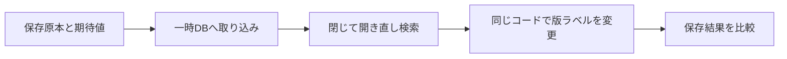

# 手元の原本で取り込みから版比較まで確認する

手元の原本と期待値を使い、取り込み・再読込・検索・版比較をまとめて確認します。一時DBを使う手順なので、実行前に入力一覧と出力先を揃えてください。

## 検証で通す処理



状態: main `3e43048`（#35統合済み）を基準に、この版で追加する品質確認用runnerです。未リリース。2026-10-24更新。

機能を増やす前に、既存の取り込み・保存検索・版比較が、指定した手元の資料で一続きに使えることを確かめます。利用者が原本一覧、数値の期待値、検索結果の期待値を明示します。ネット取得、全キャッシュの探索、既存DBの更新はしません。

## 確認する順番

1. 指定原本を読み、原本と入力JSONのハッシュ・ファイル実体を記録します。
2. 実CLIの`import-bs --dry-run`で計画だけを確認します。
3. 自作の一時DBへ`import-bs --create`し、閉じてから開き直します。BS3の原値/状態と流動比率を、用意した期待値へ照合します。
4. 指定検索を保存版とメモリ版で比べ、さらに明示した期待コードの順番とも照合します。
5. 取り込みを再実行し、解析0件・追加0件・同じ保存IDを確認して、再読込検索を繰り返します。
6. **同じ解析コードのまま版ラベルだけを変えて**再解析・旧版保持を確認し、新版IDを明示して再読込検索します。その再実行も処理不要になることを確認します。
7. `diff-bs`で旧新版を比較し、財務内容は変更なし、来歴は解析版ラベルだけの変更であることを確認します。全欠損など対象企業不明で比較不可になるケースは、期待した対象外として別集計します。
8. 入力のハッシュ・元パス・実体が変わっていないことを確認し、自作の一時DBだけを片付けます。

既存の異なる解析コード同士の品質比較ではありません。同一実装を通す手順と、版を分けた保存・比較のつながりを確認します。検索の各phaseでは保存IDを明示し、旧新版が共存しても自動的に「最新」を選びません。

## 入力を用意する

原本・金額入りの期待値はGit管理外の作業フォルダへ置いてください。次は**合成例**で、実企業の金額ではありません。相対パスはconfigまたはmanifestのフォルダが基準です。原本は停止済みの通常ファイルで、実行中に別処理で変更しないでください。

`config.json`は次の3パスだけです。既存DBを渡す欄はなく、runnerが必ず新しい一時DBを使います。

```json
{ "manifest": "files.json", "expectations": "expected.json", "queries": "queries.json" }
```

`files.json`は[import-bsと同じ一覧](../pipeline/FINANCIAL_INCREMENTAL_IMPORT.md)です。

```json
[
  { "file": "source.xbrl", "secCode": "1001", "docID": "SYNTHETIC1",
    "instant": "2025-03-31", "scope": "Consolidated", "accountingStandard": "J-GAAP" }
]
```

`expected.json`は一覧の各metadataと1対1で指定します。会社・書類・対象日・範囲・基準・通貨の組が一致しない、重複・余りがある場合は止めます。

金額は円の元数値文字列です。PDF等の独立資料から用意する場合は単位を円へ揃え、丸め差を調べてください。

runnerに許容誤差はなく、raw文字列は完全一致、比率は約分済みの分子分母を文字列で照合します。

```json
[
  { "metadata": { "secCode": "1001", "docID": "SYNTHETIC1", "instant": "2025-03-31",
      "scope": "Consolidated", "accountingStandard": "J-GAAP", "currency": "JPY" },
    "metrics": {
      "currentAssets": { "status": "selected", "raw": "120" },
      "currentLiabilities": { "status": "selected", "raw": "40" },
      "totalLiabilities": { "status": "selected", "raw": "80" }
    },
    "currentRatio": { "status": "calculated", "exact": { "numerator": "3", "denominator": "1" } },
    "expectedDiff": "unchanged", "origin": { "column": "synthetic" }
  }
]
```

欠損等も省略せず、`status`を`missing`/`unsupported`/`ambiguous`、`reason`を実際に期待する理由にします。この場合はrawを指定しません。

比率も`{ "status": "unavailable", "reason": "missing-input" }`など理由まで指定します。全欠損で採用entityが確認できない場合は`expectedDiff: "incomparable"`です。

単なる検索除外だけで理由まで正しいと扱いません。

`origin.column`は`current`（当期列）、`prior`（前年列）、`synthetic`（合成）、`unknown`のいずれかで、任意の`filingYear`に提出年を整数で付けられます。これは利用者の宣言で、runnerが提出年・公式出所・別年度の独立原本を自動確認した意味ではありません。

`queries.json`も独立に期待結果を用意します。メモリ版と保存版の自己一致だけで成功にしません。コードは正規化済みの5桁、順番も照合します。重複コードや入力範囲にないコードは拒否します。

```json
[
  { "cohort": { "instant": "2025-03-31", "scope": "Consolidated", "accountingStandard": "J-GAAP", "currency": "JPY" },
    "options": { "conditions": [{ "metric": "currentRatio", "operator": "gte", "value": 2 }], "sortBy": "currentRatio", "order": "desc" },
    "expectedCodes": ["10010"]
  }
]
```

## 実行と結果

リポジトリでNode26.12.1以上とlocked依存を用意して実行します。公開パッケージの新CLIではなく、リポジトリの品質確認用スクリプトです。

```sh
npm run build
node --import tsx scripts/verify-offline-financial-flow.ts --config /tmp/local-check/config.json
```

既定ではbuild済み`dist/cli.js`を使います。`--source-cli`は回帰テスト用で、結果の`cliMode`にも区別を記録します。build後のコードと原本を実行中に変えないでください。

成功は終了0と集計JSONです。件数・採用/欠損・比率状態・比較可能/不可・元入力不変・宣言された列/年を返し、原値、金額、書類ID、会社コード、原本、DBパスは出力しません。

`queryChecks`は3回の再読込検索の合計です。`externalReferencesVerified: false`はPDFやURLの真正性をrunnerが検査していないことを示します。

失敗は終了1です。安全な項目番号・科目名・工程の説明だけを出し、元データ・CLIのstdout/stderr・期待値の内容は出しません。不一致は正常として進めず、入力metadata・単位・期待raw・除外理由・検索順序を手元で確認してください。一時DBは成功/失敗とも片付けます。

一覧1～100件、各入力JSON最大2MiB、検索期待値1～1000条件、原本1件64MiB・一覧項目ごとの原本合計256MiBが上限です。下位CLIのコピー/応答上限も適用されます。性能は測定しておらず、高速化や大規模運用を保証しません。

## 今回確認できた実データの範囲

既存Git外キャッシュのエクシオグループとミライト・ワン、各2025/2026年3月末の計4snapshotを使用しました。どちらも**2026年有報の当期列・前年列**です。

2025年提出XBRLの独立原本を取得・検証したものではありません。原本の出所と以前のPDF照合は[実データ検証記録](REAL_DATA_VALIDATION.md)を参照してください。

保存済みPDF由来の金額期待値（円へ変換）と、独立に用意した比率分数/検索期待値を再利用し、既定のbuild済みCLIで全工程を実行しました。今回PDFを再取得・再視認した結果ではありません。

- 実2社・2時点、BS3の12項目と流動比率4件が期待値に一致。
- 112検索条件を3回の再読込で確認し、計336検索が一致。
- 同一コードの版ラベル変更後、4比較とも財務内容変更なし・解析版だけ変更。各版の再実行は解析/追加0件。
- 6入力ファイルの元パス/実体/ハッシュが不変。原本の既存チェックサムも2件一致。
- この実データ集合の欠損・未対応・曖昧・比較不可は0件。全欠損・比較不可・期待値不一致等は合成テスト用データで別に検証。

この範囲は全市場・全年度・全業種の品質保証ではありません。2025年の独立提出原本、別解析コードへの実更新、実データの欠損/非対応例の広い充足率、性能、本番DB移行、訂正全履歴は未確認です。原本・金額入りconfig/期待値/結果はGit外だけに保持し、新規取得・認証変更・定期実行は行っていません。

このrunnerは[全体計画](../plans/EDINET_TS_ROADMAP.md)の段階8（品質確認）を、段階7（保存・差分取り込み）の実装に対して繰り返す有限な検証です。

最終検証はNode26.12.1で全756テスト（既存742＋新規14件）、本体/使用例/runnerの型検査、build、保存保護Python5件が成功。独立レビュー39件も成功しました。実2社2時点の既定モード実行は2回同じ集計でした。lint設定はありません。
