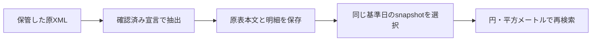

# 設備表の明細・保存・条件検索

設備表から簿価や土地面積を読み、同じ期末の記載を条件検索します。利用者が表の対象会社・基準日を確認し、読めない形式や値は理由付きで残します。

`extractFacilityDetails`は[本文表の抽出](DISCLOSURE_TABLES.md)を使い、確認した9/11/12列・3段見出しと、版3で追加した日付行付き11列・4行見出しの設備表から、合計簿価・土地簿価・建物及び構築物簿価・土地面積を読みます。versionは`FACILITY_DETAILS_VERSION = "3"`。

認識できない列配置/見出し/単位を推測で補いません。

<a id="明示入力"></a>

## 原本と対象条件を指定する

原本XMLとdocID/contextRef、確認済みの会計基準J-GAAP、表ごとの`FacilityTableDeclaration`を渡します。

```ts
import { DisclosureTableKind, extractFacilityDetails, screenFacilityDetails, FacilityField } from "edinet-ts";
const document = {
  xml: savedXml,
  accountingStandard: "J-GAAP" as const,
  selection: { docID: "SAMPLE", kind: DisclosureTableKind.Facilities, contextRef: "FilingDateInstant" },
  declarations: [{ tableIndex: 1, asOfDate: "2026-03-31", organization: "reporting-company" as const, rawSha256: reviewedFragmentHash }]
};
const details = extractFacilityDetails(document);
const result = screenFacilityDetails([document], {
  asOfDate: "2026-03-31",
  conditions: [{ field: FacilityField.TotalBookValueJPY, operator: "gte", value: 10_000_000_000 }],
  sort: { field: FacilityField.TotalBookValueJPY, order: "desc" }
});
```

`tableIndex`は本文表APIが返す0始まりの添字です。原書類を読み、どの表がどの期末・提出会社/国内子会社/海外子会社を指すか確認して宣言します。

本文hash・表位置・本文中の日付記載とcontext時点の前後を検査します。版2では、表の直前の本文または直前の一セル表に「年月日現在」があれば、宣言した基準日と完全一致することを要求します。異なる複数日付があれば保留します。読める直前日付がない場合は従来の本文内参照の検査にとどまります。対象会社・対象範囲など、宣言の意味は引き続き利用者が確認してください。別の表にも同じ日付があるだけでは正しい宣言の保証になりません。

版3の新しい4行見出し形式では、先頭行の右端4列にある単一の「年月日現在」を宣言の`asOfDate`と照合します。日付不一致は拒否し、複数日付や未確認の配置は未対応として残します。別表や本文に宣言と同じ日付があっても、この検査を代替できません。既存3段見出しの扱いは維持します。

`organizationVerification`は`declared-source-reference-matched`です。宣言のない表は`not-reviewed`として残します。

表宣言は1〜200件、検索原本と検索条件は各100件以下です。配列index上の全要素を検査し、空要素や不正なlengthを拒否します。独自iteratorで検査対象を置き換えません。

会計基準も呼出元の確認済み宣言です。`declaredAccountingStandard`へ残し、IFRS/US-GAAPや未確認基準を混ぜません。原本の会計方針の意味を自動検証したことにはしません。

## 値と出典

- 金額は元の百万円表示を十進文字列で正確に円へ換算し、面積はm²。`raw`/cellIndex/元単位の倍率を保存します。`decimal`は正確な文字列、`safeNumber`は安全に往復可能な場合だけです。浮動小数の乗算や内訳の足し算で合計を作りません。円への換算は、百万円表示の丸めを復元するものではありません。
- ダッシュ・空欄・実際の0を区別。括弧付き/複数値/負数/指数表記/不正桁区切り/未対応の数字は原文のまま非数値にします。括弧内の賃借面積等を勝手に加算/控除しません。数値セルが複数行/列に結合されていれば、同じ金額を各行へ重複計上せず利用不可にします。
- `siteAndLocation`は元の事業所名と所在地の結合表示、companyLabel/segmentも記載文字列です。表/行/セル参照と出典を残し、会社IDや地番には変換しません。出典entityは提出者であり、子会社表の個別会社とは別です。
- `rights: unconfirmed`、`propertyIdentity: not-established`。所有/共有/賃借は別途原注記を確認する必要があります。複数拠点の集合行を分割せず、同名行を同一物件として除去せず、BS全体や時価の合計にも使いません。事業所名自体が結合された行は除外理由を残します。

<a id="検索"></a>

## 検索条件と結果の読み方

同一期末の明示原本集合を対象に、4値の5演算・数値順・組織・所在地/会社ラベル/セグメントの文字列部分一致・offset/limitを扱います。円とm²で条件を指定し、十進分数で比較します。

数値条件/順序に使う値だけを要求し、欠損はexcluded、条件外はfilteredに分けます。未対応本文/表はextractionsの状態/diagnosticsを確認してください。

0件を「設備なし」とは解釈しません。

同値時はdocID/contextRef/元の表・行の順です。重複原本・同じ提出者の複数原本・期末混在は拒否します。

訂正原本の選択は先に行ってください。asOfDateは設備の基準日であり、knownAtや当時の開示範囲を自動判定する機能とは別です。

最大100原本・合計256MiB・100,000物理セル/10,000設備行、条件100件/ページ1,000行。直接検索の上限です。保存後の再検索には[専用Store](#store)を使えます。全市場運用の性能・容量検証は未完了です。

## 検証と残り

> 以下は各検証を実施した時点の記録です。件数・配布先・未確認範囲を含めて読み、現在の稼働状態とは分けてください。

既存のエクシオ/ミライト、2025/2026年の4原本を通信なしで確認。5+43+5+43の計96記載行、4項目384選択のうち330値/54非数値を独立Python Decimalと照合しました。合成テスト用データでも3表形式・年度違い・注記/非数値・換算・検索を確認しています。

4PDFの設備表（エクシオ44/46ページ、ミライト45/34ページ）を画像で確認し、14行52原数値と円/m²換算、4ダッシュがPDFの独立転記と一致しました。後続の版2検証では、PDF座標から独立抽出した全96行の数値・基準日をSQLまで照合しました。全行を手動転記した検証ではありません。

未対応: 表形式の網羅、借地/共有持分/所有会社の意味の自動判定、住所分離/地番照合、全社の保有不動産一覧、地価結合、DB索引の全市場性能・移行運用。確認済みの記載行を扱うAPIとして提供し、計画6c全体の完成とは区別します。

最終確認: Node 26.12.1で全85ファイル・2,802テスト（1ワーカー）、公開API型検査、buildが成功。最新のsource/buildで全96行のJSONが一致し、2年度の100億円以上検索は各7行/順序が独立Decimal期待値と一致しました。公開ESM/CJSからのAPIも確認済みです。


<a id="store"></a>
## 原表と明細を保存して再検索する

`FacilityDetailStore` は、確認済みの表宣言・原表本文・行/セル参照・4指標の採用状態を専用SQLiteへ保存します。XML全体はDBへ複製しません。原XMLは既存の保管先に残し、Storeの原本SHA-256と対応させてください。



```ts
import { FacilityDetailStore } from "edinet-ts";
const writer = new FacilityDetailStore("facilities.sqlite");
const saved = writer.append([document]); // 上の例の原本・宣言
writer.close();

const reader = new FacilityDetailStore("facilities.sqlite", { readOnly: true });
try {
  const result = reader.search({
    asOfDate: "2026-03-31",
    snapshotIds: saved.snapshotIds,
    sort: { field: "landAreaM2", order: "desc" }
  });
  console.log(result.rows);
} finally {
  reader.close();
}
```

一原本の国内表と海外表などで基準日が異なる場合は、宣言を日付ごとに分けて別snapshotへ保存します。同じ原本・宣言の再投入では同じsnapshot IDを返し、二重保存しません。原本や確認済み宣言が異なる場合は別snapshotとして保持します。同じ提出者・同じ基準日の複数原本を検索へ同時に含めると拒否します。訂正版を先に選び、その投入結果の `snapshotIds` を指定してください。省略時は指定基準日の保存原本が対象です。

`asOfDate` は表の基準日です。このStoreは訂正系列や観測cutoffを自動選択しません。`rights: unconfirmed` と `propertyIdentity: not-established` も保存し、表の行を確認済みの所有物件へ読み替えません。

読取専用の初回監査では全保存記録のhash・索引を確認し、保存した原表本文から表の配置・明細を再構成して突合します。検査済みの私有snapshotを再利用するため、以後の検索で原XMLを再読込する必要はありません。`audit()` でも保存整合性を確認できます。外部原XMLの再照合や、日付・組織宣言の意味の自動認証とは別の検査です。

SQLの `facility_values` viewにはsnapshot ID、原本hash、基準日、組織、所在地原文、表/行/セル位置、4指標の原値・十進文字列・単位・倍率・非採用理由を用意しています。SQLでも対象snapshotを指定してください。全保存版を合算したり、十進文字列の文字列順を数値順に使ったりしないでください。

### CLI

manifestは `file`、`selection`、`accountingStandard`、`declarations` を持つJSON配列です。`file` はmanifestからの相対パスまたは絶対パスで指定します。

```sh
edinet-ts import-facility-details --db facilities.sqlite --manifest facilities.json
edinet-ts search-facility-detail-store --db facilities.sqlite \
  --as-of-date 2026-03-31 --sort-by landAreaM2 --order desc --pretty
```

原本を選ぶ場合は `--snapshot-ids ID1,ID2`、数値条件は `--conditions '[{"field":"totalBookValueJPY","operator":"gte","value":10000000000}]'` を指定します。

一回の投入は100原本、各64 MiB・合計256 MiB以下です。日付分割後は100snapshot・保存本文合計256 MiB以下、各snapshotは32 MiB以下です。一検索も100原本・保存本文合計256 MiB、100,000物理セル・10,000設備行以下です。多くの原本を保存した場合はsnapshot IDで検索集合を分けます。SQLite復旧形式名は `facility-detail-store`。抽出形式が変わる場合は新しいDBを構築してください。

Storeの限定照合では実4原本・96行の62検索が直接検索と一致し、独立XML処理の1,286物理セル・384項目（数値330・非数値54）がSQL保存値まで一致しました。CLI/APIで作成したDBの全byteも一致しています。この初回検証は版1です。海外表2行の基準日は次の版2検証で修正しました。全市場運用は引き続き未完了です。


### 版2：海外表の基準日を分ける

ミライトの2025年・2026年有報では、国内表が3月31日現在、海外表がそれぞれ前年12月31日現在です。以前の検証入力は全表へ3月31日を宣言しており、数値照合だけでは誤りを検出できませんでした。版2では直前の日付との不一致を拒否します。

この版2検証時点では版1のStore形式を受け付けず、既存DBを保持したまま、PDF/原本で表ごとの日付を確認した宣言から新しいDBを作成しました。旧宣言をそのまま移すと、直前日付との不一致で拒否されます。現在も版1の読取互換は追加していません。

訂正した実4原本は6snapshotとなり、2025-03-31と2026-03-31の各47行、2024-12-31と2025-12-31の各1行を分けて検索できます。独立したPDF座標抽出で、全96行の基準日と384項目（330数値・54ダッシュ）をSQLまで照合しました。PDFの列見出し・日付・注記は10ページの画像でも確認しています。この4原本の確認であり、他社・他形式の保証ではありません。

### 版3：確認済み4行見出しと版2の読取保持

弘電社のS100YFSO、提出会社の2026年3月31日現在の主要設備表に対応しました。先頭の日付行と3段の列見出しからなる11列表で、ソフトウエア列と「従業員数（名）」を持つ確認済みの列配置だけが対象です。ヘッダ行数に応じてデータ開始位置と結合セルの判定を揃え、ソフトウエア等の内訳から合計を作りません。未知の見出し・列配置・単位を一般化して受け付ける変更ではありません。

新規保存は形式`edinet-ts-facility-3-v1`の新しいDBへ行います。形式`edinet-ts-facility-2-v1`は`readOnly: true`でのみ読み、版2の解析規則で保存内容を再検証します。版2で採用済みの行・値を保持し、この新形式が版2で未対応だった記録も0行のまま保持します。新しい解析規則で旧記録を再解釈しません。版2DBへの書込は拒否するため、追加対応を保存へ反映する場合は、原本と確認済み宣言から別の版3DBを作成してください。DB形式と保存レコードの版が混在していれば、hashを作り直しても拒否します。

保存済み原XMLを使い、新形式の6行・24項目（18数値・6ダッシュ・空欄0）を独立HTML表展開とDecimal処理で照合しました。既存PDFの物理25ページ（25/126）でも全24項目、提出会社・日付・百万円/土地面積㎡の見出しを確認し、表画像を視認しました。既存4原本96行の全JSONは旧解析結果と一致しています。原XML/PDFは変更・再取得せず、所有権や物件同一性の認証は追加していません。

合成の新形式・日付不一致/複数配置・未知列/単位・結合数値セルと、版2の採用済み/未対応記録のreadOnly保持・byte不変・書込拒否・版混在拒否を永続回帰テストへ追加しました。証跡は`data/roadmap/facility-kodensha-staged-20261031/`、入力配列検査を保持した適用差分と再検証は`data/roadmap/facility-kodensha-rebased-20261031/`です。これは限定形式の実装と照合であり、全形式・全市場の認証、旧DBの自動移行、配布物や実利用先への反映完了を意味しません。

版3の追加形式は、実原本S100YFSOをNode 26.12.1の固定統合SDKでCLIから投入しても6行を保存できました。8種類の検索がAPI・直接計算と一致し、再投入の重複なし、不正な宣言の拒否とDB不変、版2の未対応0行の読取保持・書込拒否を確認しています。検証中の原本と配布物は不変です。証跡は `data/roadmap/facility-v3-real-cli-20261031/`。同じ固定SDKのpackageをoptional依存なし/nativeありの2環境へofflineでインストールし、それぞれ同じ13 CLI呼出しと公開型・CJS/ESM読込も確認しました。全261ファイルはインストール前後でhash一致し、nativeのDuckDB v2.0.0でも実SQLが成功しています。検証済みpackageと詳細は `data/roadmap/facility-v3-installed-20261031/` に保存しました。既存stock-data移行候補の隔離コピーでも、同packageへの差替え後と元SDKへの復帰後に各63回帰・型検査が成功し、保存保護14件も成功しました。この先行検証は依存ツリーの複製を使いましたが、後続では固定lockから全依存をofflineで新規インストールし、差替え後と切戻し後の各63回帰・型、保存保護14件も成功しました。新規インストールの証跡は `data/roadmap/facility-v3-stock-fresh-install-20261031/`、先行検証は `facility-v3-stock-consumer-20261031/` に保持しています。正式な実利用先への反映・配布・全市場の性能と運用は残ります。
