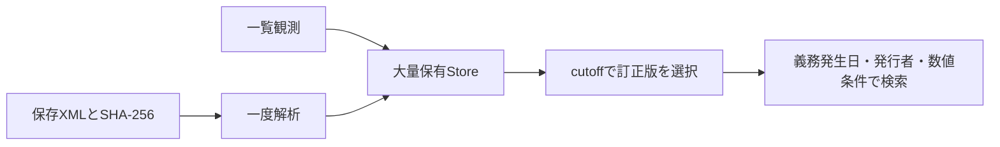

# 一次大量保有の明細・訂正版選択

大量保有の一次報告書を読み、保有者ごとの値と連名合計を区別します。後半では、一覧観測と取得時点から訂正版を選ぶ方法を説明します。

- [一次大量保有の直接明細と観測cutoff](#report)
- [一次大量保有の訂正版選択と原本観測](#versions)

各節のAPI・入力条件は区別します。検証件数と配布物の記録は実施当時のもので、現在の全体検証や稼働状態を示しません。

<a id="report"></a>

## 一次大量保有の直接明細と観測cutoff

`extractLargeHoldingReport`は一次大量保有XBRLから、表紙・発行者・提出者別/明示集計の保有数と比率、分母の構成値を出典付きで返します。`searchLargeHoldingReports`と`screen-large-holdings` CLIは、観測cutoff・報告義務発生日・報告全体/保有者別を指定して検索します。

`LARGE_HOLDING_REPORT_VERSION`は1です。[有報本文の引用](MAJOR_SHAREHOLDER_DETAILS.md)とは別のAPIです。

<a id="report-入力と一覧メタデータ"></a>

### 入力と一覧メタデータ

```ts
import { extractLargeHoldingReport, searchLargeHoldingReports, LargeHoldingMetric } from "edinet-ts";
const document = {
  xml: savedXml,
  metadata: {
    docID: selected.docID, docTypeCode: selected.docTypeCode, formCode: selected.formCode,
    edinetCode: selected.edinetCode, issuerEdinetCode: selected.issuerEdinetCode,
    parentDocID: selected.parentDocID ?? undefined,
    submitDateTime: selected.submitDateTime, knownAt: snapshotKnownAt,
    coverContextRef: "FilingDateInstant",
    withdrawalStatus: selected.withdrawalStatus, disclosureStatus: selected.disclosureStatus,
    docInfoEditStatus: selected.docInfoEditStatus
  }
};
const report = extractLargeHoldingReport(document);
const result = searchLargeHoldingReports([document], {
  cutoff: observedCutoff, dutyDate: "2025-06-16", scope: "report",
  metric: LargeHoldingMetric.HoldingPercent,
  condition: { operator: "gte", value: 5 }, sort: "value-desc"
});
```

docTypeCodeは350/360に限定します。対応する原本の一覧メタデータを渡し、knownAtは原本と対応メタデータの両方が利用可能になった観測日時（各入力の観測時刻の最大）をtimezone付きで指定します。

APIのtimezoneなしsubmitDateTimeは日本時間です。knownAtが提出時刻より前なら拒否します。

文字列の「提出日」を、システムが実際に観測した日時へ読み替えません。今回取得した2025年提出原本のknownAtは2026年の取得時刻であり、2025年のバックテストで既知だったと偽りません。

表紙contextは次元のないinstantで、提出者entityを一覧EDINETコードと照合します。350の提出日、フォーム/表紙題名、訂正フラグを照合し、一覧状態が0/0/0以外の原本は未採用にします。

metadataは呼出元の宣言であり、API応答や原本の真正性を暗号的に認証する機能ではありません。発行者名/証券コードは原タグ、発行者EDINETコードは一覧の宣言を別々に保持し、法人同一性を自動認定しません。

確認済みの標準namespaceはjplvh/2014-07-31とjpdei/2013-08-31です。表紙の第一号/第一号及び第二号様式と、確認対象フォームに限定し、未知の基準/形式からタグ名だけで推測しません。

実原本では010000、010002、020002、090001を確認しました。020000は同じ表紙/タグの検査経路を持ちますが、実原本の照合は未実施です。

<a id="report-日付と訂正"></a>

### 日付と訂正

| 項目 | 意味 |
|---|---|
| metadata.submitDateTime | 一覧が示す、その書類IDの提出日時 |
| metadata.knownAt | 原本を利用可能とした観測日時 |
| cover.dutyDate | XBRL表紙の報告義務発生日 |
| cover.filingDate | XBRL表紙factの提出日 |
| rows[].outstandingAsOf | BaseDate＝発行済株式等総数の基準日 |

BaseDateはPDFのV欄に対応します。報告義務発生日や保有日の別名ではなく、他の比率/保有値の時点へ流用しません。義務発生日が2025年6月17日、Vの基準日が6月20日の実例も、そのまま分けて返します。現在の保有ポジションや、全ての構成値が同じ時点であることは認定しません。

360はamendmentFlagと親番号を確認し、reportKindをcorrectionとします。添付された訂正対象XBRLでは、表紙の提出日が原報告のままの場合があります。実例は一覧の訂正提出日が6月23日、添付XBRLの提出日が6月17日で、両方を保持します。coverは添付XBRLのfactであり、訂正PDF自身の表紙と混同しません。

350の変更報告にもparentDocIDがある実例があるため、親番号があるだけで訂正とは扱いません。親番号の参照先を変更イベントとして自動合成することもしません。

検索は、cutoff後の原本を除いた後で、360の親子や同じ訂正対象への競合訂正が同時指定されていれば拒否します。直接検索では訂正系列を自動選択しません。[観測付き検索](#versions)で選択できます。部分訂正の値の合成と、変更履歴からの現在ポジション再構成は未実装です。

`reconstruction: not-performed`を保持します。

<a id="report-個別提出者・共同保有・報告合計"></a>

### 個別提出者・共同保有・報告合計

FilersLargeVolumeHoldersAndJointHoldersAxisのQName証跡と、提出者entityに対応する既知の独自namespace/メンバーを照合します。rowsのroleはfiler、joint-holder、reported-aggregateです。

memberのnamespace/localNameと全context/次元証跡を保持し、既存財務selectorの連結/単体や次元可否とは分けて専用検査します。DTSの所属や元QName字面の認証済みとはしません。

実原本で確認したのは単独提出と2名/3名の連名提出者です。独立したjoint-holderメンバーの実原本照合は残っています。

表紙の提出者及び共同保有者総数と提出形態をそのまま保持します。個別名義から別人/法人へ名寄せしたり、共同保有者を足して総数/比率を生成したりしません。

原本に次元なしの集計値があればreportTotalはexplicit-aggregateを参照します。集計factがなく、総数1・保有者行1が確認できる場合だけsingle-holder-reportとしてその原行を参照します。

個別と合計を二重計上しません。

name等の重複は原値・namespace・context・単位/精度が完全一致する場合だけ理由付きで採用します。値、精度、単位等が異なれば曖昧として保持し、先頭を勝手に採用しません。取得結果はコピーで、外部変更を解析済みobjectへ戻しません。

<a id="report-5数値と分母"></a>

### 5数値と分母

| metric | 原タグ/欄 | valueUnit |
|---|---|---|
| heldEquivalents | TotalNumberOfStocksEtcHeld、T＝保有株券等の総数 | share-or-unit-equivalents |
| potentialEquivalents | NumberOfResidualStocksHeld、U＝保有潜在株券等の数 | share-or-unit-equivalents |
| outstandingEquivalents | TotalNumberOfOutstandingStocksEtc、V＝発行済株式等総数 | share-or-unit-equivalents |
| holdingPercent | HoldingRatioOfShareCertificatesEtc、当期の記載比率 | percent |
| previousHoldingPercent | HoldingRatioOfShareCertificatesEtcPerLastReport、直前報告の記載比率 | percent |

XBRLのshares/pureを解決した単位と照合します。pureの0.0507は5.0700％へ正確に換算し、原値・valueUnit・multiplier=100・十進値・安全な場合のsafeNumberを分離します。保有数は非負の整数値、比率は0〜1のpure原値に限定します。非整数、範囲外、単位違い等は結果と全候補証跡へ同じ除外理由を残します。

分母の定義はPDFのT/(U+V)×100に対応する`reported-T-over-U-plus-V`です。Uがnilなら0とはせず、原比率は直接報告値として保持します。比率をT/Vへ変更したり、丸め差を再計算したりしません。実例では潜在株券数940万と発行済総数約2.35億を分母に含めるため、有報大株主の自己株式除外比率と同一定義ではありません。

nil・タグ不在・不明と明示0を区別します。株券等には潜在株券や口数を含む場合があり、すべてを普通株式の直接保有数や議決権へ置き換えません。0％の実原本も数値として保持し、未開示としません。

<a id="report-検索・cli・上限"></a>

### 検索・CLI・上限

cutoff/dutyDate/scope/metricが必須です。cutoffは提出日時とknownAtの両方へ適用し、まだ観測できない原本は解析結果/evidenceにも含めません。

scope=reportはreportTotalの参照行、holderは集計以外の行を検索します。名義の部分一致はholderで利用し、issuerEdinetCodeは一覧が宣言する発行者コードの一致です。

保有者の同一性を確認した逆引きではありません。

比較/順序は正確な分数、同額は書類ID/contextRef順です。condition.valueは選んだ指標の株・口換算単位または百分率で、5は5％です。

義務日/コード/条件外はfiltered、利用できない原本/値はexcludedへ理由を返します。matchedはページ適用前の行数であり、現在の独立保有者数や銘柄数ではありません。

offsetは0以上、limitは既定100/最大1,000です。

```sh
node dist/cli.js screen-large-holdings --manifest manifest.json \
  --cutoff 2026-10-28T12:00:00+09:00 --duty-date 2025-06-16 \
  --scope report --metric holdingPercent \
  --condition '{"operator":"gte","value":5}' --sort value-desc
```

manifestはfile/metadataの配列です。fileはmanifestの所在から解決します。

100原本/256MiB、各原本は1,000context/10,000候補、検索は10,000保有者行まで。原本ID重複を拒否します。

CLIは共通の有限読取りを使い、失敗入力はログへ表示しません。factory/object selector/search自身は通信も既存DBの変更もしません。

既存getLargeShareholdingInfoは先頭候補の原値を返す互換動作を維持し、README/生成型説明で未検証の集計範囲と単位を明示しました。

<a id="report-実原本確認と残工程"></a>

### 実原本確認と残工程

> 以下は各検証を実施した時点の記録です。件数・配布先・未確認範囲を含めて読み、現在の稼働状態とは分けてください。

正規APIで光通信の初回、上村氏の2変更、GFAの変更と訂正添付、シティインデックスイレブンスの変更（短期大量譲渡）の計6原本とPDFを取得しました。既存の一覧から選び、訂正対象の6月17日一覧を追加取得しています。

XBRL/PDF各6取得と一覧1取得で、有料サービスは利用していません。APIキーは表示せず、取得物/原本hashと観測時刻を私有の検証記録へ保存しました。

6原本11行の137選択項目を独立XML処理で照合し、採用123項目・nil12・集計名義不在2、159fact証跡（採用項目147・nil12）と数値49件（表紙の人数6件を含む）が一致しました。保有関係の43数値のうち、通常原本5件10行の38数値・12nil、Vの基準日10件、表紙日付10件/人数5件は同じ提出のPDFと一致しました。

画像でも個別/集計、分母・単位、訂正PDFの範囲を確認しました。

訂正PDFは訂正箇所の取引表だけです。訂正添付XBRLの保有5数値は訂正対象XBRLとの一致と対象PDFで別に確認し、訂正PDF自身で全文の保有値を照合したとはしません。8検索の結果・順序・nil/観測cutoff除外も独立期待値と一致しました。

索引方針: 書類ID/原本hash/抽出版/観測日時と、一覧種別・フォーム・親番号を分離保存します。保有者行のcontext/memberを保持し、集計は元行への参照で扱い、日付は義務発生/一覧提出/添付表紙/Vの基準日を別列にします。

訂正や変更を1社の同一残高へ潰さず、十進値・原単位/倍率・採用状態/理由を保存する方針です。[専用Store](#store)に永続索引を追加しています。実6原本のStore照合済みです。移行・本番規模の負荷検証は残工程です。

全様式/全銘柄、共同保有者メンバーの追加実例、発行者/保有者の法人同定、独立した保有時点の認定、証券別内訳/取引明細、訂正全文の再構成、既存DB/固定配布物/利用先の最終反映は残工程です。政策保有/役員・報酬等と他段階の範囲も維持し、全体計画6bの完了とはしません。

追加後の検証: 全99ファイル・3,162テスト（Node26.12.1/1ワーカー）、公開API型検査、build成功。不正数値の結果/候補証跡の理由一致も回帰検証しました。source/buildの実6原本11行の全JSONが同等で、公開CLI/APIは明示0％を含む報告2件で一致し、公開CJSの関数/定数も確認しています。

一覧350/360の自動選択と原本hash・利用可能時刻の接続は[訂正版選択](LARGE_HOLDING.md#versions)を参照してください。直接検索へ親子を同時投入せず、観測付き検索で選択してから読み込みます。

<a id="versions"></a>

## 一次大量保有の訂正版選択と原本観測

`selectLargeHoldingReportVersions(observations, cutoff)` は、一覧の観測日時・提出日時・利用状態・提出者/発行者・フォームを確認し、350（大量保有/変更）と360（訂正）の系列から利用可能な末端を選びます。値の合成や未観測の履歴復元は行いません。

観測は `{observationId, observedAt, listDate?, document}`。documentには一覧のdocID、docTypeCode、formCode、edinetCode、issuerEdinetCode、parentDocID、submitDateTimeとwithdrawalStatus/disclosureStatus/docInfoEditStatusを保存します。

観測日時とcutoffにはtimezoneが必要で、一覧のtimezoneなし提出日時は日本時間です。観測は最大10,000件、系列参照は100,000ステップまでです。

同一書類はcutoff以前の最新観測を使います。同時刻の内容が競合すれば未確定です。

数値/文字列の状態コードは正規化します。新しい観測が非対応種別になった場合も古い350/360へ戻りません。

最新状態が不明、書類情報修正済み、親不明、循環、提出者/発行者不一致、提出日時逆行、訂正分岐なら理由を残します。競合した訂正の参照先候補も調べ、影響する旧版の採用を防ぎます。

350のparentDocIDは訂正辺として辿りません。変更報告と直前報告の参照を、訂正と混同しないためです。撤回/不開示/通知だけの訂正は除外理由を残します。有効な子訂正が利用不能な親を辿る場合は未確定です。

<a id="versions-原本との接続"></a>

### 原本との接続

`searchObservedLargeHoldingReports(observations, sources, options)` は版選択と[一次原本の検索](LARGE_HOLDING.md#report)を接続します。sourcesは最大100件の配列で、各要素は以下です。

```ts
{docID, availableAt, sourceSha256, coverContextRef, xml?}
```

availableAtは原本を利用可能と確認した観測時刻、sourceSha256は読み込むXMLのUTF-8 SHA-256です。XMLは合計256MiBまで。

原本と系列判断に使った一覧観測のうち遅い時刻をknownAtにします。選択された訂正が欠落/未来/未読込/hash不一致/解析失敗ならunavailableSourcesへ理由を返し、旧版の数値へ戻りません。

未選択原本は解析しません。数値0とnilは分けます。

CLIは既存コマンドに一覧観測を指定します。

```sh
edinet-ts screen-large-holdings \
  --observations observations.json --manifest sources.json \
  --cutoff 2026-10-28T12:00:00+09:00 \
  --duty-date 2025-06-16 --scope report --metric holdingPercent
```

sources.jsonは `{file, docID, availableAt, sourceSha256, coverContextRef}` の配列です。fileはmanifest基準の相対パスも使えます。

選択済みでcutoff以前の原本だけを読みます。読込失敗は書類ごとにsource-not-loadedです。

UTF-8 BOMを保持してhashを照合します。入力のエラー内容は表示しません。

observationsを省略した既存のfile/metadata形式も使えます。

<a id="versions-確認範囲と残工程"></a>

### 確認範囲と残工程

保存済みの一覧と一次原本6件から、訂正対象S100VYPVを外してS100W23Pを選ぶ5件を確認しました。親参照のある350のS100W06Mも独立して選択します。2025年6月16日義務発生の報告全体検索は2件で、明示0も保持します。訂正原本欠落時は結果へ親の数値を出しません。新規のAPI取得・有料サービスは利用していません。

添付訂正XBRLの直接値を読む機能であり、訂正箇所を適用した全文再構成ではありません。共同保有者の全形式、保有者の法人同定、証券別内訳/取引明細、永続索引の本番規模検証、全市場の取得・本番運用は引き続き残工程です。

日次再観測で350/360の種別や親が消えた場合も、cutoff以前の対象観測があれば最新状態を無視しません。取下げ等はunavailable、それ以外の分類消失は `document-type-unavailable` のunresolvedです。

旧360の親参照は旧系列へのfallbackを止める根拠に限って使い、旧観測IDを返します。350のparent参照を訂正辺として辿ることはありません。

古い属性を新観測へ補う処理や、分類消失からの閲覧期間満了の断定は行いません。[財務版と同じ日次更新の注意](../pipeline/DOCUMENT_PIPELINE.md#再観測で書類種別親番号が消えた場合)を参照してください。
取下げられた訂正から有効な元書類を選ぶ場合も、その取下げの根拠IDをdecisionに残し、選択observedAtへ反映します。取下げ前のcutoffの結果を書き換えません。
同時刻の親参照競合では、片方の観測の種別が消えていても両方の参照先を未解決にします。新しい種別不明観測に別の親宣言が残る場合も、旧訂正参照先と新宣言先の採用を止め、両観測IDを根拠として返します。


<a id="store"></a>
## 大量保有Storeで保存・再検索する

`LargeHoldingStore` は一覧観測、原本のhashと利用可能時刻、解析結果を専用SQLiteへ保存します。検索時に原XMLを再読込する必要はありません。原XML自体はDBへ入れず、既存の原本保管先で保持してください。



```sh
# sources.jsonは既存の観測付き検索と同じ原本宣言。fileは省略可能
edinet-ts import-large-holdings --db holdings.sqlite \
  --observations observations.json --manifest sources.json

edinet-ts search-large-holding-store --db holdings.sqlite \
  --cutoff 2026-10-29T00:00:00Z --duty-date 2025-06-16 \
  --scope report --metric holdingPercent --pretty
```

`file` を省略すると未読込の宣言だけを保存します。同じ宣言に原本を追加して再投入すると解析結果を補完します。この場合のobservationsは空配列でも構いません。観測IDの別内容への付替えと原本hash不一致は拒否し、その投入全体を取り消します。

検索では観測cutoffで系列を選び、原本利用可能時刻も確認します。訂正原本の未取得・未読込・解析失敗で旧版へ戻りません。同一書類に異なるhashまたは表紙contextの宣言がcutoff内で存在すると、競合として保留します。結果の `storage.sources` で宣言、`unavailableSources` で保留理由を確認できます。

解析結果から既知時刻を分離し、検索で選択した観測と原本の時刻から再設定します。原値・十進文字列・単位・倍率・根拠を保ち、SQLの `holding_values` viewでも参照できます。十進値は文字列であり、SQLの文字列順を数値順として使わないでください。

読取専用で開いた最初の検索では、保存された全観測・宣言・解析結果のhashと索引の整合性を検査します。以後は検査済みの私有snapshotを再利用します。これは外部原XMLの再照合やデータの真正性の認証ではありません。APIの `audit()` でも保存整合性を確認できます。

一回の投入は原本100件、各64 MiB、合計256 MiB以下です。一検索の集合は10,000観測以下です。発行者指定時は過去の一致観測を起点に訂正の親子も読み、別発行者を宣言した訂正があっても親を復活させません。解析結果の読込は合計256 MiB以下です。

Store検索の `reports` は日付・発行者条件に合う結果と非対応の診断に絞られます。本文読込前に除外した書類は `storage.filteredReports` に記録します。元XMLの直接検索とは `reports` の配列位置が異なる場合があるため、行の参照には各結果の `sourceIndex` を使ってください。

解析・選択形式の版が変わった場合は新しいDBを構築してください。SQLite復旧の形式名は `large-holding-store` です。実6原本11行の80検索、55指標の独立XML/SQL照合、実16,916観測の保存と24時点検索を確認しました。全市場の性能・容量・運用検証は未完了です。
