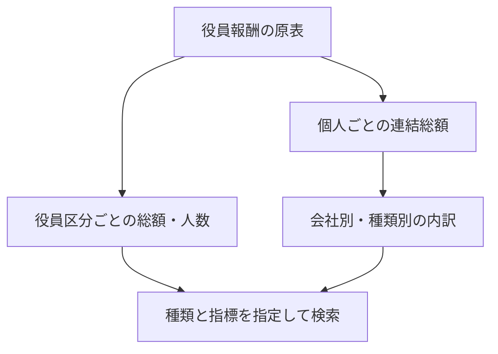

# 役員報酬の区分集計・個人総額・会社別内訳

役員報酬の区分集計、個人総額、会社別内訳を読みます。総額を会社行ごとに重複させず、対象人数や費用計上額の意味も原注記とともに保持します。

## 集計単位の使い分け



`extractOfficerRemuneration` は `RemunerationForDirectorsAndOtherOfficersTextBlock` の確認済み実績表を読みます。`searchOfficerRemuneration` と `search-officer-remuneration` CLIは、対象期間・行区分・金額/人数/内訳の定義を指定して検索します。

版は `OFFICER_REMUNERATION_VERSION = "1"` です。

## 入力と原本参照

```ts
const document = {
  xml: savedXml,
  selection: { docID: "SAMPLE", kind: "officerRemuneration", contextRef: "FilingDateInstant" },
  period: { startDate: "2023-04-01", endDate: "2024-03-31" },
  tables: [
    { tableIndex: 1, rawSha256: reviewedFragmentHash, kind: "category", headerRows: 2 },
    { tableIndex: 2, rawSha256: reviewedFragmentHash, kind: "individual", headerRows: 2 }
  ]
};
```

期間は原本を確認した呼出元の宣言で、結果にもperiodBasisをcaller-reviewedと残します。自動の対象期間認定ではありません。

開始/終了の前後、提出日以前の期末、次元のないinstant本文contextを検査します。原本XML/本文hash、表・行・セル、元見出し階層、本文注記とcontext/entityの参照を保持します。

表位置とhash、種類、見出し行数を確認して指定します。

categoryは役員区分、報酬等総額、種類別総額、対象役員の員数を確認し、個人別表と分けます。individualは氏名、連結報酬等総額、役員区分、会社区分、連結報酬の種類別額を確認します。限度額や報酬構成比の表はこの実績モデルへ採用しません。見出し/単位の矛盾、結合の不整合、明細を見出しへ含める指定などは診断を残します。

## 数値と区分の扱い

| 記載 | 保持する単位・構造 | 混同しないもの |
|---|---|---|
| category | 区分の階層、総額、内訳、対象人数 | 個人別報酬、提出時点の現任人数 |
| individual | 個人の連結総額を1回、会社別内訳をcontributionsへ | 会社別の金額、同名の別記載 |
| reported-total | 明示された原表合計 | 個人/区分の再加算による合計 |

円/千円/百万円を円単位の十進文字列へ換算し、原表示・倍率・見出し参照を残します。人数は人単位の整数です。ダッシュ、空欄、不正値と実際の0を分けます。端数切捨て等で総額と内訳合計がずれていても、原本を修正しません。

「基本報酬」と「固定報酬」、「賞与」と「業績連動報酬」は見出しを保持します。金銭報酬/基本報酬のような階層もpathで返し、同じ末尾名だけで異なる親区分を集約しません。社外役員/社外取締役といった階層ラベルも各物理セルへ参照します。

複数会社の個人表では、氏名と連結総額のrowspanが一致した範囲を1個人記載として保持します。個人総額は会社行へ複製せず、会社別内訳にcontributionIndexを付けます。同じ名前の別の物理記載を自動で結合しません。区分と個人、提出会社と他社の報酬も合算しません。

報酬は株式報酬の費用計上額等を含み得るため、paymentBasisはreported-not-verified-cash-paymentです。現金支払額や現在の年収とは呼び替えません。

対象人数には退任者が含まれる実例があり、[役員一覧](OFFICER_DETAILS.md)の人数とは照合せず、原注記を保持します。個人/会社の法人・人物同定、注記の意味認定は未実施です。

<a id="検索"></a>

## 検索条件と結果の読み方

```ts
searchOfficerRemuneration([document], {
  kind: "individual", period: { startDate: "2023-04-01", endDate: "2024-03-31" },
  role: "detail", metric: "total",
  condition: { operator: "gte", value: 100000000 }, sort: "value-desc"
});
searchOfficerRemuneration([document], {
  kind: "individual", period: { startDate: "2023-04-01", endDate: "2024-03-31" },
  role: "detail", metric: "component", componentPath: ["株式報酬"],
  companyContains: "原表の会社名"
});
```

totalは記載総額、recipientCountは区分の対象人数、componentは原見出し階層を指定する内訳です。個人総額へ会社条件を掛けて会社の金額と誤認しないよう、companyContainsは個人のcomponent検索に限定します。labelContainsは区分/氏名の原文部分一致です。

内訳階層はNFKCと空白除去後の完全一致で比べ、未記載の内訳を0として扱いません。条件は円/人の十進分数で比較します。

matched/filtered/excluded、元抽出とページ対象rowsを返します。総額が欠けても内訳を加算して補いません。

100原本/256MiB、100,000セル/10,000区分・会社別記載まで。同じ提出者は訂正・対象年度を選択してから入力します。

保存済み原本のメモリ検索であり、観測cutoffや永続索引は別工程です。

```sh
edinet-ts search-officer-remuneration --manifest reviewed.json \
  --kind category --period-start 2025-04-01 --period-end 2026-03-31 \
  --role detail --metric component --component-path '["金銭報酬","賞与"]'
```

manifestはxmlをfileに置き換えた配列です。fileはmanifest基準の相対パスも使えます。UTF-8 BOMを保持し、入力エラー内容は表示しません。

## 原本照合と残工程

> 以下は各検証を実施した時点の記録です。件数・配布先・未確認範囲を含めて読み、現在の稼働状態とは分けてください。

エクシオ/ミライトの2025/2026年3月期、弘電社/ピーエス・コンストラクション/若築建設2026年3月期、任天堂/ソフトバンクグループ2024年3月期、計9原本を確認しました。区分31記載・個人9記載、個人の会社別内訳11行を保持します。

独立XML処理で413原文参照・355見出し参照、原本のCurrentYearDurationと40記載の期間、145数値/52ダッシュが一致しました。PDFで区分149項目・会社別内訳39項目・個人総額9項目を確認し、7検索の選択/順序/除外も独立計算と一致しました。

複数会社の個人表と、階層区分・丸め差/退任者の注記は画像でも確認しています。

XBRL9件とPDF8件は取得済みデータを使用し、ソフトバンクグループ2024のPDFだけEDINETから1件追加取得しました。取得物のhash/観測時刻は私有検証記録へ保存し、認証値は表示していません。

有料取得元は利用していません。実2024本文で確認したjpcrp/2023-12-01も本文表の許可taxonomyへ追加しました。

未知namespace・全書式への対応を意味しません。

索引化は、提出者/原本・本文hash/抽出版、対象期間と確認根拠、区分/個人/会社別記載、階層見出し、金額/人数の十進値・原単位/倍率/状態、物理セル参照を別に保持する方針です。全書式/通貨、報酬限度・比率・業績指標の別モデル、注記の自動解釈、人物同定/横断履歴、永続索引/利用先への反映は残工程です。全体計画6bと他段階を完了とはしません。
