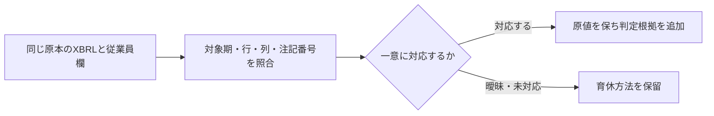

# 子会社人的資本表のラベルと数値

子会社の人的資本表から、会社名欄の表示と数値を読みます。まずラベルの検索方法、次に指標・単位・期間を指定する方法を説明します。

- [人的資本表に載る会社ラベルを探す](#labels)
- [子会社の人的資本表を数値で調べる](#metrics)

各節のAPI・入力条件は区別します。検証件数と配布物の記録は実施当時のもので、現在の全体検証や稼働状態を示しません。

<a id="labels"></a>

## 人的資本表に載る会社ラベルを探す

指定した有価証券報告書から「連結子会社の指標」表の「指標を公表した会社」を読み、文字列の完全一致・部分一致で探せます。**会社ラベル**とは、この欄に書かれた名前です。一般的な子会社一覧、法人の同一性、出資関係を判定する機能ではありません。ラベルAPIは文字列を扱います。比率は[数値API](#metrics)で読みます。

<a id="labels-対応範囲"></a>

### 対応範囲

金融庁の[2026年版EDINETタクソノミ](https://www.fsa.go.jp/search/20251111.html)の定義を確認し、独立して実装しています。

- 対象名前空間は `http://disclosure.edinet-fsa.go.jp/taxonomy/jpcrp/2025-11-01/jpcrp_cor` と、保存済み前年度原本でも確認した `http://disclosure.edinet-fsa.go.jp/taxonomy/jpcrp/2024-11-01/jpcrp_cor`。行ラベル・軸・数値・注記は同じ版で対応させ、未知の版や版の混在を推測で結びません。
- 項目は `ConsolidatedSubsidiariesMetricsOfConsolidatedSubsidiaries`（文字列・期末時点・単位なし）。
- 行指定はscenarioの `SequentialNumbersAxis` と `Row1Member`〜`Row300Member` が一つだけのもの。他の軸、typed次元、上記以外の版・企業拡張の別定義は未対応です。
- 提出者・指定期末を確認します。連結軸が宣言されていない場合は `consolidationDeclaration: "not-declared"` とし、定義ファイルの既定値から連結を補いません。財務APIの連結範囲へ変換しません。
- 同じ行に候補が複数あれば、同じ文字列でも `ambiguous`（一つに決められない）です。別行の同じラベルは残します。項目が見つからなくても「子会社がない」とは言いません。

`parsedLabel` は既存パーサーが保持した文字列です。前後空白の除去などを経ており、元XMLの字面そのものではありません。

`dtsValidation` / `originalLexicalValidation` は常に `not-performed`。表定義一式（DTS）や原文の字面の検証済みという意味ではありません。

数値文字参照らしい未解決文字列も勝手に復元しません。

<a id="labels-api"></a>

<a id="api"></a>

### APIの使い方

```ts
import {
  extractSubsidiaryHumanCapitalLabels,
  searchSubsidiaryHumanCapitalLabels,
  SubsidiaryHumanCapitalLabelOperator,
  SortOrder,
} from 'edinet-ts';

const metadata = { docID: 'SYNTHETIC-A', instant: '2026-03-31', secCode: '1001' };
const extraction = extractSubsidiaryHumanCapitalLabels(xml, metadata);
const result = searchSubsidiaryHumanCapitalLabels([{ xml, metadata }], {
  conditions: [{ operator: SubsidiaryHumanCapitalLabelOperator.Contains, value: 'SYNTHETIC' }],
  order: SortOrder.Ascending,
  offset: 0,
  limit: 10,
});
```

`secCode` は任意の申告文字列です。このAPIではコードの正規化・原本との独立照合はしません。複数原本の検索では同一期末を要求し、同じ書類番号・判明した同一提出者の複数書類を拒否します。最新版を自動で選びません。比較前にmetadata・条件を固定し、解析するXMLとSHA-256の対象を揃えます。

採用した行だけを検索します。条件はAND、`eq`（完全一致）と`contains`（部分一致）。大文字小文字・全半角・法人名の揺れを統一しません。順序はJavaScriptの文字列順（UTF-16）、同値なら書類番号・行キー順です。読み仮名順ではありません。

- `total`: 条件に合う採用行数。ページ指定前。
- `filteredRows`: 採用できたが条件に合わなかった行数。
- `excludedRows`: 欠損・未対応・曖昧で採用しなかった行数。会社数ではありません。
- `summary.emptyDocuments`: 対象項目の候補が0件だった書類数。
- `reasonCounts`: `multiple-facts`、`nil`、`tag-absent` など理由別の診断件数。候補0件の書類診断も含むため、`excludedRows`との合計一致は保証しません。

抽出結果は `traces`、検索結果は書類ごとの `sources[].traces` に[次元の出典](CONTEXT_DIMENSION_TRACES.md)をまとめます。候補の `traceRef` は同じ書類のこの配列のindexです。

`metadata.docID` と組み合わせて参照してください。同じcontextを候補ごとに全文複製しません。

原本hash・fact/context・期末・提出者・不採用理由を辿れます。

解析済みObjectの `selectSubsidiaryHumanCapitalLabels(metadata)` も使えますが、Objectは元XMLを保持しないため、この入口の `inputXmlSha256` はundefinedです。Objectを手動編集しても元XMLの次元出典は再生成しません。

原本との対応を確かめたい場合は、編集していないXML入口を使ってください。

<a id="labels-cliと入力準備"></a>

### CLIと入力準備

取得済みXMLをGit管理外に置き、次のようなJSON一覧を作ります。相対パスは一覧ファイルの場所が基準です。ネット取得やフォルダ自動走査はしません。

```json
[
  { "file": "a.xbrl", "metadata": { "docID": "SYNTHETIC-A", "instant": "2026-03-31", "secCode": "1001" } },
  { "file": "b.xbrl", "metadata": { "docID": "SYNTHETIC-B", "instant": "2026-03-31" } }
]
```

```sh
node dist/cli.js search-subsidiary-labels --manifest /path/to/files.json --contains SYNTHETIC --order desc --offset 0 --limit 10 --pretty
node dist/cli.js search-subsidiary-labels --manifest /path/to/files.json --conditions '[{"operator":"eq","value":"SYNTHETIC ALPHA"}]'
```

`--equals` / `--contains` はJSON条件へANDで追加します。成功はJSON/stdout・終了コード0、入力エラーは一般的な説明/stderr・終了コード1です。候補の欠損や未対応は入力エラーではなく、結果の理由と件数で返します。

API上限は100書類・100条件・候補合計10,000件。CLIは一覧2MiB・原本1件64MiB・合計256MiB、正しいUTF-8の通常ファイルだけを読みます。リンク先が通常ファイルのsymlinkは解決して読むため、ディレクトリ隔離の機能ではありません。元ファイルやDBを書き換えません。

<a id="labels-確認したことと未確認"></a>

### 確認したことと未確認

合成XMLで候補の重複、欠損、未知の定義、別期末、追加次元、同一提出者の二重入力、文字列条件・順序・ページ、出典参照、CLIを確認します。保存済み2社の2026年提出原本は読み取りだけで使用し、会社ラベルをGitへ収録しません。

37ラベル（31行/6行）の文字列・context・entity・行指定が独立したPython抽出と一致しました。64通りの条件/順序/ページとbuild済みCLIも独立期待値に一致し、2原本は不変です。

全2,294テスト・型/build・保存保護5件・独立レビュー/公開ビルド確認が成功しています。

別年度原本・PDF表示・全市場充足率・全タクソノミ年度・法人同一性・性能優位は未確認です。このラベルAPIはDB保存や一般的な子会社マスターの作成を行いません。主要顧客・大量保有は別の領域別APIです。

<a id="metrics"></a>

## 子会社の人的資本表を数値で調べる

`extractSubsidiaryHumanCapitalMetrics(xml, metadata, metricIds?, annotations?)`と`screenSubsidiaryHumanCapitalMetrics(documents, metric, options)`は、2025-11-01版jpcrpの子会社人的資本表を扱います。版は`SUBSIDIARY_HUMAN_CAPITAL_METRICS_VERSION = "1"`。

既存の提出会社単体API/JSON形式とは別です。

対象は女性管理職比率、男性育休率（全/正規/非正規の報告値）、男女賃金比率（全/正規/非正規）の7項目です。`SubsidiaryHumanCapitalMetricId`の値を指定します。比率は小数1=100%、賃金比率は女性平均賃金/男性平均賃金です。100%を超える報告値も保持します。

<a id="metrics-行の扱いと比較の境界"></a>

### 行の扱いと比較の境界

検査済みの会社ラベルと、同じ書類・entity・時点・完全QNameの行次元を持つ専用タグだけを結び付けます。context IDが別でも同じ行のaspectsを確認できます。同名会社の別行をまとめず、同じRow番号を使う別表や提出会社の値で補完しません。

`row.label.parsedLabel`は原表の解析済み会社ラベルです。`label.entity`/`submitterEntity`は提出者entityで、子会社の法人IDではありません。

一般子会社一覧や企業同一性の名寄せは行いません。Row軸を財務の連結/単体scopeへ変換せず、元次元・原値・精度・unit・trace参照・XML hashを残します。

DTS/元の字面の検証はnot-performedです。

育休率タグには算出方法を特定できないものがあります。初期状態は`reported/definition-unconfirmed`として原値を保持し、比較から除外します。次の宣言を原注記で確認したときだけ付けます。

```ts
{
  kind: "childcare-method", rowKey, metric: "maleChildcareLeaveReportedAllRatio",
  method: "ordinance-item2", // ordinance-item1 / ordinance-item2 / womens-act
  proof: {
    key: "jpcrp_cor:InformationAboutEmployeesTextBlock",
    contextRef: "FilingDateInstant", rawSha256
  }
}
```

rowKeyはラベル抽出または数値抽出の返値を使います。proofは同じ原本の従業員欄TextBlockで、hashはparserの`rawValue`のUTF-8 SHA-256です。

APIは参照・namespace・entity・時点・一意性・hashを検査します。配列で指定する手動宣言では、算出方法と注記の意味は呼出元が確認します。参照一致を意味の自動判定とは扱いません。

指標・手動注記・検索書類・条件は、実際のindexを持つ明示配列を渡してください。各配列のlengthと各indexは一度だけ読み、custom iteratorは使用しません。疎配列、不正な件数、指標7件・注記10,000件・書類100件・条件100件の上限超過を拒否します。iteratorで不正な注記や条件を隠しても、検査対象から外れません。

全/正規/非正規は個別に宣言します。

nilは0にしません。初期の`disclosure.state`は`unknown`です。

原注記で分かる場合だけ、`{ kind:"unavailable", rowKey, metric, state:"not-applicable" または "not-disclosed", proof }`を付け、非該当と未開示を区別できます。nil以外への未記載宣言や、未知行・重複・不正hashは拒否します。

完全一致の有効な重複factは証跡付きで採用します。異値・精度違い・nil混在は曖昧とし、負値・%文字列・未知単位等は採用しません。安全なnumberにできない原値は保持して検索から除外します。ラベルのない数値も診断へ残します。

<a id="metrics-auto-notes"></a>

### 注記を自動解釈する

`annotations: "auto"` を明示すると、確認済みの表形式と注記文言を使って算定方法・非該当を解釈します。省略時は算定方法を推測せず、手動配列は原文参照を検査します。対応taxonomyの追加により、以前除外していた2024年版の行も抽出対象になります。

```ts
const result = extractSubsidiaryHumanCapitalMetrics(xml, metadata, undefined, "auto");
console.log(result.noteInterpretation?.matched);    // 表・行・セル・注記番号・原文hash
console.log(result.noteInterpretation?.unresolved); // 対応が一意にならなかった項目と理由

const search = screenSubsidiaryHumanCapitalMetrics(
  [{ xml, metadata, annotations: "auto" }],
  "maleChildcareLeaveReportedAllRatio",
  { childcareMethod: "ordinance-item2" },
);
```



対象は2024-11-01/2025-11-01版の子会社表です。育休の全/正規/非正規3区分を持つ8列形式、異なる育休算定列が並ぶ7列形式、各行の独立した注記列で算定方法を示す9列形式に対応します。9列形式では注記列が一つの完全な参照である場合だけ使い、そのセル位置・本文も `referenceCellIndex` / `referenceCellText` に残します。同じ見出しが空の間隔で続く表は、その表群の後の注記へ結びます。親会社や以前の表の注記で補完しません。

DEIの年度開始日・年度末・当期末・FY、提出者、注記contextを確認します。育休方法の対応では原表の百分率とXBRL原値を十進分数で照合し、近似や推測の丸めを使いません。確認済みの文言から自動対応する方法は`ordinance-item1`・`ordinance-item2`・`womens-act`です。非該当は、nilセルの参照先に「対象となる従業員はおりません。」がある場合だけ付け、0へ変換しません。

自動で付いた`declaration`/`disclosure`には`origin: "automatic-rule"`を付けます。`noteInterpretation.version` はルール版 `"2"` です。`noteInterpretation`は、参照した表・セル・注記本文・原文SHA-256を返します。検索では各`sources[].noteInterpretation`から辿れます。手動で意味を確認した宣言とは区別してください。

同値が異なる算定列にある場合、重複ラベル、未知の見出し・文言、対象期の不一致などは保留します。育休率は`reported/definition-unconfirmed`のまま比較から除外されます。DTSや原文の字面の検証済みという意味ではありません。

`reportingPeriod`にはDEIの会計年度範囲を残します。自動指定した入力同士の育休・賃金比較では、開始日と終了日の一致も要求します。範囲を確認できない賃金比率は検索から除外します。期末時点の女性管理職比率は同じ期末で比較し、既定・手動モードの仕様は変えません。出向者範囲・FTE・賃金構成などの補正は行いません。

実2原本37行では算定方法92宣言・非該当9宣言が既存の独立XML/PDF照合結果と一致しました。異なる算定列が同値の2件は保留し、既定/手動モードの返値は厳密に維持しています。証跡は `data/roadmap/subsidiary-auto-notes-20261031/`。 後続の前年度2原本31行を含む4原本68行は、独立XML/Decimalで310数値・142 nil・24タグ不在を照合しました。行別算定注記70件を含む181宣言の原文参照も確認し、前年度CLIはAPIと一致しています。既存2025年版の既定出力は不変、自動出力はルール版だけを更新し、値・根拠は保持しました。証跡は `data/roadmap/subsidiary-taxonomy-2024-20261031/`。前年度PDFもエクシオ11/12/13ページとミライト15ページを描画して確認し、独立転記した31行・134数値・71ダッシュ・12項目のタグ不在、非該当6件・算定方法74宣言が一致しました。ミライトの同値の異なる算定列1件は引き続き保留しています。元PDFのhashは不変、追加通信0です。証跡は `data/roadmap/subsidiary-taxonomy-pdf-20261031/completion.json`。後続検証でNode 26.12.1の全5,307テスト、新規インストール2環境、stock-data候補の64回帰・型・旧SDKへの切戻しが成功しました。ローカルCLIも検証済みdistへ更新しています。正式vendor・サービスへの反映や全市場対応は残ります。他形式・別文言・全市場の自動解釈は残工程です。

<a id="metrics-検索とcli"></a>

### 検索とCLI

検索は同じ期末の明示集合です。`conditions`はoperator/valueのAND、`labelContains`はラベル文字列、`order/offset/limit`で並びとページを指定します。

育休率には比較する`childcareMethod`が必須で、異なる方法の行は除外理由を返します。会社の重複書類や期末混在は条件で隠さず拒否します。

未比較と条件不一致は別件数です。名称の表記統一・FTE・給与体系・出向者などの範囲は補正しません。

```sh
node dist/cli.js screen-subsidiary-human-capital --manifest files.json \
  --metric femaleManagerRatio --conditions '[{"operator":"gte","value":0.1}]'
```

manifestは`[{file,metadata:{docID,instant,secCode?},annotations?}]`。`annotations`には手動宣言配列か`"auto"`を指定します。育休の例は`--metric maleChildcareLeaveReportedAllRatio --childcare-method ordinance-item2`です。

最大100書類、検索集合のXML合計256MiB、ラベルと数値の全候補10,000件が上限です。入力の内容はエラーへ表示しません。

Object入口`selectSubsidiaryHumanCapitalMetrics(metadata, metricIds, annotations?)`では元XMLを保持しないためhashは付けません。

<a id="metrics-既存データによる独立照合"></a>

### 既存データによる独立照合

追加通信なしで既存キャッシュを私有作業先へコピーし、元ファイルの前後hash一致を確認しました。エクシオ`S100YI51`のPDF81/82ページ（冊子78/79）、ミライト・ワン`S100YG40`のPDF84ページを描画し、行名・単位・注記を確認しました。

| 検証対象 | 件数 |
|---|---:|
| 会社ラベル | 37 |
| PDF百分率とXBRL原値×100の一致 | 176 |
| PDFダッシュとXBRL nilの一致 | 71 |
| 注記で非該当と確認したnil | 9 |
| 理由を推測せず保持したnil | 62 |
| 元表に列がない投影セル（ミライトの育休正規/非正規） | 12 |

標準タグの247数値fact（176値+71nil）を独立Pythonで照合しました。ミライトの追加の別定義の育休列はこの標準タグの値へ代用していません。育休率の標準タグはエクシオで施行規則第2号、ミライトで女性活躍法の列を示すため、注記宣言と方法指定が必要です。

PDFから決めた4検索の件数も一致しました。女性管理職10%以上は5行、非正規賃金比率100%超は3行、施行規則第2号の男性育休率100%超は1行、女性活躍法の育休率80%超は5行です。数値や欠損の意味を他社・他年度・他表へ一般化せず、企業拡張列や自動注記の他形式への拡張は残工程とします。

この追加は固定配布物e673e8aの後のローカル実装です。

回帰確認: 全83ファイル・2,727テスト（1ワーカー）、build、公開API型検査に成功。
