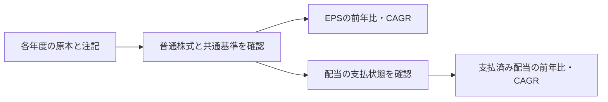

# 株式基準を確認したEPS・実績配当の成長率

EPSや支払済み配当の成長率を計算します。株式分割などで1株の基準が変わるため、原注記を確認した入力を用意してから計算します。

## 計算前に確認すること



`calculatePerShareGrowth(pair, metricId)` / `screenPerShareGrowth(pairs, metricId, options)`は、EPSと支払済み配当の前年比を扱います。IDは`PerShareGrowthMetricId.EarningsPerShare` / `.DividendPerShare`です。

`calculateCagr(documents, CagrMetricId.EarningsPerShare)` / `.DividendPerShare`と`screenCagr`は同じ根拠付き入力からCAGRを計算します。3年には連続する4原値が必要で、中間年の欠損や基準未確認も除外します。従来の売上/利益CAGRの入力と既定選択は維持します。

## 入力する株式基準

各`PerShareAnnualDocument`は`xml`、J-GAAP/JPYのannual `metadata`、`shareBasis`を持ちます。

```ts
shareBasis: {
  state: "confirmed",
  shareClass: "ordinary",
  basisDate: "2024-04-01",
  proof: {
    key: "jpcrp_cor:BusinessResultsOfGroupTextBlock",
    contextRef: "FilingDateInstant",
    rawSha256: "...64桁のSHA-256..."
  }
}
```

基準未確認は`{ state: "unknown" }`として計算不可を返します。確認済みと宣言する場合は、原注記で基準日・普通株式・遡及調整の対象年を確認します。

proofは原本内の「連結経営指標等」または「提出会社の経営指標等」のTextBlockを参照します。hashはparserの`rawValue`（解析時の外側空白処理後）からUTF-8で作成します。

APIは参照factの一意性・公式namespace・nil・hash・context/entity・基準日と注記時点を検査し、`shareBasis.status: "reference-matched"`と`declaration: "source-reviewed-by-caller"`を返します。基準の意味・支払状態・会計方針の比較可能性は、呼出元が原注記で確認する宣言です。

hash一致は参照一致の検査です。

既定では系列内の全点に同じ`basisDate`/普通株式の基準が必要です。既に遡及調整されたEPSは、その共通基準の値を使います。異なる基準を比較する場合は、以下の明示台帳による換算を指定します。調整後株価や株式数の比から分割を推測しません。

配当にはさらに`dividendStatus: "paid" | "proposed" | "unknown"`を宣言します。`paid`だけを実績計算へ使い、一部に予定額を含む年額は`proposed`です。時間の経過だけで支払済みへ昇格させません。記念配当等の内訳は自動で取り除きません。

## 明示された分割台帳からの自動換算

`calculatePerShareGrowth(pair, metricId, adjustment)` と1株当たりの `calculateCagr(documents, metricId, adjustment)` は、出典付き台帳を確認した場合だけ、元の `basisDate` から `targetBasisDate` へ換算します。既定動作は変わりません。単独の換算には `adjustPerShareValuesForSplits` を使えます。

```ts
const adjustment: ShareSplitAdjustmentOptions = {
  asOf: "2025-06-30",
  knownAt: "2025-06-30T00:00:00Z",
  targetBasisDate: "2024-04-01",
  sourceObservedAt: ["2025-06-24T00:00:00Z", "2025-06-24T00:00:00Z"],
  ledger: {
    state: "confirmed-complete",
    secCode: "10010",
    shareClass: "ordinary",
    basisConvention: "effective-date-inclusive",
    reviewedFrom: "2024-03-31",
    reviewedThrough: "2024-04-01",
    source: reviewedLedgerSource, // name / sha256 / observedAt
    events: [{
      eventId: "split-2024",
      effectiveDate: "2024-04-01",
      oldShares: 1,
      newShares: 2,
      source: reviewedEventSource
    }]
  }
};
const result = calculatePerShareGrowth(pair, PerShareGrowthMetricId.EarningsPerShare, adjustment);
```

これはAPI形状を示す合成例です。`sourceObservedAt` は入力原本の順に指定し、実際の観測時刻を過去へ変更しません。台帳の出典・完全性・株式基準日の意味は呼出元が確認する宣言です。確認できない台帳は `{state: "unknown"}` とし、`unverified-split-history` を返します。確認済みの範囲に必要な期間が収まらない場合も比較不能です。

基準日は「その日までに効力が発生した分割・併合を織込み済み」とします。元基準日より後、換算先基準日までのイベントだけを適用するため、遡及調整済みEPSを二重に割りません。1株→2株なら1株当たり値の倍率は1/2、逆方向の換算は逆数です。逆分割も正の整数比で扱います。イベントの同一IDで内容が異なる場合、同日競合、銘柄不一致、未来の原本・台帳・イベント観測は採用しません。

返却の `shareAdjustment` に元値、換算値、正確な分数、倍率、適用イベントと確認根拠を残します。元のselection・原値・株式基準は書き換えません。DPSの換算値は比較用の計算値で、実際の支払額とは区別します。分割前後が混じる年額配当を一つの基準と推定して換算する処理はありません。

複数社検索は `screenPerShareGrowth` / `screenCagr` の `shareAdjustments: Record<secCode, ShareSplitAdjustmentOptions>` で企業別台帳を指定します。このoptionを使う場合は非分割社にも確認済みの空イベント台帳が必要で、台帳のない企業は `missing-split-adjustment` として除外します。4桁/5桁コードを正規化し、誤帰属・重複キー・企業間cutoff不一致を拒否します。絞り込み・順序・ページングは換算後の正確な分数で比較します。売上・利益CAGRには分割optionを指定できません。

[ASBJの1株当たり当期純利益に関する会計基準](https://www.asb-j.jp/jp/accounting_standards_system/details.html?topics_id=29)にある遡及調整と注記を原本ごとに確認してください。[JPXの権利落](https://www.jpx.co.jp/glossary/ka/134.html)と分割の効力日は同じ概念ではなく、このAPIの台帳を価格調整へ流用しません。CLIの台帳入力は後述のとおり対応済みです。価格基準の自動判定、台帳の自動取得、全市場の完全性確認は別工程です。

## 算術・検索

前年比は`(当期−前期)/前期`で、前期は正値が必要です。EPS前年比は当期損失も計算し、配当0への減配は-100%です。負の配当は扱いません。CAGRは全点非負・基数正に限定します。

前年比の`exact`は増減率の分数、CAGRの`exact`は`{ numerator, denominator, root }`による倍率の累乗根です。表示`value`は小数1=100%の近似です。条件と順序は厳密分数で比較し、EPS前年比の-100%未満も扱います。

系列内の会社/entity・scopeと期間の連続性、企業間での対象期・基準/通貨の一致を検査します。完全一致する有効な重複factだけはこの新規計算で明示採用し、全evidenceを保持します。異値・精度違い・nil混在・安全なnumberにできない入力は計算しません。既存主要指標の`selectMetric`や売上/利益CAGRの既定動作を変更しません。

## 異なる株式基準が混在する年額配当の再構成

期中の分割・併合で interim と year-end の1株当たり配当が異なる基準で支払われた年でも、`reconstructAnnualDividendPerShare(payments, secCode, options)` で明示台帳から共通基準の年額へ換算できます。各回の原値・基準日・支払区分を保持し、合計は正確な分数で返します。

```ts
const annual = reconstructAnnualDividendPerShare([
  { paymentId: "interim", amountPerShare: 40, basisDate: "2024-09-30",
    dividendStatus: "paid", sourceObservedAt: "2025-06-01T00:00:00Z" },
  { paymentId: "year-end", amountPerShare: 25, basisDate: "2025-03-31",
    dividendStatus: "paid", sourceObservedAt: "2025-06-01T00:00:00Z" },
], "1001", {
  ...adjustment, // asOf / knownAt / targetBasisDate / ledger
  annualPeriod: { start: "2024-04-01", end: "2025-03-31" },
});
```

- `basisDate` は各回の金額が基づく株式基準日です。`targetBasisDate` へ向かう分割イベントだけを適用し、原値は書き換えません。
- 対象期間外の支払、重複する `paymentId`、負値、未知の属性、将来の観測は拒否します。台帳の完全性・競合・銘柄・cutoff検査は単独換算と同じです。
- `dividendStatus` は原注記を確認した呼出元の宣言です。全回が `paid` のときだけ `paid: true` とし、`proposed` を含む年は合計を返しても `paid: false` です。`unknown` は `unverified-dividend-status` として合算しません。
- 返却の `payments` は各回の `originalAmountPerShare`、換算値、正確分数、適用イベントを保持します。`totalPerShare` は比較用の年額で、実際の支払総額ではありません。
- 合計が安全な number で表せない場合は `unsafe-annual-dividend-total` を返します。台帳を推測取得せず、支払日や金額から株式基準を自動判定しません。

<a id="cli"></a>

## CLIで実行する

- `screen-eps-growth --manifest pairs.json`
- `screen-dividend-growth --manifest pairs.json`
- `screen-cagr --metric earningsPerShareCagr --manifest series.json`
- `screen-cagr --metric dividendPerShareCagr --manifest series.json`

前年比manifestは`[{previous:{file,metadata,shareBasis},current:{file,metadata,shareBasis}}]`、CAGRは`[[{file,metadata,shareBasis},...],...]`です。条件は`[{"operator":"gte","value":0.1}]`等です。

読取り容量・件数制限、相対fileの解決、非表示の入力エラー、除外と条件不一致の区別を維持します。基準不明等は計算不可の診断として返します。

## 取得済み原本の限定照合

> 以下は各検証を実施した時点の記録です。件数・配布先・未確認範囲を含めて読み、現在の稼働状態とは分けてください。

エクシオ`S100W0NZ`のPDF2/3ページを描画し、表と注記を確認しました。2024-04-01の1→2分割について、EPSの過年度値は遡及調整、過年度配当は当時の株式数の記載です。2025年3月期の配当63円には総会承認前の予定額が含まれます。

| 計算 | 対象年/原値 | exact |
|---|---|---|
| EPS前年比 | 2024年94.76→2025年128.97、分割後基準 | 3421/9476 |
| EPS 3年CAGR | 2022〜2025年、125.32/103.22/94.76/128.97 | (12897/12532)^(1/3)−1 |
| 実績配当前年比 | 2023年102→2024年120、分割前基準 | 3/17 |
| 実績配当3年CAGR | 2021〜2024年、82/96/102/120、分割前基準 | (60/41)^(1/3)−1 |
| 予定額を含む配当 | 2025年63 | proposed-dividendで除外 |

EPSは収益認識基準適用後の2022年からを選びました。配当には記念配当を含む年があり、記載された年額のままです。独立Pythonで9原値・14点参照・2前年比分数・2CAGR倍率/高精度小数・2注記hashが一致しました。全市場、他の株式種類、分割をまたぐ配当の自動換算や掲載成長率との一致を示すものではありません。

この追加はe673e8aの後に実装し、現在の固定配布物3cc4618へ反映済みです。

検証: 追加後の全81ファイル・2,700テスト（1ワーカー）、build、公開API型検査が成功しました。

CLIでも `screen-eps-growth` / `screen-dividend-growth` / `screen-cagr` の `--share-adjustments split.json` で同じ企業別optionを渡せます。JSONの形は上記 `shareAdjustments` と同じ企業コードをキーにしたobjectです。ファイルの相対パスは実行ディレクトリから解決し、UTF-8・通常ファイル・manifestと同じサイズ上限で読みます。各原本の `shareBasis` は従来どおりmanifestへ指定します。

```sh
edinet-ts screen-eps-growth --manifest pairs.json --share-adjustments split.json
edinet-ts screen-cagr --manifest series.json --metric earningsPerShareCagr --share-adjustments split.json
```

省略時は同一株式基準を要求する従来動作です。売上・利益CAGRにはこのoptionを使えません。CLIが台帳を取得したり、根拠のない株式基準を補ったりすることはありません。
