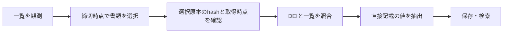

# 訂正書類・世代保存・充足率

書類の選択から、原本の照合、財務値の保存までのつながりを説明します。提出日・観測時点・取得時点を分け、どの情報に基づく結果かを追えるようにします。

## 書類選択から財務検索まで



2026-10-28のローカル実装です。全工程の進捗は[実装追跡](../plans/IMPLEMENTATION_STATUS.md)を参照してください。

## 観測時点に基づく書類選択

`EdinetRepository.getDocumentObservations({ knownAt, afterSequence, limit })`は、実際に一覧を保存した時刻までの原観測を返します。既存DBの旧行に架空の観測時刻は付けません。

日別取得の完了証跡は、書類が0件の過去日も保持します。当日分は日本時間の翌日以降に再取得されるまで確定としません。

`selectDocumentVersions(observations, cutoff)`は、明示した一覧観測から有報/半期/四半期の元書類と訂正系列を選びます。cutoffにはtimezoneが必要です。

cutoffより後の観測・提出は除外し、同じ書類の最新観測を使います。親番号、会社、書類種別、期間、提出順序を確認し、取下げ・不開示・複数の訂正末端・状態不明・親不明を理由付きで返します。

単に提出時刻の最大値を選びません。

訂正側の一覧で期間が未記載の場合は、宣言された元書類へ辿れるときだけ`targetPeriod`を返し、`sourceDocID`に元の期間根拠を残します。矛盾する有効な訂正がある系列は未解決とし、古い元書類へ暗黙に戻しません。これは書類の選択であり、訂正原本と元原本の財務値を合成する処理ではありません。

取得済み2025-06-23/24一覧の2,402観測では、現在の観測cutoffで635系列を選択、親原本がない33件は未解決、対象外種別等1,732件は除外しました。実際の取得は2026年なので、2025年cutoffでは0件です。過去に観測済みだったと扱いません。

## 期間明細の世代保存

`FinancialDetailGenerations`は、新規の専用SQLiteへ財務明細snapshotと原本hash・抽出版・対応表版を保持します。既存のBS試験DBや時点3項目専用DBは移行・変更しません。

```ts
const store = new FinancialDetailGenerations("data/details-generations.sqlite");
store.begin({ id: "extract-20261028", keys: ["document-period-scope"], extractorVersion, mappingVersion });
// snapshotはcreateFinancialDetailSnapshot等で作成した明示期間・項目の結果。
store.put("extract-20261028", [{
  key: "document-period-scope", snapshot,
  provenance: { sourceSha256, extractorVersion, mappingVersion }
}]);
store.pending("extract-20261028"); // 再open後も未保存キーから再開できる
store.complete("extract-20261028");
store.activate("extract-20261028");
store.close();
```

世代の抽出版・対応表版を計画時に固定し、異なる版の混在を拒否します。同じ計画と保存内容の再実行は許可し、同じキーの異なる内容は上書きせずbatch全体を戻します。

計画全キーが保存済みになるまで完了/公開できません。完了後は変更不可です。

`activate(oldGeneration)`で過去の完了世代へ戻せます。`read`は原値・証跡・hash・snapshot内部整合を検査し、`screen`は既存JSON検索の比較条件/混在拒否を利用します。

時点BSだけでなくPL/CFの期間明細も保存できます。

世代完了は計画キーの充足を意味します。取得失敗を0値へ置換したり、全市場取得済みとする意味ではありません。各期・scopeは別キーで明示します。検索はメモリ方式で、本番規模の索引・オンライン更新・他形式からの移行・外部改竄への認証は未完了です。原本hashは呼出側から渡すため、原本自体の保管・照合も別途必要です。

## 母集団付きの工程・値の充足率

`measureFinancialDetailCoverage`へ、母集団の基準日・出典・EDINETコード、対象提出窓・取得完了日、比較する期間/scope/基準/通貨、項目、書類候補と取得状態を明示します。

一覧未完了、対象窓に書類なし、候補複数、原本未取得、取得失敗、XBRLなし、取下げ、不開示、書類関係未解決、解析失敗、比較不能、未抽出、欠損、非対応、曖昧、数値の安全範囲外、利用可能を区別します。欠損を0にせず、空母集団を100%としません。候補の種別・対象期間の確認は呼出側の責務です。訂正の対象が不明な候補は未解決として保持します。

限定試算は現在の上場母集団（公式2026-10-27時点3,813社）と、過去2日（2025-06-23/24）の提出窓、2025年3月末・連結・J-GAAP・JPYの現金及び預金を組み合わせました。

| 状態 | 社数 |
|---|---:|
| 対象窓に書類なし | 3,304 |
| 原本未取得 | 492 |
| 利用可能 | 2 |
| 候補複数 | 12 |
| 書類関係未解決 | 3 |

この母集団は2025年当時の上場企業集合ではありません。提出窓も年間全体ではないため、2025年の全市場財務充足率とは呼びません。

## 既存ローカル価格の選択

`selectLocalClosingPrice(rows, { secCode, asOf, knownAt, source })`は、`.T`形式の日本株キャッシュから日付付き未調整終値を選びます。sourceには出典名・元ファイルSHA-256・実際の観測時刻が必要です。追加のAPI取得や契約は行いません。

比較日以前で出来高が正の最新行を返し、`ageDays`で価格の古さを明示します。出来高0行を取引成立の根拠にせず、同日の異なる価格/出来高は競合とします。

銘柄違い・不正日付・非正/非有限/安全範囲外の価格・不正出来高・観測日より未来の行を拒否します。比較日と観測cutoffには前後関係が必要で、出典自体の観測がcutoffより後なら利用不可です。

現在のキャッシュを過去に既知だったデータへ遡及させません。

`stock-data`の既存ローカル2ファイル（1417.T/1951.T）では、各6,424行を追加通信・ファイル変更なしで確認しました。出来高0行はそれぞれ126/118件、最新の出来高付き行は2026-10-19で、2026-10-28比較日に対して9日前です。

現在価格とは扱いません。2025年のcutoffでは現在観測のキャッシュを利用不可とすることも確認しました。

`adj_close`は配当等の調整を含み得るため、これを株式分割の証拠としません。価格出典の再配布許諾や過去の調整履歴は、この読み取り検証では確認していません。価格原データは新たに配布しません。EPS/BPS/配当と価格の基準一致、分割・併合、PER/PBR/配当利回りの算式・検索は残工程です。

## ローカル検証結果

> 以下は各検証を実施した時点の記録です。件数・配布先・未確認範囲を含めて読み、現在の稼働状態とは分けてください。

全76ファイル・2,606テストは世代Store追加時点で成功しました。価格選択追加後は、共有ホストの並列実行で時間超過が起きたため1ワーカーで再実行し、全77ファイル・2,619テストが成功しました。

build・公開API型検査・保存保護5件も成功しています。実2社のCF3項目（6採用値）は一時DBへの保存・再読込からの再開・JSON検索との一致・公開切替・旧世代復帰を確認しました。

比較はJSON表現で行い、保存時に省略される任意属性の`undefined`は欠落と同じ扱いです。

当期の基準・範囲・期間を原本から得る入口は[DEI財務基準判定](../financial/FINANCIAL_REPORTING_BASIS.md)です。DEIのinstantをknownAtや実際の提出時刻へ変換せず、観測・訂正版選択と原本の利用可能時刻はこのパイプライン側で保持します。自動snapshot接続はDB移行や最新版選択を行いません。

## 選択原本からの自動財務snapshot

`createObservedFinancialSnapshots(observations, sources, {cutoff, detailMetricIds?})` は、上記の書類選択と[DEIの財務基準・当期判定](../financial/FINANCIAL_REPORTING_BASIS.md)を接続します。`selectDocumentVersions` の `selected` には、選択された一覧情報、系列・観測ID、期間根拠と、その選択判断に必要だった系列内の最新観測時刻が含まれます。

取下げ済み訂正の後日観測が元書類を選ぶ根拠になる場合も、既知時刻へ含めます。

原本宣言は `docID / availableAt / sourceSha256 / xml?` です。取得時刻にtimezone、hashにUTF-8 XMLのSHA-256を必要とし、原本は100件・合計256MiBまでです。

観測は既存の10,000件上限を利用します。選択された原本だけを解析し、hash、提出後かつcutoff以前の取得、DEIと一覧のEDINETコード・記載のある証券コード・対象期間・書類種別を照合します。

半期160/170はHYまたは実原本で確認したQ2累計を扱い、四半期140/150はQ1/Q2/Q3、有報120/130はFYを必要とします。訂正側の一覧期間が空の場合も、親へ辿れた期間根拠を原本DEIと照合します。

[公式API仕様3-1-2-2の注記*3（48頁）](https://disclosure2dl.edinet-fsa.go.jp/guide/static/disclosure/download/ESE140206.pdf#page=53)に従い、半期160/170の一覧期間はDEIの `fiscalYear` と照合します。`targetPeriod` はこの一覧期間を保持するため、半期の財務値の抽出期間そのものではありません。

抽出する残高時点・累計期間はDEIの `period` / `instant` のままです。例えば一覧が2025-04-01〜2026-03-31、半期末が2025-09-30なら、事業年度で原本を照合し、値は2025-09-30時点/同日までのYTDとして扱います。

半期の一覧を半期末までの期間へ書き換えたり、事業年度が不一致の原本を採用したりしません。四半期140/150では、Q1はDEIの累計期間、Q2/Q3は原本contextで確認した単四半期の `quarterPeriod` と一覧を照合します。

Q2/Q3は事業年度開始から3暦月ずつ区切った開始日と当期末が一致し、提出者・連結範囲・次元が検証済みのcontextを必要とします。例えばQ2の一覧が2025-07-01〜2025-09-30でも、抽出する累計期間は2025-04-01〜2025-09-30のままです。

単四半期contextの不在・重複、日付不一致、通常の区切りでは確認できない変則期間は `period-mismatch` として保留し、累計contextで代用しません。

```ts
const result = createObservedFinancialSnapshots(observations, [{
  docID, availableAt, sourceSha256, xml
}], {cutoff});
for (const record of result.records) {
  // result内のbasis/各group/各選択値の状態も確認する。
  console.log(record.docID, record.knownAt, record.result.status);
}
```

`records` は原本を処理できた結果です。基準不明やIFRS単体などは `record.result.status: unresolved` のまま保持し、採用済み財務値とは呼びません。DEIが確定できない場合、一覧との提出者・期間一致も確定しません。`knownAt` は必要な一覧観測と原本の取得時刻の遅い方で、DEIのinstantとは別です。

`unavailableSources` は原本なし、cutoff後の取得、提出前の取得、未読込、hash不一致、解析失敗、提出者/コード/期間/書類種別の不一致を区別します。指定項目が基準に合わない場合は `metric-projection-mismatch` とし、XML解析失敗と混同しません。

未知・重複など項目指定そのものの不正は、原本がない入力でも拒否します。未解決/利用不能な系列は `selection.decisions` に残ります。

選択された訂正版が利用不能でも親へ戻さず、訂正版にない値を親で補完しません。生成物は一原本の直接snapshotであり、訂正差分を合成した完全版ではありません。

```sh
edinet-ts observed-financial-snapshots --observations observations.json \
  --manifest sources.json --cutoff 2026-10-28T00:00:00+09:00 --pretty
```

CLIの原本manifestは `docID / availableAt / sourceSha256 / file?` の配列（2MiB以下）で、観測JSONは16MiB以下です。fileはmanifestのディレクトリ基準で、既に宣言した原本が未読込の場合は省略できます。

選択対象かつ時刻条件を満たした原本だけを読み、BOMもhash対象に保持します。読込失敗は未読込の理由付きJSON・終了0、入力宣言/条件の不正は入力内容を表示せず終了1です。

API/CLIともネットワーク取得や既存DB更新は行いません。

実2,402観測の635選択系列に保存済み2原本を接続し、残り633件を原本なしで保持しました。DEI22項目・財務値10件、原本hash、一覧との一致、既知時刻を独立したXML/JSON処理でも確認し、2025年cutoffで0件になることを確認しました。

実訂正原本の完全版再構成を検証した結果ではありません。既存 `FinancialDetailGenerations` へのJ-GAAP明細2件の保存・再読込も確認しています。

合成した訂正前後の直接値では、cutoff選択→保存→中断再開→冪等保存→旧世代復帰を試験しました。既存Storeは観測/knownAtやIFRSを保存する型ではないため、これで観測付き本番永続化の完了とはしません。

観測/原本の一体保存、訂正差分の再構成、IFRS等の永続索引・本番移行・利用先反映は残工程です。

観測入力・原本・日本基準/IFRSの直接結果を再起動後も保持する入口は、[財務アーカイブ](OBSERVED_FINANCIAL_ARCHIVE.md)を参照してください。既存世代Storeとは別の専用形式で、原本履歴・cutoff・抽出版ごとの解析キャッシュを保持します。

固定世代から直接BS/明細をSQLで検索する別DBは、[財務検索索引](FINANCIAL_SEARCH_INDEX.md)を参照してください。原本アーカイブと従来の世代Storeを変更せず、検索用の固定世代へ転記します。従来の `FinancialDetailGenerations.screen` は引き続きメモリ検索です。

[母集団全件の分割構築・再開](FINANCIAL_INDEX_BUILD.md)では、原本指紋と母集団を固定し、会社別checkpointが全件揃ってから一つのSQL検索世代へ集約します。処理完了と原本/財務値の充足は分けて返します。

[不足原本の取得と再開](FINANCIAL_SOURCE_ACQUISITION.md)をアーカイブへ接続しました。選択cutoffと今回の原本取得日時を分け、保存済みを再取得せず、一件ずつcommitします。

[全社の固定取得job・試行履歴](FINANCIAL_SOURCE_JOB.md)も追加しました。日別一覧backfill/定期起動・全市場の実取得/充足率は引き続き残工程です。

[日別一覧backfillと原観測転送](FINANCIAL_DOCUMENT_SYNC.md)を追加。既存の日別完了証跡を使い、空の日/当日再取得と取得元namespace付きcursor転送を接続します。取得jobの固定一覧を変更する場合は、新しい計画で扱います。

[固定財務索引の品質集計](FINANCIAL_INDEX_QUALITY.md)では、全本文/値projectionを再検査し、母集団・書類・行・値の品質を分け、同一cohortの重複も保持します。

[品質条件付きの財務世代切替](FINANCIAL_INDEX_PUBLICATION.md)を追加。全社集約世代の品質・公開条件を候補へ固定し、直前候補の期待値が一致する場合だけ切替/旧候補復帰を履歴付きで行います。

[公開snapshotによる財務検索](PUBLISHED_FINANCIAL_INDEX.md)を追加。公開候補を実索引と照合し、読取中の世代を固定して検索します。明示再ロードの検査失敗では既存snapshotを維持します。

### 再観測で書類種別・親番号が消えた場合

[公式API仕様3-1-4/3-1-5](https://disclosure2dl.edinet-fsa.go.jp/guide/static/disclosure/download/ESE140206.pdf)では、閲覧期間満了や取下げ後の日次更新で、書類種別や会社属性等がnullになります。同じdocIDにcutoff以前の財務書類観測がある場合、最新の空属性観測を対象外として捨てず、以前の元書類/訂正原本へ戻りません。

明示的な取下げ等は理由付きunavailable、それ以外の分類消失は `document-type-unavailable` のunresolvedとします。属性欠落だけから閲覧期間満了と断定しません。

訂正の親番号まで消えた場合は、cutoff以前に観測した訂正参照を、影響する元系列の採用を止めるためだけに使います。旧観測IDもdecisionの根拠へ残し、会社・期間・書類種別を新しい観測へ補って採用しません。

以前の財務観測がないdocIDは財務書類と推定しません。同時刻の矛盾は未解決、将来観測は従来どおり除外します。

失効根拠の出力は合計100,000参照を上限とし、黙って切り捨てません。

取下げられた訂正から有効な元書類を選び直せる場合は、取下げ観測も選択根拠へ残し、選択のobservedAtをその観測時刻以前へ戻しません。取下げ前のcutoffでは訂正が選ばれるため、採用原本の選び直しを知った時刻と、元書類自身の観測時刻を分けて扱います。

同時刻の訂正観測が異なる親番号を指す場合は、どちらか一方を先に読んで採用しません。訂正自身をconflicting-observationsとし、宣言された両方の参照先系列をunresolved-correctionにします。

種別消失時の新しい親宣言と既知の旧訂正参照も、影響先の採用を止める根拠として両方確認します。会社を絞った取得計画でも関連系列全体を確認し、他社側の競合を落としません。

期間照合の変更は抽出版 `basis: 2` / `observed: 3` に反映しています。旧版の解析キャッシュは再利用せず、旧版で作った未完了計画の続行は拒否します。原本を保持したまま新しい計画で再構築してください。
