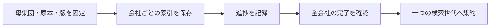

# 母集団全件の分割構築・再開・世代集約

固定した原本と会社集合から、検索データを会社ごとに構築します。途中で停止しても同じ計画から再開し、全会社の処理後に一つの世代へまとめます。

## 会社別の処理から一世代へ



`FinancialIndexBuild` は、母集団・原本アーカイブの指紋・cutoff・抽出版を固定し、会社ごとの[財務SQL索引](FINANCIAL_SEARCH_INDEX.md)をcheckpointして一つの検索世代へ集約します。状態形式は `FINANCIAL_INDEX_BUILD_VERSION = "1"`。

原本アーカイブ版1・財務索引版1の形式を変更せず、構築状態だけを別の専用SQLiteへ保存します。

計画の全会社を処理したことと、財務値が全社分揃ったことは別です。原本不在・基準不明・IFRS単体・context不在等は理由付きで保持し、正常値や0値へ変えません。

## 固定する入力

| 項目 | 意味 |
|---|---|
| `id` / `generation` | 構築ID / 集約後の検索世代ID。各1〜200文字の英数字・`_.:-` |
| `archiveSha256` | 停止した原本アーカイブをreadOnlyで開いたコピー全体のSHA-256 |
| `population` | asOf、実観測時刻、出典名/URL、sourceSha256、重複しないEDINETコード集合 |
| `options` | cutoff、必須extractorVersion、任意sourceCommit/明示duration明細 |

母集団は1〜100,000件です。コード集合は並び順に依存しない形へ固定し、空・重複・不正コードを拒否します。母集団の実観測がcutoffより後の場合や、基準日がcutoffの日本日付より後の場合は使用しません。現在の上場母集団を過去に既知だった集合へ遡及させません。

`ObservedFinancialArchive.snapshotSha256()` はreadOnlyの物理ファイルだけで利用できます。元アーカイブを停止し、更新しない別名のコピーを計画用入力として保持してください。

単なるcache追加でもDBのbyteが変われば、次の再開時に指紋不一致で停止します。同じbyte列の別パスへのコピーは利用できます。

実行中はreadOnlyの私有コピーを読むため、入力の新旧を混在させません。新しい入力・cutoff・母集団・抽出版は別の構築ID/世代にします。

計画には索引形式版と抽出/対応表の版も保持します。途中で対応表版が変わった場合は会社処理を続けず、新しい計画を必要とします。source commitや出典hashは呼出元の宣言であり、署名認証や母集団そのものの真正性を保証するものではありません。

<a id="api"></a>

## APIの使い方

```ts
import {ObservedFinancialArchive, FinancialSearchIndex, FinancialIndexBuild} from "edinet-ts";

const source = new ObservedFinancialArchive("data/frozen-observed.sqlite", {readOnly: true});
const index = new FinancialSearchIndex("data/financial-index.sqlite");
const build = new FinancialIndexBuild("data/financial-build.sqlite");
try {
  build.begin({
    id: "listed-20261028", generation: "listed-20261028",
    archiveSha256: source.snapshotSha256(),
    population, // asOf / observedAt / source / sourceSha256 / edinetCodes
    options: {cutoff, extractorVersion, sourceCommit}
  });
  const progress = build.runNext("listed-20261028", source, index, {limit: 20});
  if (progress.pending === 0 && progress.failed === 0) {
    build.finish("listed-20261028", index);
  }
} finally {
  build.close(); index.close(); source.close();
}
```

`population` は確認した母集団を明示します。既存の `CompanyMasterSnapshot` を使う場合は、`queryCompanyMaster` でasOf/knownAt/listingStatusを検査したrowsからコード集合を作り、snapshotの観測時刻・sourceUrl/sourceSha256も引き継ぎます。

全コードの取得や「上場」の解釈をこの構築器が勝手に変更しません。

`begin` は同じ内容だけを再投入できます。構築IDが同じでも、指紋・母集団・世代名・cutoff・版・明示項目等が変われば上書きを拒否します。原本はメモリ/更新可能なアーカイブではなく、同じ指紋のreadOnlyファイルを使用します。計画optionsにedinetCodesを別途入れて母集団を狭めることはできません。

## checkpointと再試行

`runNext` の一回の処理数は1〜100社、既定20社です。未処理会社を先に選び、枠が残る場合に失敗会社を再試行します。各社では親子関係を含むアーカイブの会社指定を使い、一回の原観測10,000件という既存上限に全母集団が引っかからないようにします。その会社の関連集合自体が上限を超える場合は失敗として残し、観測を黙って切り捨てません。

会社別世代IDは計画hashと会社から固定します。索引への保存と状態DBへのcheckpointは別transactionですが、索引が先にcommitされてcheckpointが失敗した場合も、同じ会社世代を同内容で再投入できます。部分的な索引書込はSQL索引のtransactionで戻し、全件保存済みの会社世代だけをcheckpointします。

状態DBは会社処理のtransactionでwriterを直列化します。途中でprocessが停止すれば、その会社の状態更新はSQLiteのcommit境界で反映か未反映となります。

未反映会社は次回に再実行します。試行回数は完了/失敗として記録した回数です。

live workerのleaseや稼働中フラグではありません。停止済みDBを前提とするファイル保護と、同一内容の冪等再投入を使います。

処理失敗は `status:failed / lastErrorCode:company-materialization-failed` として保持し、元の例外文や入力内容は保存しません。他社の処理は継続できます。原本不在や未確定等、アーカイブが正常に返す保留は「機械的な処理失敗」ではなく、会社別世代の診断です。

`progress(id)` は計画と全会社の状態、pending/failed/completed、会社別世代ID/hash、行数、選択書類数、原本不在/未確定等の件数を返します。`companiesWithRows` は索引行を一つ以上作れた会社数で、必要指標が全て採用された会社数ではありません。

原本・状態・索引を別パスへ移動しても、同じ入力と会社別世代を保つ場合は利用できます。欠落した別の索引DBを完了済みとすることはできません。

## 全件集約と旧世代

`finish` は全会社のcheckpointがcompleteであることを必要とします。会社別世代のhash、所有会社、cutoff、抽出/対応表版を計画と照合してから、全母集団を一つのSQL検索世代へ集約します。親子検査のため複数会社で読んだ同一観測は同一内容だけを重複除去し、矛盾する観測/財務行は拒否します。訂正差分と親の財務値は合成しません。

訂正原本の扱いは、[金融庁のEDINETタクソノミ概要説明（2025年11月）](https://www.fsa.go.jp/search/20251111/1b-1_GaiyoSetsumei.pdf) 2-1-5/2-1-5-1（本文24〜25頁）も参照してください。本文全体がiXBRL対象の様式と財務本表だけが対象の様式では、添付が必要になる条件が異なり、縦覧終了後などはXBRLのない訂正もあります。現在の採用対象は選択済み原本の直接値で、消えた科目を親から補う根拠にはしません。

同資料の訂正区分では、記載内容も変更する場合の `ReportAmendmentFlagDEI` と、記載内容を変えずXBRLだけを直す `XBRLAmendmentFlagDEI` を区別します。後者がfalseでも、数値が不変という意味ではありません。`AmendmentFlagDEI` は訂正有無の別項目です。表紙の提出日は当初日を残す場合があるため、訂正の提出時点・利用可能時点を表紙日だけから決めず、公式一覧の観測と実取得時刻を保持します。複数の訂正枝も、提出日時だけで優先順位を推定せず未解決を保持します。

集約先の `FinancialIndexGeneration.assembly` に、計画hash、原本指紋、母集団、全会社別世代のID/hashを保持します。一回の会社数に関係なく、完成後は一つのgenerationで通常のSQL検索ができます。会社別世代も削除しません。

集約先の書込は一transactionです。状態DBの完了markerは集約索引のcommit後に保存します。

途中停止でmarkerだけ未反映となった場合も、同じ集約内容を再確認してfinishを再実行できます。`finished:true` は状態DBに完了証跡があることです。

progress単独で外部の索引ファイルの現在状態まで監査する意味ではなく、finishは提供された索引の実データを再検証します。

新しい原本/訂正・取下げ観測は、新しい入力指紋・計画・世代で処理します。古い世代を上書きせず、旧generationを明示した検索へ戻せます。稼働サービスのactive世代やcronをこのAPIが自動切替することはありません。

<a id="cli"></a>

## CLIで実行する

```sh
edinet-ts plan-financial-index-build --state data/build.sqlite \
  --archive data/frozen-observed.sqlite --population population.json \
  --id listed-20261028 --generation listed-20261028 \
  --cutoff 2026-10-28T23:59:59+09:00 --extractor-version pinned-extractor-1

edinet-ts run-financial-index-build --state data/build.sqlite \
  --archive data/frozen-observed.sqlite --db data/index.sqlite \
  --id listed-20261028 --limit 100

edinet-ts financial-index-build-progress --state data/build.sqlite --id listed-20261028

edinet-ts finish-financial-index-build --state data/build.sqlite \
  --db data/index.sqlite --id listed-20261028
```

`population.json` は上記population object、2MiB以下です。planでは入力宣言を検証してから固定原本の指紋を取得します。

runはcheckpointと原本指紋を検証し、会社ごとの状態をJSONで返します。pendingが残っていても失敗がなければ終了0、会社失敗があればJSONを保持して終了1です。

finishはpending/failedが一つでもあれば拒否します。条件/DB/指紋の不正等は入力内容を表示せず終了1です。

進捗CLIは状態DBの私有コピーをreadOnlyで読みます。

## 再構築済みの日次候補をまとめて構築する

`build-prepared-financial-cycle.mjs` の `--max-batches`（既定1、1〜100）で、1〜100社のbatchを同じarchive/state/index接続で反復できます。日次入口の上限は100社×10batchです。呼出元は全batch終了まで同じ排他を保持します。入力指紋・容量をbatchごとに確認し、signalは会社commitの境界で処理します。従来の会社checkpointを維持するため、停止後の再開で処理済み会社を再取得・再構築しません。


通常の日次入口 `scripts/roadmap/run-daily-financial-preparation.mjs` も、取得完了後の構築を一回100社で区切ります。101社の合成母集団で、実際の二重ロック下のCLIが100社で部分終了し、次の呼出しで残り1社を同じ入力指紋・同じ構築recipeのbyte列で完了することを確認しています。ライブラリAPIの既定20社は維持します。CLIの終了0だけで完了とせず、`status` と残件数を確認してください。既に凍結した候補は、その入力に固定したruntimeで再開します。

`scripts/roadmap/build-prepared-financial-cycle.mjs` は、再構築receiptがある固定候補の索引を進めます。一回の上限は既定100社、指定可能な範囲は1〜100社です。同じSDK・構築script・固定configを使い、処理社数だけを引数で変えるため、既存の入力指紋と会社別checkpointを引き継げます。品質集計は公開承認とは別です。

呼出元が既存runnerと同じ順序で、候補ルートとmetadata checkpointの排他を保持します。`--locked` 自体はロックを取得しません。

```sh
flock -n -E 75 --close "$CYCLE_ROOT.lock" \
  flock -n -E 75 --close "$METADATA_CHECKPOINT.lock" \
  node scripts/roadmap/build-prepared-financial-cycle.mjs \
    --config "$PREPARED_CYCLE_CONFIG" --max-companies 100 --locked
```

再構築前の候補や上限外の指定は拒否します。途中結果は `partial`、全社集約後は `built` を返します。終了コード0だけで全社完了とは判断せず、`status` と残件数を確認してください。公開catalogの切替は行いません。

## 集約世代だけを利用側DBへ出力する

`FinancialSearchIndex.exportGenerationTo(generation, targetIndex)` は、assemblyのある集約世代を空の別専用DBへ出力します。出力先も通常の `FinancialSearchIndex` で、世代ID・指紋・来歴・品質・検索結果を保持します。会社別世代は出力せず、元の構築DBと会社checkpointは再開・監査用に残します。

```ts
const source = new FinancialSearchIndex("data/build-index.sqlite", {readOnly: true});
const target = new FinancialSearchIndex("data/reader-candidate.sqlite");
try {
  source.exportGenerationTo("listed-current", target);
} finally {
  target.close();
  source.close();
}
```

既存内容のある出力先、同一DB、未集約の会社別世代は拒否します。転送途中の失敗では出力先の全転送をrollbackします。出力は公開切替ではありません。読取DBの交換とreader再ロード・旧ファイルへの切戻しを検証したうえで、正式な切替手順を使います。元DBや旧読取DBの削除は行いません。

## 実母集団での確認と残工程

既存の公式コードリストsnapshot（asOf 2026-10-27）の上場3,813社と、原観測5,911件/保存原本4件を持つ固定アーカイブで確認しました。13社で状態/索引を閉じた後に再開し、100社ずつで全3,813社を完了、会社別3,813世代から一世代へ集約しました。

失敗0、行を持つ会社4、財務行8、原本不在等の選択1,264件です。全市場の財務取得完了という結果ではありません。

母集団は現在の上場集合であり、2025年当時の市場集合ではありません。

独立SQLite/JSON処理で母集団コード・全3,813 checkpoint・計画/会社別世代/集約markerのhashと来歴を検査し、80検索が直接構築した参照世代と一致しました。原本アーカイブのbyte不変、source/built・CLIでの計画/完了後run/finish再投入、CommonJS、配布物のNodeNext型検査も確認しています。

新規API取得/課金はありません。

合成試験では、原観測10,002件からの会社別構築、失敗後再試行、checkpoint/完了markerの書込中断、指紋差替え拒否、訂正後の別世代と旧値保持、他社を名乗る訂正の重複診断、全母集団が揃わない集約の拒否を確認しました。

取得対象の差分計画と再開可能なネットワーク取得、全市場/全年度の実際の原本取得・充足率、比率/他指標・他領域の索引、本番の公開切替/運用・旧DB移行・利用先反映は、全体ロードマップの残工程です。

## 取得対象全件を使った追加検証（2026-10-29）

> 以下は各検証を実施した時点の記録です。件数・配布先・未確認範囲を含めて読み、現在の稼働状態とは分けてください。

固定した現在上場3,813社/原観測5,911件から計画した1,268書類の取得が全件完了しました。最終原本指紋を照合した別の固定コピーを使い、取得後cutoff `2026-10-28T16:19:58.834Z` で全3,813社を構築・集約しました。

会社処理の失敗0、行あり1,172社・2,526行、採用値あり1,156社です。元の一覧窓に選択書類がない2,636社、親不明62系列、未対応US GAAP4原本、証券コードなし1原本を分離して保持します。

独立SQLite/JSON処理で世代/全行hash、母集団・書類・会社数、16 cohortと全指標別の状態が一致。値は採用6,211・欠損252・曖昧89・非対応/unsafe各0でした。これは保存した一覧窓の選択原本が全件揃った検証です。全市場/全年度のデータ充足や全採用値のPDF照合、公開条件の通過とは区別し、公開catalogは切り替えていません。

### 固定コピーの指紋再利用

readOnlyの私有コピーでは、初回に全byteをhashし、その後はdevice/inode/size/mtime/ctimeの一致を確認して同じSHA-256を再利用します。私有コピーの書換え・差替え・切詰めやリンク追加/差替えを検出すると停止し、異なるファイルのhashへ自動更新しません。

新しい元DBを使う場合は、readOnlyを新しくopenして新しい構築計画を作ります。同じreadOnlyをopenしたまま元DBが変わっても、既存の私有コピーに変更を混ぜません。

実5,197,045,760 bytesの固定アーカイブで、旧実装の反復3回は約17.1〜22.0秒、変更後は初回約21.4秒・反復約0.024〜0.062msでした。両実装の全hashは完了時指紋と一致し、元ファイルのmetadataも不変。

全社構築全体を再測定した速度ではありません。変更/リンク/close/書込用DBの拒否を含む8テストを追加し、全133ファイル/3,638テスト・型・buildが成功しました。

この最適化は固定配布物53eb2adの後のローカル変更です。

採用値の原XML追跡も追加検証しました。全1,263採用書類・6,211値（BS3,655/明細2,556、日本基準5,613/IFRS598）について、別実装のXML処理で原本SHA、namespace付きタグ、原値/精度、context/entity、期間・範囲・JPY単位が一致しました。

採用値の原XML出典の照合であり、全値のPDF照合・全候補の選択正当性や未対応基準の保証は別です。
