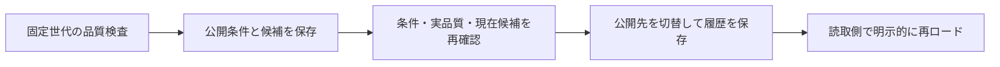

# 品質条件付きの財務世代切替と復帰

品質を確認した検索世代を公開候補として保存し、指定した操作で公開先を切り替えます。旧候補へ戻すときも、品質の再確認と切替履歴を残します。

## 候補保存と公開切替は別操作



`FinancialIndexPublication` は、[固定財務世代の品質](FINANCIAL_INDEX_QUALITY.md)と公開条件を候補へ固定し、明示操作で公開pointerを切り替える専用catalogです。`FINANCIAL_INDEX_PUBLICATION_VERSION = "1"`。

既存の原本/索引形式版1や従来の明細世代Storeを変更せず、サービスや利用先vendorを自動更新しません。

## 候補と既定条件

`prepare(id, index, generation, policy?)` は、[母集団全件の分割構築](FINANCIAL_INDEX_BUILD.md)でassemblyを持つ世代だけを受け付けます。全本文/値索引の品質を検査し、世代・原本・構築計画・品質の指紋、母集団/quality、policy、条件違反を保存します。

候補を保存する操作では公開pointerを変えません。同じID/内容は再投入できますが、世代や条件を上書きできません。

既定policyは次の8条件です。条件未達の候補も `eligible: false / violations` 付きで保存し、確認できます。

| 条件 | 既定値と数え方 |
|---|---|
| `minimumCompaniesWithUsableValues` | 固定母集団の会社数。各社に保存projectionの利用可能値が一つ以上必要 |
| `maxUnavailableSources` | 0。選択原本の不在/時刻/hash/parse等の利用不可書類数 |
| `maxUnresolvedSelections` | 0。訂正系列等の書類選択が未解決の件数 |
| `maxUnavailableSelections` | 0。取下げ/非開示/通知等で選択利用不可の件数 |
| `maxUnresolvedRecords` | 0。原本からの基準/範囲等の結果が未解決の書類数 |
| `maxUnavailableGroups` | 0。作れなかったgroup別の書類数 |
| `maxDuplicateCohortIdentifiers` | 0。各cohort内の重複EDINETコード数と重複証券コード数の合計 |
| `maxUnavailableValues` | 0。保存値の欠損/非対応/曖昧/unsafe件数の合計 |

書類系列の件数は品質の `selectionDecisions` から取り、解析結果の未解決と分けます。関連する系列で会社所属が未確定でも、黙って無視しません。policyを明示する場合は8項目すべてを0以上の安全な整数で指定します。条件を変更する場合は新候補IDにし、どの条件で採用したかを残します。

このpolicyは保存した対象/projectionの条件です。必要年度・cohort・一覧窓の網羅、未指定の主要21指標や全形式、過去の市場母集団、原本の真正性、投資判断の適切さを保証しません。限定母集団での成功を全市場公開の承認へ読み替えません。

## 明示切替と旧候補への復帰

```ts
import {FinancialIndexPublication, FinancialSearchIndex} from "edinet-ts";

const catalog = new FinancialIndexPublication("data/publication.sqlite");
const index = new FinancialSearchIndex("data/financial-index.sqlite", {readOnly: true});
try {
  const candidate = catalog.prepare("candidate-1", index, "listed-current");
  if (candidate.eligible) {
    const previous = catalog.current()?.id ?? null;
    catalog.activate(candidate.id, index, {expectedActive: previous});
  }
} finally {
  index.close();
  catalog.close();
}
```

`activate` は候補が条件を満たすことと、実索引の全品質が保存候補に一致することを再検査します。その後の一transactionで、確認した `expectedActive` と現在pointerが同じ場合だけ切り替え、連番/直前候補/切替先を履歴に追加します。

初回は `expectedActive: null`。他の処理が切り替えていれば拒否し、後勝ちで上書きしません。

旧候補へ戻す場合も、旧世代を保持した索引を渡し、同じ `activate` で現在候補を `expectedActive` に指定します。旧世代は削除せず、復帰も新しい履歴へ残します。同じ現在候補へ同じ期待値で再投入した場合は履歴を増やしません。pointer書込に失敗すると、その回の履歴追加も全体rollbackします。

候補・履歴のrecord hash、履歴の連続性・前後関係、pointerとの一致を検査します。条件未達、違う索引、本文破損、壊れた履歴/pointerを正常な公開結果へ変換せず、古い候補へ自動fallbackしません。副ファイル/未知形式/リンクの既存専用DB保護を共有し、外部SQLでhashまで作り直す改竄の認証を行いません。

## 読取側の確認

`current()` はcatalogの現在候補と履歴の整合を確認するmetadata読取です。実索引まで検査する場合は `resolve(index)` を使います。

指紋/品質が一致した候補の `generation` を通常の `index.screen` へ渡せます。全品質の検査は重いため、読取snapshotのロード/再ロード時に確認し、同じ固定snapshotで検索を続ける使い方を想定します。

readOnlyのcatalog/索引は既存と同じ私有コピーであり、外部更新を追随しません。切替後の新候補を見る読取側は再読込します。既存の読取snapshotは旧世代を保持します。候補に保存するのは世代/品質の指紋で、索引ファイル全体の指紋ではないため、同じDBに新しい不変世代を追加しても旧候補の復帰を妨げません。

<a id="cli"></a>

## CLIで実行する

```sh
edinet-ts prepare-financial-index-publication --catalog data/publication.sqlite \
  --db data/financial-index.sqlite --generation listed-current --id candidate-1

edinet-ts activate-financial-index-publication --catalog data/publication.sqlite \
  --db data/financial-index.sqlite --id candidate-1 --expect-none

edinet-ts financial-index-publication-status --catalog data/publication.sqlite \
  --db data/financial-index.sqlite

# 旧候補へ復帰
edinet-ts activate-financial-index-publication --catalog data/publication.sqlite \
  --db data/financial-index.sqlite --id candidate-1 --expected-active candidate-2
```

prepareの `--policy` は2MiB以下のJSON。省略時は上の既定条件です。

条件未達でも候補保存が正常なら終了0なので、`eligible / violations` を確認します。activateは `--expect-none` と `--expected-active` のどちらか一つが必須。

条件/品質/期待値が不一致なら内容を表示しないstderrと終了1です。

statusはreadOnlyで `active / indexVerified / history` を返します。`--db` 省略時はmetadataだけで、`indexVerified: false`。

指定時は実品質を再照合します。これらはローカルcatalogの操作で、systemd・本番サービス・stock-dataの切替を実行するものではありません。

## 実世代の確認と残工程

当初4原本の3,813社世代は、利用可能値を持つ会社4・原本不足1,264・未解決系列62で、既定条件により候補保存のみとなり公開を拒否しました。別の限定4社/5実原本では25値がすべて採用され、既定条件を満たす2世代を別DBに作成。

CLIで旧→新、APIで新→旧と切り替え、履歴3件と現在pointer、source/built・CLI/CJS、NodeNext型検査を確認しました。本番サービスは変更していません。

試験は8条件の実世代からの検出、系列だけ未解決/利用不可でも拒否すること、期待値の競合、pointer書込失敗の履歴ごとrollback、再読込/readOnly、未知/壊れた候補・履歴/pointer、旧世代復帰を含みます。全市場の必要期間・原本/指標充足、業務上の公開条件、本番/利用先へのロード・定期切替は残工程です。

独立SQLite/JSON処理でも候補/品質/世代/構築計画の指紋、8条件の判定、履歴3件の前後関係と現在pointerが一致しました。全130ファイル/3,623テスト、ビルド、公開型・配布物NodeNext型検査、認証値混入の非表示検査が成功しています。

公開候補を読取側へロードし、世代を固定して検索/明示再ロードする入口は、[公開snapshotの財務検索](PUBLISHED_FINANCIAL_INDEX.md)を参照してください。
