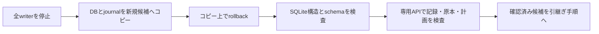

# 停止した専用DBのhot journal復旧

停止した専用DBとrollback journalをコピーし、元ファイルを残したまま復旧候補を作ります。SQLiteの構造を確認した後、各APIで保存内容を再検査します。

## 復旧候補を作ってから内容を検査する



`recoverDedicatedSqliteSnapshot` / `recover-sqlite-snapshot` は、停止したDBと同名の `-journal` をコピーし、SQLiteのrollbackを新規の私有候補で行います。元ファイルを削除・書き換えず、既存の出力directoryも上書きしません。

SQLiteは未完了の書込みをrollback journalから戻します。復旧に必要なjournalを先に削除すると、元の状態へ戻せなくなる可能性があります。

[SQLiteの復旧手順](https://www.sqlite.org/lockingv3.html)、[journalを失う場合の説明](https://www.sqlite.org/howtocorrupt.html#_deleting_a_hot_journal)を参照してください。

<a id="api"></a>

## APIの使い方

```ts
import {recoverDedicatedSqliteSnapshot, FinancialSourceJob} from "edinet-ts";

// 全writerを停止して、DBとjournalのSHA-256をそれぞれ固定します。
const result = recoverDedicatedSqliteSnapshot({
  source: "stopped-state.sqlite",
  outputDirectory: "recovery-attempt-1", // まだ存在しないdirectory
  kind: "financial-source-job",
  databaseSha256,
  journalSha256,
});

// 構造の検査と、アプリケーションの全record検査は別です。
const state = new FinancialSourceJob(result.output.path, {readOnly: true});
try {
  const progress = state.progress(jobId);
  // 期待するplanSha256・全task/試行履歴・原本との対応を照合します。
} finally { state.close(); }
```

対象は `DedicatedSqliteRecoveryKind` に含まれる専用形式です。各クラスの固定schema/kindを検査します。主な対応は次のとおりです。

| kind | クラス |
|---|---|
| `observed-financial-archive` | `ObservedFinancialArchive` |
| `financial-source-job` | `FinancialSourceJob` |
| `financial-index-build` | `FinancialIndexBuild` |
| `financial-search-index` | `FinancialSearchIndex` |
| `financial-index-publication` | `FinancialIndexPublication` |
| `company-master-store` | `CompanyMasterStore` |
| `corporate-registry-store` | `CorporateRegistryStore` |
| `corporate-registry-block-store` | `CorporateRegistryBlockStore` |
| `large-holding-store` | `LargeHoldingStore` |
| `facility-detail-store` | `FacilityDetailStore` |

## 検査と保存する証跡

入力は単一リンクの通常ファイルに限り、symlink/hardlink、WAL/SHM付き、DBとjournalの合計32GiB超を拒否します。両ファイルを開いたまま、inode・サイズ・mtime/ctimeとパスを照合し、コピー時と復旧後の再読で指定SHA-256との一致を検査します。

圧縮法人番号の `corporate-registry-block-store` はDB本体640 MiB超をコピー前に拒否します。復旧後は `CorporateRegistryBlockStore.audit(fileId)` 等で全原記録を検査してください。復旧receiptの `applicationRecordsValidated` は引き続き `false` で、SQLite/schema検査だけを原値の照合済みへ読み替えません。

全writerの停止は呼出元の前提です。稼働DBのオンラインbackupや、ロック解除を行うAPIではありません。

journalは[公式ファイル形式](https://www.sqlite.org/fileformat2.html#the_rollback_journal)のページ/sector/元ページ数・複数区画・各recordのページ番号とchecksumを検査します。同期済み区画の後の未同期headerはSQLiteと同様に採用せず、宣言されたrecordの欠損やchecksum不一致は停止します。

重複ページの検査はページ数に対応するbitmapを使い、上限内では約8MiB以下です。内容のコピーとSHA-256は1MiBのbufferで順次処理します。

別DBを参照するsuper-journalの末尾magicを持つ入力は、SQLiteで開く前に拒否します。外部パスを含むjournalをコピー先から再生しないためです。

これは[SQLiteのsuper-journal処理](https://www.sqlite.org/lockingv3.html#the_rollback_journal)を含む複数DB transactionの復旧を行う機能ではありません。

コピー上の `integrity_check(1)` が `ok` で、復旧後サイズがjournalの元ページ数と一致し、固定schema/kindも一致した場合にだけ、`recovered.sqlite` と `manifest.json` を残します。manifestは両入力のパス/byte数/SHA-256、journal区画/record数、出力の指紋、SQLite版と検査範囲を記録します。

出力DBとmanifestを同期し、manifestは一時ファイルからrenameします。通常の失敗では自作の候補directoryを片付けます。

処理自体が強制終了した場合、manifestのない未完了directoryが残り得ます。

`applicationRecordsValidated` は **false** です。SQLiteの構造検査だけで、財務値・履歴・原本hash・公開条件が正しいと扱いません。

各専用APIで全recordと固定計画/原本を照合してから、検証済み候補として既存の世代切替手順へ渡します。現在のruntimeを自動停止・切替する処理は含みません。

元DB/journalは照合・再試行のため保持します。

<a id="cli"></a>

## CLIで実行する

```sh
# writer停止後に取得した両指紋を指定
edinet-ts recover-sqlite-snapshot \
  --source stopped-state.sqlite \
  --output-directory recovery-attempt-1 \
  --kind financial-source-job \
  --database-sha256 <DBのSHA-256> \
  --journal-sha256 <journalのSHA-256> --pretty
```

成功時だけ復旧manifestをJSONで返し、失敗は終了1と内容非表示のエラーです。再試行には別の新規directoryを指定します。従来の専用DBコンストラクタは副ファイルを引き続き拒否し、復旧を暗黙に実行しません。

## 検証と境界

> 以下は各検証を実施した時点の記録です。件数・配布先・未確認範囲を含めて読み、現在の稼働状態とは分けてください。

合成DBへ同期ありの書込みを行い、cacheからspillした後の子processをSIGKILLしました。複数journal区画から復旧したDBはtransaction開始前の全byteと一致し、元のクラッシュ状態のDB/journalも全byte不変です。

取得状態DBでは完了・失敗・未処理のcheckpoint/全履歴を復元し、残件からの再開と最終原本照合まで検証しています。初期の6形式でchecksum/欠損/ページ異常・指紋違い・super-journal・WAL/SHM・リンク・既存出力先を試験し、その後に法人番号・大量保有・設備・圧縮法人番号の固定形式も追加しました。圧縮法人番号では復旧後の原本監査と追加入力まで確認しています。

この検証は電源断や全てのディスク故障の再現ではありません。WAL、ATTACHでの複数DB transaction、破損したDB header、既に欠けた元ページ、同期済みrecordが壊れたjournalを修復したとは扱いません。元のメタデータDBや旧BS/明細Storeは、このAPIの復旧対象ではありません。

実状態の私有コピーでの追加検証: 停止済み旧取得状態（7,337 task・2,939試行履歴、完了2,931）を別ファイルへコピーし、16 taskの未commit更新をspillしてSIGKILLしました。復旧後の物理SHA-256は元状態の `65409dfc7d39949d6a79585c829e0e911b396edf03a3a4dfc9db1e637f2193b6` と一致し、`FinancialSourceJob.progress` による全計画/task/履歴も完全一致しました。

元の旧状態とクラッシュした試験入力は不変です。この検査では履歴に残る旧running markerを実processの稼働証拠には使わず、旧unit停止を確認しています。

試験記録は私有 `data/roadmap/real-state-recovery-proof.json` に保持します。

取得状態の復旧後は、[`FinancialSourceJob.audit` / `audit-financial-source-job`](FINANCIAL_SOURCE_JOB.md#復旧候補未完了checkpointの再開前監査) で期待計画・停止原本と全task/履歴を照合できます。一般の復旧manifestにある `applicationRecordsValidated: false` を書き換えず、指定jobの監査結果を別の証跡として保持します。

結果の状態指紋が復旧manifestの出力指紋と一致することを確認し、新しい固定実行configへ渡します。財務値/公開条件の検査は引き続き別工程です。

## 解析済みStore/JobとDuckDB作成経路

`kind: "parsed-financial-store"` と `kind: "parsed-financial-job"` を追加した。汎用API/CLIは従来どおり私有コピーだけを復旧し、`applicationRecordsValidated: false` を返す。結果のStore.page/get、Job.plan/progressで内容を再検査する。

DuckDB作成経路には、候補・共有Storeの排他下で全レコード検査と退避を済ませて管理DBを復旧する別の内部処理を追加した。cold/空journalと新規schema初期化の扱いを含め、[強制終了復旧仕様](DUCK_FINANCIAL_RECOVERY.md)を参照する。これは任意の原本DBを自動書換えする処理ではない。
