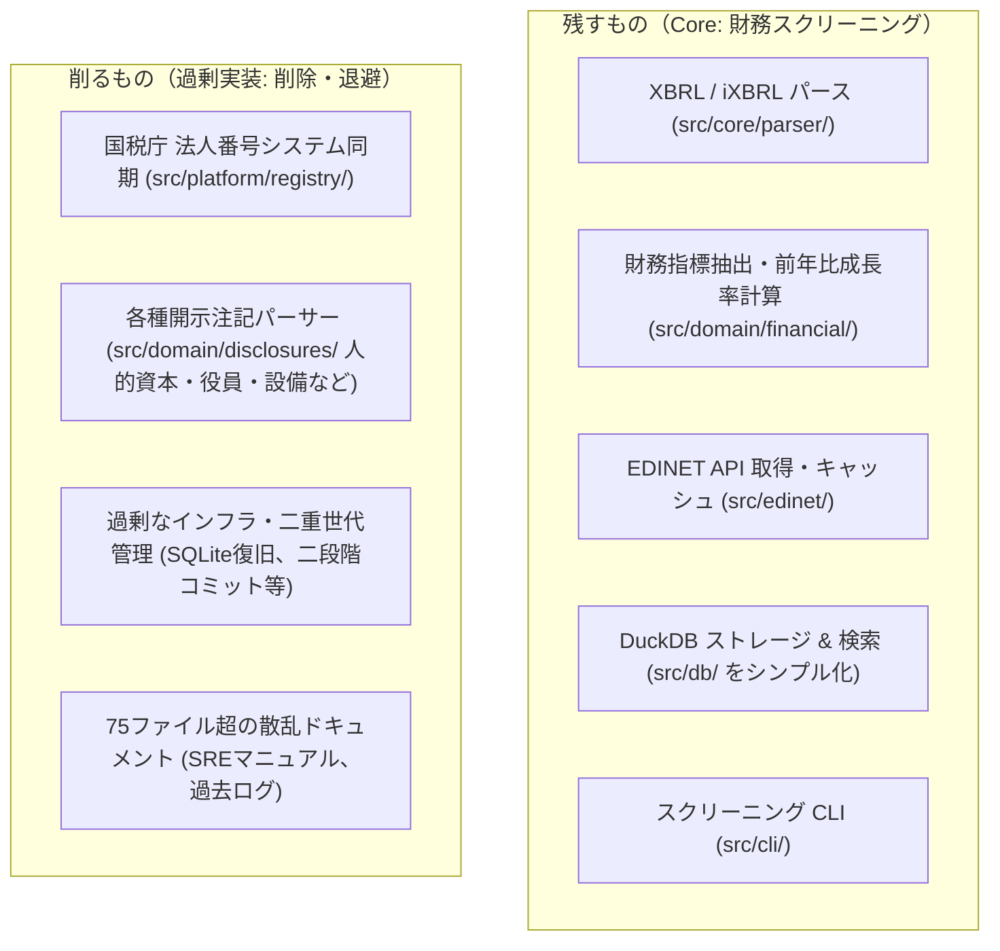

# コア機能特化に向けたスリム化計画（アプローチA）

**作成日**: 2026-11-03

**目的**: 本来のゴールである「**前年より利益率が20%伸びた企業を利益率順に抽出（スクリーニング）する**」に機能を絞り込み、過剰実装された周辺機能とドキュメントを大幅に削ぎ落としてコードベースの可読性・保守性を劇的に向上させる。

---

## 1. 残すもの（Core） vs 削るもの（Prune）



### 残すもの（コア機能）

1. **XBRL / iXBRL パーサー (`src/core/parser/`)**:
   - 売上高・営業利益・純利益・資産・資本等を正確に読み取るXML解析処理。
2. **財務抽出・成長率計算・スナップショット (`src/domain/financial/`)**:
   - 連結/単体、決算期、会計基準（日本基準/IFRS）を正しく揃えて指標を抽出。
   - 当期と前期の数値を突合し、「売上成長率」「営業利益率」「利益率成長率」を計算。
3. **EDINET API 連携・キャッシュ (`src/edinet/`)**:
   - EDINETから有報原本（XBRL ZIP）をダウンロードし、ローカルに保存。
4. **検索・保存ストレージ (`src/db/`)**:
   - **DuckDB 1本に統一**。SQLiteとの二重管理や複雑な世代管理カタログを全廃し、抽出データを DuckDB テーブルに書き込んで SQL で一発検索・ソートできるようにする。
5. **スクリーニング CLI (`src/cli/`)**:
   - `edinet-ts parse`: 単一ファイルの解析
   - `edinet-ts download`: 書類取得
   - `edinet-ts screen`: 条件スクリーニング（「利益率伸び率 >= 20%」「ORDER BY 営業利益率 DESC」等）

---

### 削るもの（削除または退避）

1. **国税庁 法人番号公表サイト連携 (`src/platform/registry/` 全14ファイル)**:
   - 全国580万法人の全件取込、日次差分ZIPダウンロード、GPG署名検証、XMLストリーミングを全廃。
   - 代替: EDINETの提出者一覧および証券コードマッピングのみで企業を特定。
2. **過剰な開示情報パーサー (`src/domain/disclosures/` 全20ファイル)**:
   - 人的資本（育休・男女賃金格差）、役員報酬、監査報酬、設備地番、主要顧客、受注、政策保有株、大量保有報告を全廃。
3. **過剰な高可用性インフラ・二重世代管理 (`src/db/`, `src/platform/pipeline/`)**:
   - `sqlite-recovery.ts`, `financial-index-publication.ts`, `financial-detail-generations.ts` 等のSRE級の運用機構を削除。
   - DuckDB への直接書き込みとシンプルなファイル更新に一本化。
4. **散乱したドキュメント（75ファイル以上 → 4ファイル程度へ圧縮）**:
   - `docs/pipeline/`（約30ファイルの運用マニュアル）
   - `docs/history/requests/`（プロンプト生ログ `REQUESTS_*.md`）
   - 一過性の完了報告、ベンチマークログ

---

## 2. 目指すシンプルな構造

### ディレクトリ構造

```
src/
├── xbrl/              # XBRL/iXBRLパーサー (XML解析・Context・Unit)
├── edinet/            # EDINET API連携・書類ダウンロード・キャッシュ
├── financial/         # 財務指標抽出・前期比較・成長率計算
│   ├── extraction/    # 財務指標タグ定義
│   ├── analysis/      # 成長率・利益率計算
│   └── screening/     # 条件絞り込み・ソート
├── db/                # DuckDB 保存・検索（シンプルに数ファイル）
├── cli/               # CLI コマンド
├── types/             # タクソノミ型定義
└── index.ts           # 公開API（シンプルに厳選）

docs/
├── README.md          # 概要・使い方
├── QUICKSTART.md      # スクリーニングの実行例・SQLクエリ例
├── METRICS.md         # 対応財務指標一覧
└── ARCHITECTURE.md    # パースからDuckDB格納までの設計概要
```

---

## 3. 安全な実施手順（3ステップ）

### Step 0: 現状のバックアップ退避

作業前に現在の状態を退避ブランチ（例: `backup/full-featured-before-trim`）として作成・保存する。必要なコードや過去の調査結果はいつでも参照可能にする。

### Step 1: ドキュメントの大掃除（Doc Sprawl解消）

1. `docs/history/requests/` や不要な完了ログ、不要なマニュアルを削除。
2. ドキュメントを「クイックスタート」「指標定義」「シンプルな設計図」の数点に統合。

### Step 2: 過剰機能のコード・テスト削除

1. `src/platform/registry/`（国税庁）および関連テストを削除。
2. `src/domain/disclosures/`（各種開示注記）および関連テストを削除。
3. `src/db/` のリカバリ・二重世代管理・カタログ切替関連コードを削除し、DuckDB 1本に整理。

### Step 3: 公開API・ビルド・テストの正常化

1. `src/index.ts` をスリム化（コアな財務スクリーニングAPIのみエクスポート）。
2. 残したテスト（財務パース、成長率計算、スクリーニング）を実行し、全件パスを確認。
3. `pnpm run build`、`pnpm run lint`、`pnpm run format:check` をパスさせる。
