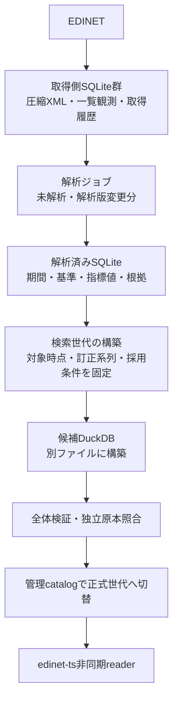

# 取得用SQLite・検索用DuckDBへの改善実装計画

作成日: 2026-10-31

状態: P1〜P6を実装・限定検証済み。P0の技術受入基準は固定。P7の全社・日次・配布・利用先移行、P8の旧データ整理は継続。本番切替は未実施。

本書をこの構成変更の計画・完了条件・進捗の管理先とする。全体ロードマップの `IMPLEMENTATION_STATUS.md` とは別に管理する。既存の財務品質・訂正対象修正・固定配布物の作業は継続し、その成果を本計画へ取り込む。

## 1. 決定する構成と目的

取得・原本保管・解析結果の蓄積にSQLite、検証済みの検索・分析にDuckDBを使う。通常の検索APIは解析済みテーブルを読み、XMLを解析しない。

| 目的 | 達成する状態 |
|---|---|
| 通常読取を軽くする | XML解析を読取経路から外し、世代全体の監査結果を安全に再利用する |
| 検索データを小さくする | 原本・会社別の構築途中データを検索用ファイルへ持ち込まない |
| 再解析を可能にする | 原本を保持し、原本hash・解析版・選択条件から解析結果を再現する |
| 日次処理を壊さず移行する | 取得系のSQLiteと既存の再開処理を維持し、新しい検索経路を段階導入する |

取得側SQLite群は論理上の保存領域を指す。初期実装では既存の原本DB・取得ジョブDBの固定schemaを変更せず、解析済みテーブルを専用の別SQLiteへ保存する。ファイルを1つに統合することは本計画の前提にしない。

正式世代の参照先・切替履歴を持つ管理catalogも当初はSQLiteを維持する。検索本体をDuckDBへ変更することと、管理用の小さなDBを移行することを分ける。

## 2. 判断の根拠と未確認事項

| 検証 | 確認結果 | 本計画への反映 |
|---|---|---|
| 取得用DB | DuckDBの容量削減は約4.8%。100原本保存はSQLiteの方が速い。双方のcommit前後の強制終了復旧は成功 | 原本・取得状態はSQLiteを維持 |
| 検索用DB | 同じ世代・manifest込みで144.33→12.01 MiB（約91.7%減）。索引構成の差を含む | 検索用DuckDBを実装対象にする |
| SQL集計 | 限定した集計でDuckDBが約3.6〜13倍速い | 分析SQLを対象に含めるが、全検索の高速化率へ流用しない |
| Nodeの検索処理 | 12ケースと件数境界3条件で戻り値一致。監査込みの速度はほぼ横ばい、最大RSSも約1 GiBで同程度 | 全体監査の再利用を別の改善として実装・測定 |
| 互換性 | 非同期化、SQLite固有SQL、catalogの具象クラス依存に対応が必要 | 既存同期APIを保持し、新しい非同期readerを追加 |

詳細: [検索・Node検証](DUCKDB_VALIDATION.md)、[取得用DB検証](DUCKDB_ACQUISITION_VALIDATION.md)。これらは限定した環境・データの結果であり、解析済みSQLiteの新schema、正式catalogとの接続、並行アクセス、長時間運転の完了を意味しない。

## 3. 保存モデルと処理単位

P1の実テーブル・解析キーは[版付き解析済みStore仕様](../pipeline/PARSED_FINANCIAL_STORE.md)で固定した。他の名称は設計上の仮称。既存の型・検査・来歴表現を優先して利用し、各工程のschema確定時に固定する。

| 保存先・役割 | 主な保存内容 | 識別・整合条件 |
|---|---|---|
| 既存原本SQLite | 圧縮XML、内容hash、原本観測・取得時刻、一覧履歴 | 元byte列・hash・観測時刻を保持。同一内容は共有 |
| 既存取得ジョブSQLite | 計画、対象書類、取得状態、試行履歴 | 既存checkpoint・未提供/失敗の区別を維持 |
| 解析済みSQLite：解析実行 | 書類ID、原本hash、解析版、対応表版、処理条件、成功/失敗 | 書類ID・原本hash・各版・正規化した条件から解析キーを作る |
| 解析済みSQLite：財務行 | 会社、書類、会計基準、連結範囲、通貨、期間・期間分類 | 解析実行に紐付け、異なる期間・scopeを別行にする |
| 解析済みSQLite：指標値 | 指標ID、検索用数値、原文字列、精度・単位、状態、理由、context等の根拠 | 原値を検索用浮動小数へ置き換えない。欠損・未対応・曖昧・安全範囲外・0を区別 |
| 解析済みSQLite：ジョブ | 計画、未処理/失敗/完了、再試行情報 | 原本単位で結果と完了状態を同じtransactionに保存 |
| 検索用DuckDB | 採用した財務行・指標値・必要な証跡、世代manifest | 入力、採用した解析キー、選択版、品質・検証記録を固定 |
| SQLite管理catalog | 正式候補、切替履歴、期待する直前候補 | 検証記録と一致する候補だけ切替。旧世代へ復帰可能 |

指標値は1指標1行を基本とする。追加明細の原文・構造など、数値表だけでは保持できない根拠は必要なJSON/原文として保持し、対応済みの情報を落とさない。

### 取得・解析・採用を分ける

1. 原本取得の保存を先に確定する。解析失敗でも原本は残す。
2. 解析ジョブがDB内の原本を読み、版付きの直接抽出結果を保存する。同じ解析キーの同じ内容は再利用し、異なる内容は上書きせず拒否する。
3. 解析結果は訂正系列の最終採用を意味しない。検索世代構築時に、固定した一覧観測・cutoff・原本利用可能時刻・訂正対象を照合して採用する。
4. 原本の直接抽出と、複数書類の訂正差分を合成する機能は区別する。現行が保証しない全文再構成を、本変更で暗黙に行わない。

XMLの内容に依存する判定・context等の根拠を解析済みテーブルへ残し、書類系列との照合はその保存結果と固定一覧から行う。必要な情報が足りない場合は、通常検索でXMLへ戻る代わりに解析版を更新して再処理する。

## 4. 実装段階と完了条件

P1〜P6は実装・限定検証済み。P0の技術受入基準は第7節で固定。P7の全社・日次・配布・利用先移行、P8の旧データ整理は継続する。段階ごとの現状・証跡・残件は第8節で管理し、限定検証だけで本番切替可能とは判断しない。

| 段階 | 作業・成果物 | 完了条件 | 依存・進め方 |
|---|---|---|---|
| P0 仕様と基準の固定 | schema、解析キー、時刻・状態・来歴、検索世代manifest、比較対象APIを定義 | 日本基準/IFRS、BS/PL/CF、訂正対象、失敗の具体例を仕様で表現できる | 現在進行中の抽出修正を反映する接続点を決める |
| P1 解析済みSQLite | 専用Store、原本単位のtransaction、版付き結果、読取・破損検査 | 値・原文・根拠が既存抽出結果と一致。再投入・内容競合・中断・再openを確認 | 別worktree・専用DBで並行可能 |
| P2 解析ジョブ | 既存パーサーへの接続、対象計画、未解析/解析版変更分の処理、checkpoint | 同じキーは再解析せず再利用。異なる版・条件は別結果。失敗後に原本再取得なしで再開 | 仕様・Storeは先行可能。抽出入口への接続は並行修正の固定後 |
| P3 DuckDB構築 | 解析済みStoreからの分割読取・一括転記、固定入力、構築manifest | XMLを読まずに構築。中断再開・再実行の同内容検査・全列一致を確認 | P1。初めは固定fixtureで独立実装 |
| P4 非同期reader | 検索・品質・世代読取、SQL差異の吸収、接続の再利用 | 既存APIと値・出典・診断・件数・順序が一致。入力不正・無制限・0件・offsetを検証 | P3。既存同期APIの戻り値は変えない |
| P5 snapshot検証再利用 | 初回の全体監査、検証済みsnapshotの保持、ファイル変更検出、返却値の検査 | 定常検索で全世代走査なし。置換・切詰め・破損を拒否。初回と定常の時間・RSSを別測定 | P4。現行SQLite側の改善とは効果を分けて比較 |
| P6 世代管理へ接続 | readerに必要な最小の共通契約、原本照合記録、candidate検査・切替・切戻し | 未検証・別候補・改変記録を拒否。新世代の読込失敗で旧snapshotを保持。実catalogで確認 | 並行中の原本照合gate・来歴修正が固定されてから統合 |
| P7 全社・日次・利用先移行 | CLI/export追加、SDK固定、stock-data等の利用先、取得→解析→構築→検証→切替 | 全社比較、翌日更新、停止再開、競合・容量保護、利用先の型/回帰/切戻しが成功 | P2〜P6と既存品質条件の達成 |
| P8 旧データ整理 | 旧検索SQLite、不要世代、検証コピー等の参照・保持一覧 | 正式世代と切戻し先を確認し、不要な恒常二重保存を解消 | 新経路の日次反復・復旧確認後。原本を削除対象としない |

## 5. 構築・読取・切替の運用

| 工程 | 実装方針 |
|---|---|
| 入力固定 | 一覧の末尾/指紋、原本の取得時点、対象会社、cutoff、解析版・条件・SDKをmanifestに保存する。後から取得が増えても構築入力へ混ぜない |
| 解析結果の固定 | 解析済みStoreの固定計画・結果指紋を取得する。稼働中DBを無保証に読み続けず、既存の停止済みコピー方式等を再利用する |
| 転記 | NodeからSQLiteの解析済み行を分割読取し、DuckDBへ一括保存する。BLOBや全結果をメモリへ一度に集めない。Parquet等の中間形式は実測で必要な場合だけ導入 |
| 原子性・再開 | 完了した分割単位とcursorを記録する。データcommit後にcheckpointが途切れた場合も、同じ入力を再投入して内容一致を確認できるようにする |
| 完了 | 件数・全列・論理的な内容指紋・品質・原本照合を検査し、候補を不変にする。異なるDBエンジン間で物理ファイルhashの一致は求めない |
| 読取 | 閉じた候補を検査して読取専用で開く。読取中は世代を固定し、明示reloadで新候補を検査する。検証キャッシュをmtimeだけで信用しない |
| 切替 | 管理catalogの期待する直前候補と照合し、品質・原本照合記録が入力/解析/世代に一致する場合だけ正式参照先を変更 |
| 復帰 | 新readerの構築完了まで旧readerを維持する。旧候補と対応するSDK・検証記録を組で保持し、戻せることを実証 |

「全件監査」は、移行・世代完成・初回読込で保存内容を一通り検査することを指す。通常検索で全XMLを展開したり、毎回原本を全件検査したりする設計にはしない。独立原本照合の証跡は、キャッシュの有無にかかわらず正式世代の受入条件として維持する。

## 6. 裏で進行している作業との分担

2026-10-31に確認した変更差分・計画記録に基づく。統合直前に再確認する。

| 既存作業 | 本計画で先に進める範囲 | 統合待ちの範囲 |
|---|---|---|
| 訂正対象の来歴修正・全体回帰 | 解析結果に必要な根拠・版の保存仕様 | `financial-reporting-basis.ts`、`observed-financial-snapshots.ts`の変更 |
| 全社再構築・品質調査 | 停止済みコピー・固定fixtureによる新Store/転記/reader検証 | 稼働入力、原state/index、既存worker・サービスの変更 |
| 原本照合gate・集約専用DB・接続共有 | 既存の成果を読む境界の設計、独立したDuckDB実装 | `build-financial-cycle.mjs`、検証器、日次制御の変更 |
| 分割・評価指標・法人番号保存 | 既存の抽出値を保存できるモデルの確認 | `src/cli.ts`、`src/index.ts`、固定配布物への反映 |

実装は専用worktree・専用の出力ディレクトリで行う。既存の3件のデータフロー改善を重複実装しない。P1〜P4の新規モジュールを先行し、P2の既存入口・P6・P7の共有ファイル変更を後で統合する。

同じホストでは容量・CPU・一時領域も共有される。既存の全社構築に容量停止の記録があるため、大容量コピーや全体テストは空き容量・実行中処理を確認してから行い、既存の容量guardを下げない。

## 7. 検証順序と受入条件

| 範囲 | 必須確認 |
|---|---|
| 小標本 | 日本基準/IFRS、BSと期間明細、複数期、連結範囲、訂正対象矛盾、欠損/nil/曖昧/安全範囲外。新しい保存経路と既存結果が全列一致 |
| 再解析 | 同じキーの再利用、版更新、条件変更、途中失敗、同一キーの異内容拒否。旧世代を変更しない |
| 全社 | 既存候補との値・来歴・診断・採用理由の差分を全件分類。意図した修正と移行による退行を分ける |
| 性能 | Nodeの接続開始・初回検証・定常検索・構築・更新を分離。反復値、RSS、ファイル/一時容量、条件を保存。DB変更と監査再利用の効果を分離 |
| 障害 | 解析/構築commit前後のSIGKILL、checkpoint間隙、二重起動、低容量、新世代の欠損/破損/指紋不一致、readerの失敗時維持 |
| 型・配布 | 同期APIの互換と新非同期API、CLI、ESM/CJS、固定package・利用先回帰、SDKとDB世代の組で切戻し |

速度・容量の過去倍率だけで受入れず、値と根拠の一致・品質条件を必須とする。性能の数値基準と必要な容量余裕はP0で同じ固定データと運用条件を使って定め、基準未達なら正式切替を行わず原因を調べる。

### 全社測定前に固定する性能・容量基準

以下は本移行の技術的な受入基準。利用先の業務SLAが別途定まった場合は、その条件も満たす必要がある。全社の完成結果を見て閾値を緩めない。基準を変更する場合は理由と旧基準での判定を残し、新しい固定条件で再検証する。

| 対象 | 基準 | 証拠・比較条件 |
|---|---|---|
| データ整合 | 未説明の値・根拠・採用・診断の差分0件。独立原本照合の不一致0件 | 全3,812社の直接抽出比較と同梱Python照合。既存の品質gateも通過すること |
| 検索ファイル容量 | DuckDBが同一集約世代のSQLiteの50%以下 | manifest・必要な証跡を双方へ含める。原本・会社別世代の削除による削減を含めない |
| 定常検索 | 12ケースのケース別中央値のDuckDB/SQLite比の中央値が1.10以下、各ケースは1.25以下 | 同一世代・同一条件・全結果一致。ウォームアップ1回、測定5回。検証結果を再利用するDuckDBと現行SQLite APIを比較 |
| 初回利用 | 接続から品質検査完了までがSQLiteの1.25倍以下 | 定常検索と分けて測定。最初の全体監査・私有コピーを含める |
| メモリ | DuckDBのprocess最大RSSが比較SQLiteの1.25倍以下 | 同じ固定ケースを独立processで実行。OSの最大RSSを使い、heapだけで判定しない |
| 日次処理 | 取得完了後の解析・構築・独立照合が24時間以内に完了し、翌日分を処理可能 | 実日次入力で連続2日以上。初回全件解析と差分更新の時間・cache再利用件数を別記録 |
| 容量保護 | 出力先と一時領域の双方で既存guard（34 GiB＋原本＋解析snapshot相当）を維持 | 構築前・分割処理中・snapshot確定時の確認、容量不足時の停止・再開。原本/旧正式世代の削除で押し通さない |

容量・時間・RSSはローカルの同じ保存条件とSDKで比較し、競合する大規模処理がない状態で最終測定する。NASを一時領域に用いた今回の再開は全件の整合性検証へ利用できるが、上記のローカル性能受入とは区別する。定常検索で初回監査再利用の効果とエンジン差を混同しないため、毎回監査するDuckDBの測定も併記する。12ケースは最大1,000社の固定cohort検索であり、全社の任意クエリや並行負荷の保証へ広げない。

数値判定は `python3 scripts/evaluate-duck-financial-performance.py <reader/summary.json>` で再現する。12ケース×5測定・3モード・結果一致を検査し、欠落・重複・非有限値を拒否する。数値条件をすべて満たす場合はexit 0、未達の場合はexit 1とし、判定JSONは双方で出力する。出力は数値条件のみの判定で、ローカル環境・競合負荷・全社整合性・実日次の証明や正式切替の承認を代替しない。小標本の容量等が基準未達でも、全社基準を緩める理由にしない。

## 8. 直近の着手順と進捗の記録

現在の着手先はP7。最新固定SDKの性能比較とconsumer回帰を完了し、品質gateを満たす全社再構築・実連続2日の日次運転へ進む。P8の削除は正式参照・切戻し・日次の確認後に行う。P1〜P6の実装を最初からやり直さない。

各段階を完了する際は、この表の状態・固定source/入力・証跡・残件を更新する。実装済み、検証済み、本番反映済みを区別する。

| 段階 | 状態 | 固定source・証跡 | 残件 |
|---|---|---|---|
| P0 | 仕様・技術基準を固定、受入待ち | 本書第7節の数値基準、[Store仕様](../pipeline/PARSED_FINANCIAL_STORE.md)、[ジョブ仕様](../pipeline/PARSED_FINANCIAL_JOB.md) | 全社・ローカル性能・実日次の証跡で基準達成を確認（P7） |
| P1 | 実装・限定検証済み | 新規Store、専用27テスト、Node型検査、実2原本/4行/18指標の一致。`data/benchmarks/parsed-financial-store-20261031-v4/` | 全社・ジョブ/検索接続はP2以降で実施 |
| P2 | 実装・限定検証済み | 固定計画・原本読込・結果由来checkpoint。関連75テスト、型検査、実2原本で再open・残件処理・cache時XML読取なし。`data/benchmarks/parsed-financial-job-20261031/` | 全社性能・実環境の日次受入はP7で確認 |
| P3 | 実装・限定検証済み | [構築仕様](../pipeline/DUCK_FINANCIAL_INDEX_BUILD.md)、実2社/4行/18指標の全列一致、XML読込・解析0回。`data/benchmarks/duck-financial-index-build-20261031-v8/` | 全社比較・容量/速度受入はP7 |
| P4 | 実装・限定検証済み | [非同期reader仕様](../pipeline/DUCK_FINANCIAL_SEARCH_INDEX.md)、共有SQL/検査、実候補24検索・品質一致。`data/benchmarks/duck-financial-reader-20261031/` | 全社戻り値の比較・利用先最終統合はP7 |
| P5 | 実装・限定検証済み | 初回全件監査・64 MiB分割・私有snapshot内の結果再利用。DuckDBは4,096件候補を検証中（SQLite標準1,000件）。小標本の全結果一致・初回/定常/RSS測定 | 全社の性能・RSS・運用受入はP7 |
| P6 | 実装・限定検証済み | [独立照合gateとreload](../pipeline/DUCK_FINANCIAL_VERIFICATION.md)。実2原本・採用値8件/根拠16件照合と検証済み切替/復帰 | 全社・日次制御/配布への接続はP7 |
| P7 | 進行中 | 日次/構築/照合/切替CLI、同梱SDK、翌日/競合/SIGKILL試験、実3,812社の直接比較・独立原本照合完了、12検索比較一致（品質/初回性能は未達）、consumer隔離移行候補、DuckDB企業マスター結合/業種比較 | 最新固定SDKの全社再構築・性能/容量受入、品質gate、実連続2日の日次、正式SDK/vendor統合 |
| P8 | 保持一覧を準備、整理未実施 | 本書の保持・整理事前一覧、固定SDK保全archive | P7受入・日次/切戻し確認後、正式参照を監査して旧データ整理 |

### P7の次作業と停止条件（2026-10-31更新）

| 順序 | 作業 | 現状 | 次の完了条件 |
|---|---|---|---|
| 1 | 最新固定readerの性能比較 | SDK `457af1…` のrun2は全5数値達成。ただし別の初回交互比較は1.58465で未達 | 新候補の全5数値基準・入力/SDK/hash不変を確認 |
| 2 | 最新配布候補のconsumer回帰 | 最新 `457af1…` で型検査/64回帰成功、全261ファイル/lock一致 | 最終採用SDKの性能受入後に正式vendor統合 |
| 3 | 日次検証用の保存容量確保 | 既存guardで停止。NASは0700を保持できず利用保留 | 同じ34 GiB留保と専用権限を満たす領域を確保。原本/旧正式世代を削除して押し通さない |
| 4 | 最新SDKの全社再構築・品質確認 | 旧固定SDKの全社直接比較/独立照合は完了。品質gateは未達 | 新取得分・抽出修正を含む全社比較/独立照合と既存品質条件を満たす |
| 5 | 実日次・正式統合 | 10月31日のmetadata待機は通過、取得準備が容量停止 | 同一SDKで実連続2日、24時間以内、停止再開・正式vendor/参照・切戻しを確認 |

容量の実測は `data/benchmarks/duck-financial-unified-daily-20261031/capacity-requirements.json`。原本pool転記の事前guardだけでも空き39,553,253,376 bytes以上が必要（記録時点で約2.48 GiB不足）。これは転記中の追加書込・後続構築/照合を含まない下限であり、全工程に十分な空き容量の見積りではない。

### 実装記録：P1（2026-10-31）

専用worktree `/tmp/edinet-sqlite-duckdb-implementation-20261031` に現在のsource/testを固定コピーし、`src/db/parsed-financial-store.ts` を追加した。新規4ファイルだけを元作業ツリーへ取り込み、共有する抽出処理・CLI・exports・稼働サービスは変更していない。

- 保存は原本1件のtransactionで、完全な結果と財務行・値の列を一緒に確定。途中の例外は全件rollbackする。
- 解析キーは原本hash・書類・解析/対応表版・source commit・項目集合を固定。処理時刻はUTCで保存し、同内容再投入でも最初の時刻を保持。
- 原値・原単位・decimals・全候補の根拠を保持。失敗・保留・欠損・0・曖昧・安全範囲外を分離。読取時に本文とSQL列・件数・hashを突合する。
- 読取は最大100件・本文合計64 MiBで区切る。巨大な改変本文は読込前の容量検査で拒否する。
- 専用27テストに、日本基準/IFRSのBS・PL/CF、複数期、単体、半期、訂正対象、版分離・重複・中断・再open・改変・readOnly保護を含む。
- 実原本はS100X444（日本基準）とS100X4AG（IFRS）。4行・18指標の完全な解析結果が保存前後・readOnly再読取で一致し、元archive全体の前後hashも不変。元XML/PDFの独立金額認証ではなく、既存解析結果と新Storeの一致検証。

証跡のsource manifestと取り込んだStoreのhashは一致する。最初の実原本検証は検証スクリプトのstatement二重closeで終了し、修正後に再実行した。最終の保存・読取コードに対する証跡はv4で、v1〜v3を最終状態の根拠にしない。

次はP0のジョブ契約を固定し、P2の未解析/解析版変更分の計画・checkpoint・アーカイブ読込を接続する。P3〜P8も本計画の残工程として保持する。

### 実装記録：P2（2026-10-31）

`ParsedFinancialJob` と固定アーカイブの `readSource` を追加した。原本の書類ID・hash・取得時刻を含む不変計画を専用SQLiteへ保存し、別入力・版違い・計画改変を拒否する。

可変な「完了」checkpointは別DBへ重複保存せず、P1 Storeの原本単位transactionを完了の唯一の根拠とした。保存直後に中断しても、次回は同じキーを検査して再利用する。解析失敗も同じキーで再利用し、修正は新解析版で別結果を作る。原本読込・DB保存の障害はparse-failedへ変換せず停止し、未保存キーをpendingに残す。

- `runNext` は1〜100原本まで処理し、原本間でevent loopへ制御を返してsignalを扱う。同じinstanceの二重実行を拒否する。
- cache hitでも固定アーカイブ中の宣言・取得時刻・本文存在を確認するが、XML本文は読み直さない。異なる原本観測や最新版へ自動で戻らない。
- Store・job・既存アーカイブの関連75テストとNode型検査を確認。実原本2件では1件処理→再open→残り1件→cache再利用2件、直接解析結果との一致、元の大型DBと隔離アーカイブの不変を確認した。
- 型・CLI/export・正式切替はまだ接続していない。finishedは対象キーに保存結果が揃った意味で、failed/unresolvedを含み得る。公開可・全社品質を意味しない。

仕様は[解析ジョブ](../pipeline/PARSED_FINANCIAL_JOB.md)。証跡は `data/benchmarks/parsed-financial-job-20261031/summary.json` とsource manifest。共有ファイルは追加メソッドを除いた本文が元と一致することを確認してから取り込み、P1 Storeの変更は正規化関数の内部exportのみとした。原本DBのschema・既存の取得/検索API・サービスは変更していない。

次はP3の検索manifestと選択・来歴の接続を定義し、解析済みテーブルからXMLを再読込せず検索用DuckDBを構築する。全社規模の進捗計算・処理反復・復旧とP3〜P8の残件は引き続き対象とする。

### 実装記録：P3（2026-10-31）

固定一覧・原本宣言と解析済みStoreを読み、XMLを再読込せず検索用DuckDBを構築する経路を追加した。会社単位の財務行・値・完了receiptを同じtransactionで保存する。会社別中間世代の財務行は重複保存せず、集約世代の行だけを保持する。

既存の書類選択・時点・期間・訂正対象検査と、SQLite用の財務行生成を共有した。並行作業のIFRS単体証跡・観測版7を維持して取り込み、旧IFRS単体非対応を期待していた回帰テストは現在の対応仕様に更新した。既存CLI・公開exports・日次制御・サービスは変更していない。

限定実原本検証は現在の解析版で専用Storeを作り直し、会社1件の構築後にDuckDB接続とinstanceを閉じて残件再開した。SQLite集約世代と4行・18指標が全列一致し、構築時XML読込・パーサー呼出しは0回。元の小標本archiveと解析済みStoreのhashは不変だった。旧解析版のcacheを新しい対応表版へ流用しないことも確認した。最終の実原本証跡はv8。v5は版違いの既存cache、v6/v7は検証スクリプトの入力組立不備で停止しており、完成の根拠にはしない。

P3の構築完了は正式利用への切替を意味しない。P4の安全な候補ファイルの読込・非同期reader、P5のsnapshot監査再利用、P6の品質/原本照合gateとcatalog、P7の全社・日次・障害復旧、P8の旧データ整理を継続する。

関連9ファイルの202テストがすべて成功し、元作業ツリーのNode型検査も成功した（`tests-final.json`）。初回200/202から、IFRS単体対応後の旧期待値2件を仕様に合わせて修正して再検証した。実原本証跡の対象5モジュールは取り込み後もhash一致。次はP4の非同期readerと安全なファイル読込を実装する。

### 実装記録：P4・snapshot読込基盤（2026-10-31）

`DuckFinancialSnapshot` を追加した。原本パスにエンジンを直接接続せず、単一リンクの通常ファイルを非追従fdで開き、1 MiB単位で私有ディレクトリへコピーする。コピー前後のfd・パスの同一性、DuckDBの `.wal`/`.tmp` 副ファイルを確認する。コピーと同時にSHA-256を計算し、私有コピーをreadOnly・外部アクセス禁止・自動拡張導入禁止で開く。

DuckDB自身のcatalog表現を使い、P3と共通のDDLから生成したschemaと、列・制約・索引・viewを含めて比較する。形式・完成マーカーも確認する。これはファイル読込の基礎検査であり、財務行・指標manifestの全体監査や正式切替の品質gateを代替しない。SQLは接続単位で直列化し、closeは開始済みSQLを待ってから接続・instance・私有コピーを破棄する。元ファイルの後続置換は固定した私有snapshotに影響させず、私有コピー自体の変更は次のSQL前後で拒否する。

専用試験は完成/未完成候補、欠損・未知ファイル、リンク・副ファイル、列/表/索引/view/形式の変更、readOnly強制、私有コピー切詰め、元ファイル置換、SQL中のcloseを対象にする。初回の試験遅延は巨大Bufferの要素ごとの比較だったため、元ファイル不変の確認をSHA-256比較に変更した。

P4の検索・品質・世代APIは未接続。P5の初回全件監査と検証結果の再利用も、まだ完成扱いにはしない。

P4読込基盤の最終検証は23/23テスト成功、型検査成功。証跡は `data/benchmarks/duck-financial-snapshot-20261031/`。財務データ・CLI・exports・稼働サービスは変更していない。

### 実装記録：P4・非同期reader（2026-10-31）

`DuckFinancialSearchIndex` の世代・品質・検索・指紋・closeを追加した。既存同期readerの監査・品質・検索を `FinancialIndexReadQueries` へ移し、SQL要求をSQLiteは同期、DuckDBは非同期で実行する。別々の検査実装を増やさず、既存同期APIの返却型を維持した。DuckDBではSQLite専用のINDEXED BYと無制限LIMITだけを変換する。

専用fixtureは日本基準・IFRS連結・IFRS単体を含み、0件・無制限・offset・条件・ソート・明示書類・unsafe診断・不正入力・未収録世代・返却値変更・複数SQL中のcloseを比較した。18条件の比較と準備を同じテスト内で行うケースは20秒上限に設定した。実候補ではBS/期間指標の24検索・値・根拠・診断がSQLiteと一致し、品質も構築identity以外が一致した。DuckDBの組立計画は解析済みStore指紋を含むため、旧SQLite計画とその世代hashは同一とはしない。それぞれ自身のmanifestとhashを検査する。

実原本由来の証跡は `data/benchmarks/duck-financial-reader-20261031/summary.json`。元SQLite/DuckDBは不変。現在は従来と同じ全体監査を読取ごとに行い、P5で分割/容量上限と安全な検証再利用を進める。初回・定常の速度改善と全社RSSは未達であり、本番切替も行っていない。

元作業ツリーで型検査成功、関連11ファイルの220ケースを確認した。初回は219成功・51社一括処理の1件が既定5秒でtimeoutしたため、当該試験の上限を30秒にして単独再実行し成功。最終結果は `tests.json` と `batch-test-final.json` のケース単位の和集合で220/220成功。実原本証跡と取り込み後の対象4ファイルのhash一致も確認した。次はP5の全体監査の分割・容量制限と検証済みsnapshotの再利用を進める。

### 実装記録：P5（2026-10-31）

DuckDB readerのopen時に全件監査と全行本文の品質照合を行い、検査済みmanifestと品質をその私有snapshot内だけで再利用するよう変更した。通常検索では全世代監査と全manifest複製を行わず、返却行のhash検査を維持する。世代・品質は独立コピーを返し、SQLなしでも私有ファイルの同一性を前後検査する。完成世代以外の孤立行・値を拒否する。

共有監査は原本manifestを64 MiB以下、行/指標payloadを最大100件・64 MiBごとに制限した。byte長をSQL内で先に調べ、巨大本文を展開しない。日本語やNULの有無で文字数とbyte数を取り違えないよう、SQLite/DuckDBそれぞれのbyte長関数へ変換する。100件超の行/指標をreaderで検査する試験、64 MiB超の改変本文の拒否、初回破損・孤立値・cache返却時の改変・返却値分離・定常監査なしを確認した。

小標本の性能結果は `data/benchmarks/duck-financial-reader-cache-20261031/summary.json`。同じ12検索の5反復中央値は、SQLite約51.7ms、DuckDB毎回監査約2,194ms、再利用約763ms。再利用は自身との比較で約2.9倍だが、この小標本ではSQLiteの方が速い。RSS削減もほぼなく、全社高速化・省メモリ化の達成とはしない。初回openと反復、別processのRSSを分離して保存した。uncached比較は現行の分割監査で、過去P4の完全再現ではない。

次はP6の原本照合gate・管理catalogとの接続。P7の全社/日次/配布/障害復旧、P8の旧データ整理は残っている。本番経路は切り替えていない。

P5の元作業ツリー最終確認は関連6ファイル・95テスト成功、Node型検査成功。ベンチマーク対象3ファイルのhashも取り込み後と一致。証跡は同ディレクトリの `tests.json` と `implementation-summary.json`。

### 実装記録：P6・非同期catalog接続（2026-10-31）

`FinancialIndexAsyncReader` の最小契約と `FinancialIndexPublication.prepareAsync/resolveAsync/activateAsync` を追加した。候補構築・保存とCAS transactionは既存同期APIと共有し、schema・候補形式版を維持する。snapshot指紋の前後一致、世代本文/品質のhash一致を確認する。policy/CASはawait前に取り込み、候補とpointerは書込transactionで再確認する。

専用6テストと既存publication18テスト、共有fixtureへ整理したreader11テストの合計35テスト、Node型検査が成功した。実原本由来の候補も専用SQLite catalogへ保存し、旧→新→旧とreadOnly再openを確認した。既定policyは不合格で、検証専用policyは観測済みの欠損値を許容した。この検証を正式な品質承認・原本照合済み公開へ読み替えない。

証跡は `data/benchmarks/duck-financial-publication-20261031/`。対象3ファイルのsource hashは取り込み後と一致し、元DuckDBは不変。本番catalog・サービス・公開exports/CLIは変更していない。

非同期catalog操作は従来SDK同様の品質/pointer操作であり、独立原本照合gateではない。次はDuckDBからの検証用projectionと既存の独立Python照合を接続し、記録の候補/原本/解析/世代への結合を確認する。その後、読込失敗で旧snapshotを保持するreloadを実装する。P6は未完了のまま継続する。

### 実装記録：P6・独立原本照合gateとreload（2026-10-31）

DuckDBの全列を一時SQLiteへ最大100件/64 MiBで転記し、全品質が元snapshotと一致した後、既存Python照合器へ渡す入口を追加した。一時DBは成功・失敗とも削除し、原本・検索DuckDBを更新しない。通常の構築/検索でXMLを読み直さず、明示した原本照合時だけ既存独立Pythonが読む。

version2の照合記録には候補本文・取得入力・DuckDBファイル・世代・品質・原本・構築計画・照合器の指紋とchecksを結合する。記録なし・別候補/入力・改変を拒否し、切替/切戻しのたびに全採用値を再照合してから既存catalogのCASを使う。従来の品質/pointer用SDKを正式入口へ読み替えない。新しいgateは日次候補排他を保持した呼出側から利用し、既存日次commandへの統合はP7。

`DuckFinancialPublicationReader` は新候補の全読込・catalog照合が成功するまで旧readerを保持し、失敗時も旧snapshotで検索を続ける。明示reload、別世代・破損・activeなし、同時reload拒否、実行中close、切戻しを専用試験で確認した。

実原本由来の最終証跡は `data/benchmarks/duck-financial-verification-20261031-v3/`。2原本・4行の採用値8件/根拠16件が独立照合に成功し、専用catalogで検証済み旧→新→旧、元DuckDB/原本不変を確認した。既存欠損を許容する明示policyを使った限定検証で、全社品質合格や本番切替ではない。全社・日次・CLI/exports/配布・利用先・SIGKILL復旧はP7、旧データ整理はP8へ残す。

P6の最終確認は関連8ファイルの108テスト成功と、原本副ファイルの照合後再検査を追加したgate10テスト成功をケース単位で統合し109/109成功。Node型検査も成功。最終実原本証跡はv3、対象5ファイルのhash一致、reloadモジュールのsource hashをimplementation-summaryへ保存した。次はP7のCLI/公開exports・固定配布物・全社/日次・利用先・障害復旧と、P0の数値受入条件を進める。

### 実装記録：P7・公開APIと読取CLI（2026-10-31）

解析済みStore/Job、DuckDB builder/reader/reloadと関連型を `src/index.ts` へ公開し、検索・品質・世代・catalog状態の非同期CLI4件を別モジュールへ追加した。未知入力の内容やdriver例外を表示せず非0終了する。既存CLIは維持し、原本照合なしの切替commandは追加していない。

optional driverの具体型を公開宣言へ漏らさないようsnapshot内部型を接続の最小構造へ変更した。driverなしconsumerでESM/CJS import・SQLite利用・strict NodeNextの型検査、driverなしDuckDB CLIの安全な失敗を確認した。driverありでは実原本由来4行の品質・世代・検索のCLI/SDK一致を確認した。

隔離作業ツリーで通常のbuildとnpm packを実行し、README入り最終の試験tgzは `data/benchmarks/duck-financial-package-20261031-v2/edinet-ts-1.1.17.tgz`。証跡はconsumer-proof、pack.json、全source manifest。registryへのpublish・rootの稼働dist・利用先vendor更新はしていない。これは配布候補の検証で、正式な固定配布物への移行完了ではない。

全sourceの比較時に、並行作業の `src/financial-version-selection.ts` が隔離コピー後に更新されていたことを記録した。本tgzはmanifestの隔離時点のソースに固定し、その更新を上書き・途中取り込みしていない。P7の正式配布物は並行修正の固定後に再build・全受入・vendor検証する。自身の対象4ファイルは取り込み後とhash一致。

作成/日次/検証付き切替のCLI、独立照合器の配布同梱、全社/翌日/停止再開/競合/容量、利用先、SIGKILL復旧、数値性能基準の受入は引き続き残件。P0の全社基準とP8の整理も維持する。

P7の読取/配布入口の最終回帰は関連6ファイル・47テスト成功、元作業ツリーのNode型検査成功。試験tgzのhashと、自身のsource対象4ファイルのhash一致を確認した。詳細は同ディレクトリのimplementation-summary.json。

### 実装記録：P7・共有解析Storeと作成CLI（2026-10-31）

`buildDuckFinancialCycle` と `build-duck-financial-cycle` を追加した。固定archiveと対象母集団から解析計画を作り、共有の解析済みSQLiteへ未解析分を保存した後、候補の固定snapshotからDuckDB構築を再開する。解析・構築それぞれの件数/バッチ数を制限でき、同一セッション内では原本コピーと接続を再利用する。入力・SDKコード/package manifest・元の解析版をrecipeへ固定し、実解析キーにもSDK指紋を結合する。

CLIは既存運用と同じflockを候補→共有Storeの順に取得し、no-fork workerの寿命へ結合する。容量は34 GiB＋原本/解析snapshot分を出力先とtmpで確認し、guardを下げない。未知出力/ファイル、リンク、原本hash不一致、別入力/SDK、改変receiptを拒否する。snapshot copyは共有Storeを閉じて副ファイル・前後の同一性を確認してから確定し、未確定tmpだけを排他下で回収する。

fixtureでは翌日相当の新原本1件だけが解析され、旧4件は再利用された。共有Storeが更新された後も、旧候補の固定snapshotから元の8行で完成できた。実原本由来のCLI最終証跡は `data/benchmarks/duck-financial-cycle-20261031-v3/`。通常ラッパーを経た別processで解析途中→構築途中→4行完成→同内容再実行、二つのlockの競合拒否、killされたlock保有processの解放、原本不変を確認した。v1は候補別Storeの試作、v2は共有Store接続時点の証跡で、最終コードの根拠はv3。

構築結果ではmetadata最新性を証明していないため、metadataCurrentForCutoff/financialValuesValidated/publicationEligibleをfalseとし、metadata/原本照合のblockerを維持する。原本照合なしの切替は行わない。取得handoffとmetadata証拠、原本照合/検証付き切替のcommand統合、SQLite hot journal/DuckDB WAL書込中のSIGKILL実復旧、全社・利用先・数値性能受入は残件。lock保有processだけのkillをDB復旧確認へ読み替えない。

`src/index.ts` に入っていた並行作業のFacility/LargeHolding Store exportsを保持し、新しいpublic exportだけを追記した。実CLI検証は隔離SDKへ固定しているため、index全体のhashは並行変更を含む元作業ツリーとは異なる。作成モジュール・CLI・検証スクリプトのhashは取り込み後と一致する。稼働distとvendorは更新していない。

作成経路の元作業ツリー最終確認は関連6ファイル・68テスト成功、Node型検査成功。隔離buildも成功。実CLI証跡v3と自身の作成モジュール・CLI・検証スクリプトのhash一致、並行index exportsの保持、全隔離source manifestを保存した。P7は未完了のまま継続する。

### 実装記録：P7・書込中SIGKILLと管理SQLite復旧（2026-10-31）

既存の私有コピー復旧APIへparsed Store/Jobのkindを追加し、作成経路に管理下SQLiteの復旧を接続した。私有像のintegrity/schemaと全アプリレコードを検査し、変更前DB/journalを退避・fsyncしてからSQLite自身へrollbackさせ、復旧像のhashと一致することを確認する。cold/空journalは有効なmainの全検査・退避とBEGIN EXCLUSIVE後に処理する。SQLite WAL/SHM・super-journal・壊れたhot journal・未知形式は拒否し、raw archiveは更新しない。32 GiB上限と34 GiBベースの復旧容量余裕を維持する。

新しいStore/Job/catalogのschemaはstagingへcommitしてからrenameする。初期化前後のkillで空の最終DBを残さず、排他下で未確定stagingだけを回収する。元のSDK・入力と異なる状態へは再開しない。

実原本由来の最終証跡は `data/benchmarks/duck-financial-recovery-20261031/summary.json`。通常flock付きCLIを使い、schema COMMIT前/後、実Store.put COMMIT前/後、実DuckDB会社COMMIT前/後、catalog更新中の7点で実SIGKILLを行い、全て4行まで再開・同内容再実行・原本不変を確認した。初期化の3形式とcold/空/破損journal、ジョブ・catalog履歴は別fixtureでも確認した。

復旧前のコピーとvalidated/restored記録は候補の親の `edinet-cycle-recovery-*` に保持し、自動削除しない。大容量・全社・disk full/電源断をこの小標本の結果へ読み替えない。P7の取得handoff/metadata証拠・正式切替command・照合器同梱・全社/性能/利用先、P0の数値基準、P8の整理は残件。

復旧経路の最終確認は関連6ファイル・57テスト成功、Node型検査・隔離build成功。元作業ツリーの初回は56成功＋並行SDK更新による指紋差異1件で停止し、その記録を保存した。チェックを緩めず、同じ実装での再実行は57件成功。実CLIの7点と対象6ファイルのhash一致、全隔離source manifestと並行差分を証跡へ保存した。全社・metadata/handoff・正式切替command/配布・利用先とP8は継続する。

### 実装記録：P7・原本照合器のSDK同梱（2026-10-31）

原本照合・記録再検証・検証済み切替の入口をSDKへ移し、旧スクリプト入口は再exportにした。独立Python照合器は既存正本からbuild/test時に生成コピーする。配布コードは同梱assetを参照するため、利用側にリポジトリのscriptsディレクトリは不要。`python3` は実行環境に必要。

照合開始後に原本副ファイルが現れる回帰ケースで検査漏れを確認し、終了時にも検査するよう修正した。修正後は関連11テスト、型検査、隔離buildを通過。試作tgz内にSDK入口とPython assetが含まれ、assetの全byte列が正本と一致することを確認した。初回並列検証では5秒timeoutも発生したため、最終は30秒の個別上限で確認した。

証跡: `data/benchmarks/duck-financial-verifier-distribution-20261031/`。配布後の実原本実行・取得日次handoff・検証付き切替CLI・全社受入・利用先移行は継続し、今回の同梱確認だけで完了扱いにしない。本番切替・registry公開は行っていない。

### 実装記録：P7・配布SDKでの実原本照合（2026-10-31）

試作tgzを新しいconsumerへ展開し、リポジトリのscriptsが存在しない状態で公開SDKを実行した。実2原本・4行・採用値8件/根拠16件の独立照合、記録再利用・再検証、未検証切替拒否、old→new→oldの切替/復帰が成功。元archive・DuckDBの前後hashは不変だった。同じconsumerでdriverなしESM/CJS/strict型、driverあり読取SDKとCLIの一致も成功した。

検証スクリプトは `scripts/verify-duck-financial-package.ts`（第5引数に原本archiveを指定）。証跡は `data/benchmarks/duck-financial-package-20261031-v3/summary.json`。明示した試験用品質条件と隔離catalogでの小標本検証であり、全社品質・日次最新性・本番切替の証明ではない。

続いてSDK照合結果・記録・bindingの公開型を追加し、Python戻り値の件数・方式・hashを検査する。取得日次handoff、正式CLI、全社/利用先/性能の受入は引き続き残件。

公開型追加後も型検査と関連11テストは成功した。配布実行証跡v3は型追加前のtgzに対するもので、以後の配布確認では最終sourceから作成したtgzで再検証する。

### 実装記録：P7・原本照合CLI（2026-10-31）

`verify-duck-financial-values` を追加。停止したDuckDB・原本SQLite、読取専用catalog、候補ID・固定入力hashを受け取り、SDKの独立照合で記録を作成する。`--check` は既存記録を原本から再検証し、未記録・異入力を拒否する。正式参照の変更は行わない。signalをPython照合へ渡し、中断は終了コード2とする。

記録の新規作成は一時ファイルからの排他的linkで確定し、同時作成で既存記録を置換しない。一時リンクの削除後にdirectoryをfsyncする。関連15テストと型検査が成功。最終link削除順の変更も専用テストで再確認する。配布consumer検証を拡張し、SDK照合とCLIの再照合結果を比較する。

取得日次handoff・メタデータ最新性を確認した正式切替CLI・全社受入・利用先移行は継続。本番切替・npm registry公開は行わない。

最終sourceからの隔離build/tgzでconsumer検証も成功。証跡は `data/benchmarks/duck-financial-package-20261031-v5/summary.json`（v4はlink削除順調整前）。ESM/CJS/strict型、実2原本のSDK照合・切替/復帰、CLI再照合一致を確認した。原本・DuckDBの前後hashは不変。最終の保存helper専用テストも成功した。

### 実装記録：P7・取得完了からDuckDBへのhandoff（2026-10-31）

既存の取得完了・一覧境界・取得履歴監査と再構築を利用する `buildReconstructedDuckFinancialCycle` を追加した。監査済みの再構築入力、parser commit、共有解析Store、接続コードをhandoffへ固定し、別入力での再開と処理中の記録変更を拒否する。既存検索SQLiteの構築処理を重複させず、新候補は独立したduckdbディレクトリへ保存する。

境界5ケースに加え、日次完了記録あり/なしの2ケースで取得→再構築→解析済みSQLite→DuckDB→同一結果の再開を実行した。計7テストが成功し、元原本の不変を確認。鮮度が確認できたケースでも正式切替可能とは返さない。初回の結合試験ではsourceCommitの形式不正を検出し、入口でも40桁hexを検査するよう修正した。

証跡: `data/benchmarks/acquired-duck-financial-cycle-20261031/tests.json`、source manifest。実行は隔離worktreeと専用DBで行い、稼働DB・root dist・vendorは変更していない。日次一括CLI、検証付き正式切替、全社受入・利用先移行は継続。

### 実装記録：P7・取得済み日次候補の排他付きコマンド（2026-10-31）

`run-acquired-duck-financial-cycle.mjs` を追加。取得候補→metadata完了記録（指定時）→DuckDB候補→共有解析Storeの順で非待機flockを保持し、既存再構築から新経路の構築を実行する。config内容を親子でhash照合し、排他取得前後の入替を拒否する。signalを子と解析ジョブへ伝え、競合75・中断2・その他失敗1とする。

日次完了記録あり/なしの結合試験でコマンドから同じ構築結果を再読込し、各ロックの競合で75・stdoutなしを確認。関連7テスト・型検査が成功。全社検証、自動取得開始との日次一括制御、原本照合と正式切替の接続、利用先移行は継続する。稼働DB・root dist・vendorは変更していない。

このコマンド検証の対象source指紋と結果は `data/benchmarks/acquired-duck-financial-cli-20261031/summary.json` に保存した。実EDINET全社データの試験ではなく、隔離した取得fixtureによる結合試験。

### 実装記録：P7・取得候補の原本照合と検証付き正式切替（2026-10-31）

`verifyAcquiredDuckFinancialCycle` と `activateAcquiredDuckFinancialCycle` を追加し、排他付きコマンドの `--verify` / `--publish --catalog ... --expected-active ...` に接続した。取得監査・再構築・品質・日次鮮度を再確認し、既存の原本照合記録を再検証してから明示CASで切り替える。処理中のhandoff変更、別候補、未記録、品質/鮮度未達を拒否する。catalogは候補/共有入力の外へ置き、切替時は追加の排他を保持する。切替モードで照合記録を自動作成しない。

関連12テスト・型検査が成功。境界単体試験に加え、日次完了記録あり/なしの実プロセスで原本照合成功、鮮度ありの切替成功、鮮度なしの切替拒否、古い直前候補による再切替拒否と履歴不変、catalog競合75を確認。初回はfixtureを品質未達と想定した期待値が誤っており、実際に照合が成功したため、その成功と正式切替を確認する結合試験へ修正した。

証跡: `data/benchmarks/acquired-duck-financial-publication-20261031/summary.json`。専用fixture・一時catalogの検証で、本番の正式参照を変更したものではない。自動取得開始からの一括日次制御、実EDINET全社比較、性能/容量受入、利用先/vendor移行、P8整理は継続する。

### 実装記録：P7・日次準備/取得からの一括制御関数（2026-10-31）

`runDailyDuckFinancialCycle` を追加。既存の日次準備・取得制御を利用し、待機/取得途中/容量停止/中断を維持して、新しいDuckDB構築へ接続する。version 2はDuckDBの完成記録から古い未完了日を選び、当日完成と翌日の新候補を区別する。handoffの日付・完成hash/出力先、取得/構築中の準備設定不変を検査する。

境界6件と2日間の結合試験1件が成功（対象外の既存20件は未実行）。翌日metadata完了前の待機、完了後の別候補構築、前日のDuckDB不変、共有解析Storeのbyte列不変を確認し、既存解析結果を再保存せず再利用した。初回は日次rootが未作成で容量検査に失敗し、必要なprivate rootを作るよう修正した。

証跡: `data/benchmarks/daily-duck-financial-cycle-20261031/summary.json`。専用fixture・隔離worktreeでの検証で、実EDINET全社・本番運用の証明ではない。関数呼出元の動的な日次排他・provider構成を備えた一括コマンド、全社/性能/容量受入、利用先移行は継続する。

### 実装記録：P7・日次一括コマンドの排他/provider接続（2026-10-31）

`run-daily-duck-financial-cycle.mjs` を追加。既存の日次設定、取得provider、batch上限を利用し、日次root/metadata・動的に選んだ取得候補・DuckDB候補・共有解析Storeを排他して一括制御する。初回候補作成と既存handoffの再開を区別し、準備後の後続ロックは制御関数のwithBuildLocks境界で保持する。

`withOperationalLocks` は既存のLinux flockと同じファイルを親fdで保持する。実プロセスで競合75、正常/例外時の解放、SIGKILL後の解放、symlink/重複ロック拒否を確認。単体9件と2日間の結合1件が成功し、結合ではネットワークを禁止してCLIから初回取得・構築を完了、翌日のmetadata待機と新候補・cache再利用を確認した。対象外の既存20テストはこの試験では実行していない。

証跡: `data/benchmarks/daily-duck-financial-cli-20261031/summary.json`。不要import除去を除く同一ロジックを隔離worktreeで検証した。実EDINET全社・実APIへの通信、サービス登録、本番切替は未実施。全社/性能/容量受入と利用先/vendor移行、P8整理を継続する。

### 実装記録：P7・実全社入力での構築開始と観測上限修正（2026-10-31）

固定済み3,812社・約1.40 GBの原本archiveを専用出力で実行した。初回は解析計画が全一覧を一括読込し、10,000観測上限で停止した。原本APIの上限は変えず、会社ごとに関連訂正系列を含めて選択し、対象会社の採用原本IDを重複排除するよう修正した。会社ごとの読込を要求する回帰テストを追加し、cycle関連8件・型検査・隔離buildが成功した。

修正後の対象は7,440原本。最初の100原本が42.36秒、最大RSS 298,356 KiBで成功（失敗/未解決0）。原本archiveのSHA-256は固定入力と一致し、前後不変を確認。100件の部分結果で全社完了とは判断せず、同じSDK/入力から残件と3,812社のDuckDB構築を継続実行中。34 GiBの容量保護は維持する。

証跡: `data/benchmarks/duck-financial-full-20261031-v2/` のconfig、固定SDK manifest、first-batch-summary、batch別JSONとtime記録。初回上限失敗はv1に保持。v2のbatch-002は開始時点では実行中で、最終結果・値/根拠比較・独立照合・性能/容量受入は未完了。本番切替や原本削除は行っていない。実行中は隔離worktreeのsrc/dist/packageを変更しない。

### 実装記録：P7・全件比較器の準備（2026-10-31）

実全社構築のbatch-002が稼働中であることをプロセスhandleとDB件数で確認。途中確認では682原本、解析Store約38.29 MiB、空き約36 GiB、worker RSS約255 MiB。全件完了・容量/性能受入とは判断しない。実行中の固定SDKは変更していない。

`verify-duck-financial-direct.mjs` を追加し、固定SDKによる直接XML解析と解析済みSQLite/DuckDB経路の全行・全指標hash・全診断を会社別に比較できるようにした。実2原本・2社・4行・18指標の小標本を同じ固定SDKで構築して比較が成功。改変した入力は証跡出力を作る前に拒否した。証跡は `data/benchmarks/duck-financial-direct-small-20261031/`。

この比較はパーサー共通の保存/転記/採用経路の一致検証であり、独立Python原本照合は別途必要。全社構築完了後に実行し、容量保護のため大容量原本コピーを構築と重ねない。全社比較・独立照合・性能/容量受入・利用先移行・P8は継続。

### 実装記録：P7・同一世代の性能比較器（2026-10-31）

全社構築batch-002は引き続き稼働し、今回の確認で1,269原本まで保存された。完了扱いにはせず、実行中の固定SDKを維持した。

`benchmark-duck-financial-cycle.mjs` を追加。完成候補と同じデータ/manifestのSQLiteを生成し、固定SDKのSQLite・DuckDB毎回監査・DuckDB監査再利用を別processで比較する。代表12検索、warmup1回・計測5回、初回open/quality・検索・RSS・同一世代容量を分離し、全結果一致と物理snapshot hashを検査する。

実2社の小標本で12ケース×5回×3modeの結果が一致し、snapshot hash改変は結果を出す前に拒否した。証跡は `data/benchmarks/duck-financial-direct-small-20261031/reader-benchmark-v2/`。全社構築との並行実行だったため、小標本の時間を正式な性能受入の根拠にしない。全社完成後の直接解析比較・独立照合・性能/容量受入、P0数値基準の確定、利用先移行・P8は継続。

### 実装記録：P7・stock-dataの隔離移行候補（2026-10-31）

財務snapshot利用先を確認し、同期exportが `stock-data-edinet-roadmap` にあることを確認した。別worktree `/tmp/stock-data-duck-migration-20261031` で固定試験tgzを導入し、`--engine duckdb` と非同期exportを追加。既存の所有権/内容hash/サイズ/原子的保存の検査、静的JSON形式を維持する。同一snapshotのSQLiteと出力一致、0、CLI、SQLite経路へ戻した出力一致、失敗時の旧asset保持、元DB/catalog不変を確認した。

型検査・関連13テスト・利用先全回帰10ファイル64テストが成功。初回は旧固定SDKの対応表版8を期待する1件が失敗し、導入候補の版9に更新して意味的な選択値も再検証した。元consumer worktreeはcleanのままで、稼働vendorは変更していない。差分・試験tgz・source指紋・結果は `data/benchmarks/stock-data-duck-migration-20261031/`。

重要な残件: rootの価格DB driver 1.5とSDK内driver 2.0をlockfile上は分離できたが、同じprocessで1.5を先に初期化するとSDK側の実エンジンもv1.5.3になることをSQL version()で確認した。SDKだけの専用processではv2.0.0。移行候補は専用CLIでの静的JSON export方式とし、混在processを受入済みとはしない。SDK側の実エンジン版の拒否検査が必要。詳細は[利用先移行仕様](../pipeline/STOCK_DATA_DUCKDB_MIGRATION.md)。全社受入・正式SDK/vendor統合は継続。

### 実装記録：P7・native実エンジン版の拒否（2026-10-31）

構築と読取へSQL version()によるv2.0.0検査を追加。新規beginだけでなく再開の形式検査でも確認し、書込前に拒否する。読取はメモリDBで確認してから候補へ接続し、候補接続でも検査する。packageが2.0でも、別版nativeライブラリの先行loadによる実エンジン1.5を認めない。

専用の別SDK worktree `/tmp/edinet-duck-engine-guard-20261031` でbuildし、関連27テスト・型検査が成功。実1.5 driverを先に初期化したprocessで、新規構築・既存計画再開・完成候補読取が拒否され、schema書込0件と候補hash不変を確認した。2.0専用processは同じ既存候補を読める。証跡: `data/benchmarks/duck-financial-engine-20261031/summary.json`。

全社構築中のSDKは変更せず、この検査を含まない固定SDKによる既存の全社実行は継続している。今回の新SDK検査と旧固定SDKの全社データ証跡を混同しない。engine検査入り配布物のconsumer回帰、全社比較・独立照合・性能/容量受入・正式統合は残件。

### 実装記録：P7・engine検査入り配布物のconsumer回帰（2026-10-31）

別SDK worktreeから検査入りtgzを作成し、内容hashを含むvendor filenameで隔離consumerへ導入した。lockfileは価格DB用1.5とSDK用2.0の分離を維持。SDKのsrc参照ではなく展開した配布物で、型検査と利用先全回帰10ファイル64テストが成功した。

旧1.5 driverを先行初期化するpreloadをCLI結合試験へ追加。混在時は終了コード1・stdoutなしで失敗し、旧assetと元DB/catalogを保持した。通常の専用CLIは同一snapshotのSQLiteと同じJSONを出力し、SQLiteへ戻した出力も一致する。

証跡: `data/benchmarks/stock-data-duck-guard-20261031/` の内容固定tgz、source指紋、差分、tests.log。元consumer worktreeはcleanで、稼働vendorは未更新。全社構築は引き続き旧固定SDKで稼働中。全社/性能/容量受入後の正式SDK/vendor統合、P0数値基準とP8は継続。

### 検証記録：実全社解析中の未解決分類（2026-10-31）

実行中handleとworker PIDの生存、CPU時間の増加、Store件数の増加を確認し、同じ実行を継続した。途中3,089原本の保存時点で処理失敗0、resolved 3,081・unresolved 8だった。未解決の理由は対応外会計基準5件、提出者/書式を確定できない2件、証券コード未確定1件。値を補完したり採用条件を緩めたりせず、そのまま保存している。

読取専用transactionでの部分在庫を `data/benchmarks/duck-financial-full-20261031-v2/partial-unresolved-inventory.json` に保存した。全社の最終品質判定ではなく、完成後に直接解析経路との一致と、実際に世代へ採用された未解決/欠損を別途確認する。未解決は処理失敗や移行退行と同義ではないが、正式候補の品質条件を満たす根拠にも使わない。

### 実装記録：P7・全社完成後の検証連鎖（2026-10-31）

`verify-duck-financial-raw.mjs` と `verify-duck-financial-full.py` を追加した。実workerのpidfdで終了を待ち、built結果のときだけ、直接XML比較・同梱Python独立原本照合・同一世代性能比較を逐次実行する。検証コードを出力配下に固定し、各段階のhash/終了コード/時間/logを保持する。失敗時は後続を停止し、検証childの中断処理も備える。正式参照は変更しない。

実2社の小標本で連鎖が完了し、直接比較4行18指標、独立照合8値16根拠、性能比較12ケースの結果一致を確認。未完了入力、途中検証失敗、待機制御のSIGTERMでも後続を開始せず、元workerを止めないことをassert-based self-checkで確認した。証跡は `data/benchmarks/duck-financial-direct-small-20261031/validation-chain/` と `chain-self-checks.json`。その後のcontroller自身のsourceコピー追加はmetadata保存だけの変更で、全社待機制御でコピーとhash一致も確認した。

全社worker PID 2126764の待機制御を `data/benchmarks/duck-financial-full-20261031-v2/validation-chain/` で開始した。待機開始時は構築workerも検証制御も実行中で、検証コードの固定hash一致を確認した。全社の完成・検証結果・性能/容量受入を先取りしない。全社構築の固定SDKは変更していない。

### 実装記録：P7・停止確認と一時領域を分けた再開（2026-10-31）

前回の全社workerはexit 1で停止し、`batch-002.json` は空。解析済み7,200/7,440原本は保存されている。旧検証制御も空の結果ファイルで停止し、全社比較・独立照合は開始されていない。容量不足が疑われるが、終了理由として確定していない。

既存NASの専用一時ディレクトリでreadOnlyアーカイブの開閉に成功したため、固定SDK・入力・容量guardを変更せず、`TMPDIR`だけを変更して`batch-003`を再開した。原本・解析済みDB・候補の保存先はローカルを維持する。環境と制約は `data/benchmarks/duck-financial-full-20261031-v2/batch-003-environment.json` に保存。NASへの一時コピー・spillを含む時間は、ローカルだけの性能受入結果として扱わない。

検証制御に`--result`を追加し、前回の失敗証跡を上書きせず再開結果を指定可能にした。再開ファイルの選択、partialで後続を開始しないこと、ディレクトリ外のパス拒否をassert-based self-checkで確認。`validation-chain-resume/`で新workerの実pidfdを待機し、完成時だけ固定コードによる全社比較・独立照合・検索比較へ進む。完了判定と正式切替は保留する。

### 実装記録：P7・全社検証制御の回帰テスト（2026-10-31）

`test/duck_financial_supervisor_test.py`を追加。`python3 -m unittest discover -s test -p '*supervisor_test.py'`で3テスト成功。空の旧batch結果があっても指定した再開結果を読むこと、partialでは後続検証を開始しないこと、run外パスを拒否すること、待機制御へのSIGTERMで元の構築プロセスを止めないことを実プロセスで確認した。全社検証の完了を表すテストではない。

### 実装記録：P0/P7・数値受入の再現可能な判定（2026-10-31）

`evaluate-duck-financial-performance.py`を追加し、第7節の容量比・ケース中央値比・最悪ケース比・初回時間比・最大RSS比を判定可能にした。12ケース×5回の各測定と3モードを検査し、結果不一致・測定欠落・重複・NaNを拒否する。`python3 -m unittest discover -s test -p '*performance_test.py'`の2テストが成功し、単一ケースの退行を全体中央値で隠さないことも確認した。

既存の2社小標本に適用した結果は全5条件で未達。証跡は `data/benchmarks/duck-financial-direct-small-20261031/validation-chain/reader/numeric-criteria.json`。この規模ではDuckDBの固定費が大きく、全社性能の合否へ流用しない。判定器は正式切替を承認せず、全社整合性・測定環境・日次・容量保護を別途確認する必要がある。全社処理で使用中の固定SDK・固定検証コードは変更していない。

### 実装記録：P7・一時領域の容量保護と判定CLIの終了コード（2026-10-31）

構築テストを出力先不足・一時領域不足に分け、片方だけ不足しても解析済みStore/DuckDBへの書込みを開始しないことを確認した。関連9テストとNode型検査が成功。容量guard自体や全社実行中の固定SDKは変更していない。

数値判定CLIは未達をexit 1で返し、運用側がJSONの出力成功だけを合格と扱わないようにした。容量比の50%ちょうどの合格と50%超の不合格をCLI実行で確認し、性能判定の3テストが成功。全社構築は引き続き実行中で、完成結果の数値判定・独立照合・正式切替は未実施。

### 実装記録：P7・全7,440原本の解析結果保存完了（2026-10-31）

NASを一時領域にした`batch-003`で保存件数が7,200→7,440へ進み、固定計画の全原本の解析結果保存が完了した。Storeのstate/outcome.statusはいずれもcompletedが7,440件、解析済みDBは434,933,760 bytes。`data/benchmarks/duck-financial-full-20261031-v2/all-parsed-summary.json`に確認時刻・件数・容量を保存した。

completedは解析処理の結果を保存した意味で、結果中の未対応/保留の解消、検索候補の完成、独立原本照合・性能受入・正式切替の完了を意味しない。workerは引き続き検索世代構築に向けて稼働しており、旧正式参照は変更していない。

### 実装記録：P7・全社解析の未解決分類とsnapshot（2026-10-31）

保存済み7,440解析結果のうちresolvedは7,421、unresolvedは19。上位理由はbasis-unresolved 18、security-code-unavailable 1。basisのissue件数（重複あり）はunsupported-standard 12、unsupported-document-form 6、invalid-issuer 2、unsupported-period-code 1、period-range-conflict 1。書類ID・原本hash・issueを `data/benchmarks/duck-financial-full-20261031-v2/all-unresolved-inventory.json` に保存した。

直接解析した各原本の未解決と、訂正・時点条件を反映した検索候補の採用/品質は区別する。未解決原本を根拠なくresolvedへ変更したり、品質gateを緩めたりしていない。全件の解析済みsnapshot（434,933,760 bytes）が候補配下へ確定し、workerは引き続き動作中。検索世代完成後に最終採用と診断を照合する。

### 保持・整理の事前一覧（P8の削除実行前に再確認）

2026-10-31時点。以下は保持理由の一覧で、削除許可や旧正式世代の参照監査完了を意味しない。P7受入・日次反復・切戻し確認前に削除しない。

| 保存物 | 参照・保持理由 | 整理できる条件 |
|---|---|---|
| `data/roadmap/daily-financial-compressed-v2/2026-10-30/candidate/reconstructed/archive.sqlite` | 今回の固定原本。candidate/input.jsonがhashとpathを参照 | 本計画では原本を削除対象にしない |
| `data/benchmarks/duck-financial-full-20261031-v2/parsed.sqlite` | 7,440結果の版付き再利用cache、停止後の再開元 | 新日次経路のcache参照・再解析要否を確認してから。現段階は保持 |
| 同runの`candidate/parsed-snapshot.sqlite` | 今回の検索世代と固定解析内容の対応を再現する入力 | 対応する検索世代・照合・切戻しの保持条件と一緒に判断 |
| 同runの`candidate/index.duckdb`と付随ファイル | 現在構築中の候補。書込み中のWALを独立削除しない | worker停止・接続close・候補参照監査の後。現在は対象外 |
| 同runの`fixed-sdk.tar.gz`・`fixed-sdk-archive.json` | 実行中SDKのsrc/dist/scripts/testと依存lockを保存。全873ファイルの内容hashを検査済み | このSDKで作った候補の再現・切戻しを保持する期間は残す |
| 同runの旧batch・旧`validation-chain/`と再開`validation-chain-resume/` | 失敗・再開・固定検証コードの監査証跡 | 最終受入の参照先を固定した後、失敗理由と再現情報を保持して整理判断 |
| `data/benchmarks/stock-data-duck-guard-20261031/` | guarded試験SDK・consumer差分・64テストの証拠 | 正式SDK/vendor統合・利用先回帰完了まで保持。全社SDKと別版であることを維持 |
| `/mnt/ds218j/home/.cache/edinet-ts-validation-20261031/`の私有一時領域 | 稼働workerの原本/解析コピー・spill | 通常closeで削除。異常終了時も実process/FDの不在を確認し、専用一時物だけを対象にする |

実行SDKの保全archiveは4,556,440 bytes、SHA-256 `419aaaab4a97aac35a7024a83c40756d34b4039d69c110443dd8527641d73587`。作成前後の各ファイルhashとarchive内の全memberのhashを照合した。node_modulesは含めず、固定package-lockを保持する。これはguard追加前の全社実行SDKであり、正式な最終配布物と混同しない。原本・既存世代・稼働一時領域の削除は行っていない。

### 実装記録：P7・全社DuckDB構築完了と品質gate未達（2026-10-31）

`batch-003`がexit 0、status builtで終了。DuckDBは62,926,848 bytes（約60 MiB）、全3,812社・14,816財務行・available 38,598指標。再開分の実行時間25分42.86秒、最大RSS 1,271,412 KiB。前回までの解析時間を含む初回総時間ではなく、NAS一時領域を使った再開測定である。`build-completion-summary.json`に物理hash・品質概要・未承認状態を保存した。

品質gateは未達で正式切替不可。書類選択のunresolved 571・unavailable 109、原本側のunavailableSourcesは訂正対象不一致4・期間不一致7・原本不足16・XBRL未提供9、解析側のunresolvedRecords 19、明細のcurrent-period-context-absent 4。値はmissing 3,080・unsupported 14・ambiguous 6（unsafe-number 0）。これらを移行が生んだ差分と決めつけず、同じ固定入力の直接XML経路との全件比較で分類する。quality-conditionsを緩めて正式切替は行わない。

`validation-chain-resume/`は実worker終了を確認してrunning-directへ移行した。直接比較・独立原本照合・性能比較の結果はまだ未確定。P7の実日次・最終SDK/vendor統合とP8整理も引き続き残件。

### 実装記録：P7・品質不足の書類単位一覧（2026-10-31）

完成候補を別のreadOnly readerで全体監査し、入力/SDK/物理DuckDB hashを照合したうえで、原本不足36件・解析未解決19件・明細不足4件・非採用の書類選択680件の診断を `quality-document-diagnostics.json` へ保存した。正式catalogは変更していない。

`quality-gap-inventory.json`では、行なし55書類＝原本側36＋解析側19、対象3,812社＝採用書類なし21＋採用済み行なし13＋行あり利用可能値なし1＋利用可能値あり3,777、の件数整合をassertで確認した。これは不足の説明であり、許容・修正済みや移行退行なしの証明ではない。全社直接XML比較は別workerで継続中。

### 実装記録：P7・不足16原本の取得履歴確認（2026-10-31）

`source-missing`の16書類は、固定原本DBのsource宣言がすべて0件で、元の`source-job.sqlite`の取得taskにも存在しなかった。詳細の一覧観測・書類ID・宣言数・取得taskとの対応を `missing-source-inventory.json` へ保存。単にcutoff後の原本を除外した16件、とは説明できない。

取得時の選択と取得後の一覧再構成時の選択の差が疑われるが、この確認だけで原因確定とはしない。次の日次入力では、補完済み一覧から選択した書類と取得計画の差を照合し、必要分を実際の取得時刻で保存した新候補を作る。今回の固定原本・時刻・SDKを書き換えて穴埋めしたり、後日取得をcutoff前へ遡及したりしない。既存経路とDuckDB移行による差分かどうかは全社直接比較の結果で判断する。

### 実装記録：P7・不足原本の選択時刻仮説を再検証（2026-10-31）

不足16書類について、元取得archiveと再構築archiveの会社別関連観測を同じ再帰条件で読取。観測行の保存hashを照合して固定し、全社構築の固定SDKで取得計画cutoffと取得完了cutoffの双方を選択した。16件すべてが4条件でselectedとなり、時刻差/再構築による一覧追加だけでは取得計画の欠落を説明できなかった。証跡は`missing-source-selection-input.json`と`missing-source-selection-comparison.json`。

現在のroot distでも16件はselected。ただし準備時のSDK指紋f32722…と現在の2309ec…は異なり、操作コードの指紋も異なる（`acquisition-software-comparison.json`）。現在のSDKの結果を過去の取得計画作成時の結果と同一視しない。取得計画はselected 7,449/unresolved 587、今回の検索世代はselected 7,465/unresolved 571で16件分の差があるが、因果確定には準備時SDKでの再現が必要。

最初の比較用スクリプトは観測hashを本文だけのhashと誤解して停止した。保存形式に合わせて`[observationId, body]`のhashを照合するよう修正後、入力の生成成功を確認してから選択比較を実行した。誤った比較結果を証跡・判断には使用していない。固定原本・取得計画・root distは変更していない。

### 実装記録：P7・選択ロジック修正前後で不足16件を再現（2026-10-31）

準備時SDKと完全一致する配布物は、保存済み43パッケージの同じ指紋計算では見つからなかった（`acquisition-sdk-package-search.json`）。そこで、取得後に入った`7b8e854`（現行編集済みメタデータと過去通知の区別）の直前commit `49f4e41e81d504ac888fe2616169dbe37b29a578`のselectorを隔離し、同じhash検査済みの観測・cutoffで比較した。

修正前は16件すべてconflicting-observationsで非採用、今回の固定SDKでは16件すべてselectedを再現した。`missing-source-before-edit-fix.json`と隔離source/hashを保存。元取得計画から今回の候補へのselected +16、unresolved -16とも整合する。ただし完全一致SDKでの取得実行再現ではなく、この修正が差を説明できるという証拠として扱う。

今回の不足は、新SDKの選択修正を旧取得計画のデータへ適用したことと整合する。新SDKを正式固定するときは、同じ配布物で取得・再構築・DuckDB構築を実行した新しい日次候補で不足を再評価する。旧候補の時刻・計画を上書きして合格にしない。操作コードの通常経路は同じdistを使用するが、本全社検証は旧取得データと新しい隔離SDKの組合せであることを保持する。

### 実装記録：P7・同一SDKで取得から構築まで接続する新配布候補（2026-10-31）

最新src/scripts/test/docs等747ファイルを作成前後hash検査付きで `/tmp/edinet-duck-unified-sdk-20261031` へ固定し、root dist・進行中の全社検証SDKを変更せずbuildした。取得→再構築→DuckDB→検証/切替、日次再開、構築再開、実エンジン版拒否の関連5ファイル26テストが82.60秒で成功した。

試験配布物は `data/benchmarks/duck-financial-unified-sdk-20261031/edinet-ts-1.1.17.tgz`。全261配布ファイルが隔離buildとhash一致し、同梱独立Python照合器と実エンジン版検査も含む。artifact SHA-256 `7b259963ed55a365291f8c4da22e3a71f2c0f0da310e3cd820bc1155c051daa7`、SDK指紋 `014e78013c9fce7c4c8aabf09a49dcd1c32c26199ef2d2cece9d320797a25fa3`。source manifest・build/test log・内容指紋を同directoryに保持した。

これは取得と検索構築を同一配布物で実行する次の候補で、現在の全社照合SDKや既存consumer試験SDKとは別版。古い版での全社結果/consumer64テストを、この新候補の全社受入・利用先回帰の代わりにしない。次は同じ配布物の実取得から新候補を作り、不足16原本を含めた品質・日次・consumer最終回帰を確認する。正式vendor・稼働サービス・管理catalogは変更していない。

### 実装記録：P7・新しい同一SDK配布物でconsumer全回帰（2026-10-31）

`/tmp/stock-data-duck-unified-20261031`を元consumerのbase c47394875d3db313b0b9919ca0629b4ffa31ff6fから作成し、既存試験差分と新しいSDK tarball `7b259963…`を接続した。過去の試験worktreeと正式vendorを上書きせず、lockfileもofflineで新tarballへ固定。財務SDKの2.0 driverはSDK配下へ分離し、価格用1.5 driverを維持した。

初回は63成功・結合テスト1件が60秒でtimeout。複数の独立CLIを含む結合テストの待機上限をSDK接続試験と同じ120秒にそろえて再実行し、10ファイル64テストが88.28秒で成功、型検査も成功した。SDK本体・性能受入基準は変更していない。初回logを保持し、実際の結合テストは約63.6秒だった。旧driver先行load時の拒否、通常CLIのSQLite出力一致、失敗時の旧asset保持を含む。

証跡は `data/benchmarks/stock-data-duck-unified-20261031/` の試験tarball・consumer差分・source指紋・両試験log・summary。元 `/home/oharato/workspace/stock-data-edinet-roadmap` がcleanであることも確認した。本候補は新SDKでのconsumer接続を確認した段階で、旧SDKで進行中の全社XML照合の結果を流用して最終受入とはしない。同じ新SDKによる実取得/日次・全社受入・正式vendor統合は残件。

### 実装記録：P7・新SDKの日次CLIを実運用設定で起動（2026-10-31）

既存の日次設定を別出力先へ複製し、新SDKの固定commitをsource manifestから読み取って、実systemd状態・実metadata checkpoint・既存の排他を使って日次CLIを実行した。元ワークスペースからの絶対パス実行はexit 0、`waiting-for-daily-metadata`。完了記録はcompletedDay 2026-10-30 / throughDate 2026-10-29のため、10月31日分の取得・構築へ進まなかった。解析済みDB・日次候補が未作成であることを確認した。

当初は隔離SDKをcwdにして失敗。診断用の別CLI（import先は同じ固定SDK）で、既存guard summaryの相対archivePathがcwd依存でmigration proofと不一致になることを確認した。元workspace cwdとSDK cwdを同条件で比較し、前者は待機成功・後者は拒否を再現。既存の完了記録・設定・SDKを変更して回避していない。初期コマンドのcommit指定も、推測せずsource manifestの正規値を使う形へ訂正した。

証跡は `data/benchmarks/duck-financial-unified-daily-20261031/` のsettings・source commit・起動/診断log・cwd比較・summary。これは実日次の待機gateの確認で、2日分の取得/構築完了の代わりではない。metadataが10月31日分を完了した後、同じ設定・SDKで再開する必要がある。相対archivePathを含む既存guard記録を使う場合は元workspaceをcwdにする。新しいguard記録を作る側で絶対パスを使う移行は別途既存運用と整合させる。

### 実装記録：P5/P7・監査のキー読取をORからINへ変更（2026-10-31）

全社候補の同じ100指標を3位置で比較し、ORとtuple INの全返却値が一致。各warmup 1回・交互5回の中央値はOR→INが177.71→103.58 ms、147.54→41.40 ms、168.92→80.22 ms（約1.7〜3.6倍）。SQL部だけの探索測定で、API全体の高速化率や正式性能受入とはしない。

共有`FinancialIndexReadQueries.projectionBatch`の2行だけを変更し、行ID/指標IDの正確なキー集合をINで取得するようにした。100件/64 MiBの事前容量検査・内容hash・順序/件数の検査は維持。既存SQLite/DuckDBの検索・破損・容量検査41テスト、新規の両DBで100件境界が同一行の指標を分断する105件ページング2テスト、Node型検査が成功した。

新しい隔離SDK `/tmp/edinet-duck-projection-in-20261031` を既存同一SDK候補の2行差分からbuildし、完成済み全社DuckDBを読取。初回open 105,190.86 ms、cached quality 11.88 ms、generation 893.20 ms、最大RSS 648,028 KiB。品質JSONと世代hashが構築時記録に完全一致し、原本DuckDBの物理hashと実行SDK指紋の前後不変を確認した。SDK指紋は`ca2890ccb560f4e49cc52e9b247fe75abd7f7deff4490fa07cff0ff4674d41f5`。証跡は `data/benchmarks/duck-financial-projection-in-20261031/`。

初回監査はまだ重く、競合する全社XML比較もあるため、正式なローカル性能受入としない。進行中の固定SDK/検証連鎖・旧試験tarball/consumerは変更していない。最新のSQL変更を正式SDKへ含める際は、同じ配布物の受入と利用先回帰を改めて揃える。

### 実装記録：P5/P7・容量上限を保った監査batch拡大（2026-10-31）

容量headerの計算前に100キーへ絞るMATERIALIZED CTEを実全社DBで比較したが、6条件で安定した改善がなく不採用。headerのキー・byte数は全一致した。証跡は `data/benchmarks/duck-financial-header-20261031/`。この実験のSQLは実装へ追加していない。

同じgeneratorでheader件数だけを100/500/1,000へ変え、同じ2,000財務行・5,000指標を読み、全件hash一致を確認した。各warmup 1回/3測定の中央値は財務行2,617.91→410.55 ms、指標3,417.46→1,358.58 ms（100→1,000件、約6.4倍/2.5倍）。DB往復を減らすため、共有projectionBatchのheader上限を1,000へ変更。文字列payloadの64 MiB上限・各キーの事前検査・hash照合は維持し、容量が先に上限へ達すれば小さいbatchで読む。

関連4ファイル45テストとNode型検査が成功。両DBで1,005指標の1,000/5件境界（同じ行の指標が跨ぐ）と別世代混入なしを確認し、1,000headerを取得しても40 MiB/行なら最初の1キーだけ本文取得する容量検査を追加した。

新隔離SDK `/tmp/edinet-duck-batch1000-20261031`（指紋 `6471ec319880537c248bffcdd314b167db17cb8f3da8d08c025636a86aa29741`）で同じ全社候補を読取。open 31,511.00 ms、cached quality 10.11 ms、generation 672.84 ms。品質JSON・世代hashが完全一致し、SDKと元DuckDBの前後hash不変を確認。旧100件版の単発open 105,190.86 msから短縮したが、最大RSSは648,028→816,764 KiBへ増加した。`data/benchmarks/duck-financial-batch-size-20261031/`に測定・build/test・source指紋を保持する。

これらは並行する全社XML照合中の探索測定で、正式なSQLite比較・性能/RSS受入ではない。速度だけを理由にRSS増加を無視しない。既存の全社検証SDKや試験配布物を上書きしておらず、この変更を含む最終配布・同一SDK日次・consumer回帰は残件。

### 実装記録：P7・同世代の容量比較と改善readerの比較開始（2026-10-31）

進行中の全社検証SDKを変更せず、読取互換性を確認した改善reader SDK `6471ec…` で同じ完成候補をSQLiteへ投影した。既存benchmarkを証跡directoryへ固定コピーし、元の入力・構築SDK `594d6f…` の指紋検査を維持したまま、reader SDKの指紋を別に固定・検査する比較を開始。build時の入力hashを新readerのhashへ書換えてはいない。変更内容と元/比較scriptのhashは `data/benchmarks/duck-financial-reader-upgrade-20261031/preparation.json` に保存した。

検証済み投影SQLiteは159,780,864 bytes（約152 MiB）、同じ世代のDuckDBは62,926,848 bytes（約60 MiB）。manifest込みで比率0.39383、約60.62%減となり、第7節の容量条件（50%以下）はこの比較で達成した。DuckDBには構築receiptも残る一方、原本や会社別世代の削除を削減量へ算入していない。両ファイルの物理hashを記録と照合済み。`capacity-comparison.json`を証跡とする。

12ケース・warmup 1回/5測定、SQLite/毎回監査DuckDB/監査再利用DuckDBの3process比較は実行中。全社XML照合も並行しているため、結果が揃っても負荷差を踏まえた探索比較として扱い、正式な性能/RSS受入を先取りしない。同じ新SDKでの実取得/日次・品質条件・最終配布/consumer統合は別途必要。

### 実装記録：P7・独立照合の先行実行と改善reader比較（2026-10-31）

既存metadataサービスは正常終了・inactiveで、次回timerは10月31日9:00 JST。新SDKの実日次はこの完了記録待ちを維持している。

全採用値38,598件の独立Python/XML照合を、閉じた検査済み比較SQLiteから開始した。`data/benchmarks/duck-financial-independent-full-20261031/input.json`で投影hash・元原本hash・世代・入力・構築SDK/reader SDK・同梱verifierのhashを固定。34 GiBの空き余裕を確認し、大きなDBの追加コピーは作らない。既存のcopyを伴う構築/検証wrapperのguardは変更していない。正式catalogへの記録/切替は行わず、結果は未確定。

3mode比較のSQLite processは終了し、初回利用15,135.36 ms、最大RSS 917,102,592 bytes。従来の単発DuckDB 31,511 msと比べると初回時間は未達で、実行中の定常/毎回監査比較の結果を待つ。並行負荷があるため正式受入ではない。

### 実装記録：P5/P7・DuckDBへのキー引数をリスト化（2026-10-31）

1,000指標の正確なtuple集合を通常INと2つのVARCHARリストの同時unnest/JOINで比較し、全結果一致。3位置での交互5測定の中央値は529.18→73.92、341.61→50.50、356.09→51.43 ms（約6.8〜7.2倍）。SQLのキーを文字列結合して埋め込まず、nativeのlistValueでbindする。

DuckDB readerだけで、共有generatorの正確なprojection SQLをリストbindへ変換した。キーの種類/数を検査し、1,000件/64 MiBの事前検査・出典・hash検査は維持。途中cursor・同じ行の複数指標・本文のSQLite一致を追加確認し、関連4ファイル16テストと型検査が成功した。SQLite側のSQLと進行中の検証SDKは変更していない。

隔離SDK `/tmp/edinet-duck-list-keys-20261031`（指紋 `ddc244518388e48f14cfca94757b37f23d3e29677b38b97e4dbce0f9fae173f6`）で全社候補を読むと、品質JSON・世代hash・元DuckDB hashの一致を確認。単発openは46,503.07 msで前の31,511 msより遅かった一方、process CPUは29.61→25.21秒、CPU使用割合は90%→51%、最大RSSは816,764→793,560 KiBだった。異なる並行負荷を速度改善と混同しないため、IN/list/list/INの交互全体読取を `data/benchmarks/duck-financial-list-ab-20261031/` で開始した。リスト版の正式性能受入・最終配布/consumer回帰は未完了。

SQL・build/test・source指紋・単発API結果は `data/benchmarks/duck-financial-list-keys-20261031/`。独立照合、3mode比較、交互比較はいずれも別の固定コードで実行し、原本/既存候補の改変や公開条件の緩和は行っていない。

### 実装記録：P7・全社直接比較と全採用値の独立原本照合が完了（2026-10-31）

固定SDK `594d6f…` の全3,812社・14,816行・41,698指標（非採用状態を含む）で、直接XML抽出と解析済みSQLite/DuckDBの行・値・採用・診断がすべて一致した。元archiveの前後hashも不変。最終summaryは `data/benchmarks/duck-financial-full-20261031-v2/validation-chain-resume/direct/summary.json`。時間は約81分40秒、最大RSS 923,012 KiB。

別実行の同梱Python v5照合器で、全14,816行のSQL/DEI/系列、採用値38,598件と原本事実43,340件を照合して成功。採用値を持つ7,408書類、明示訂正対象278書類、現期単体IFRS 6行を含み、対象不明のlegacy訂正は0件。既存の検査済み投影SQLiteを再利用し、元archive・投影・verifierの指紋を固定/照合した。約30分15秒。証跡は `data/benchmarks/duck-financial-independent-full-20261031/`。

元の検証連鎖は直接比較成功後、追加コピーを前提にしたraw wrapperの容量guardで停止した。guardは下げず、後続reader段階は開始していない。この失敗logを成功へ上書きせず、追加DBコピーを作らない独立照合の成功記録を別に保持する。対応する入力hash・構築SDK・件数を照合して、`duck-financial-full-20261031-v2/acceptance-evidence.json`へ証跡を集約した。正式切替の許可ではない。

### 実装記録：P7・12検索の一致と数値条件4/5達成（探索比較）

改善reader `6471ec…` の3mode比較が完了。12ケース×5測定（warmup 1回）、全戻り値hashがSQLite/毎回監査DuckDB/監査再利用DuckDBで一致。監査再利用版のSQLite比は、ケース中央値比の中央値0.1012、最悪0.1884（ケース別で約5.3〜25.5倍速い）。最大RSS比0.8943、容量比0.3938。初回利用はSQLite 15,135.36 msに対し35,411.14 ms、比2.3396で基準1.25を未達。数値判定はexit 1を返し、切替可とはしていない。

証跡は `data/benchmarks/duck-financial-reader-upgrade-20261031/` のcomparison/summaryとnumeric-criteria。並行負荷のある探索比較で、同じ新SDKによる実取得/日次や、後続のlist/fused readerの正式性能受入の代わりにしない。元候補の品質・metadata blockerも維持する。

### 実装記録：P5/P7・交互比較と初回の行監査/品質集計の統合

IN/list/list/INの交互全社読取が完了し、全回で品質と世代hashが一致。open中央値は52.87→42.03秒、process user CPUは32.57→25.25秒、最大RSS中央値は743,068→705,916 KiB。並行負荷下のため正式受入ではない。`duck-financial-list-ab-20261031/summary.json`に保存。

新しい`auditSnapshot`で、行のmanifest/本文/hash/指標投影の検査と品質集計を同じ分割読取にまとめ、全SQL指標のhashは別途すべて照合してからreaderを返す。本文と保存hashを同時に改変したケース、本文/行/値の破損・行欠落・版違い・1,000件/64 MiB境界を検査した。旧同期APIの正常な返却形式を維持する。

隔離SDK `77b978…` で全社候補の品質・世代hash一致、元ファイル不変を確認。単発open 47,458.18 ms、user CPU 22.51秒、最大RSS 761,972 KiB。前のlist単発と比べCPU/RSSは下がったが、wall timeの改善と同一視しない。`duck-financial-fused-audit-20261031/`に保持。

監査整理中に、JSONではNaN/Infinityがnullと同じ表現となり、欠損のSQL数値を改変してもhashだけでは拒否できない5ケースを再現した。共有の値監査で有限数/NULLを明示検査する最小修正を追加。修正後は関連54テスト、金融版の索引/構築43テスト、型検査が成功した。凍結済みv1配布物でも同じDBのv1読取とv2拒否を実測しており、条件付きskipを残して合格とはしていない。

調査用profileでは、全社open 28.50秒/user CPU 18.90秒の内、DB呼出しのuser CPUは約7.27秒、呼出し間の本文検査・集計等のJS処理は約11.62秒だった。`duck-financial-reader-profile-20261031/attribution.json`に固定。計測wrapperは元の処理へそのまま委譲し、受入証跡には使わない。初回性能、最新コードの固定配布/consumer回帰、同一SDKの実日次、品質条件、P8整理は引き続き未完了。

### 検証記録：P5/P7・4,096件の部分読込試験と実日次の容量停止（2026-10-31）

凍結済みfused readerでheader件数だけを1,000/4,096へ変更し、実際のlist bindと64 MiB制限を通して本文込み8,192行・16,384指標を交互に2回読取った。全比較hashと元DuckDBの前後hashは一致。中央値は行1,966.64→1,129.53 ms、指標787.70→461.20 ms。最終batchは比較digestだけを対象件数で打切っており、件数の違う余剰読込を含む探索結果。RSSは同一processの累積最大値で件数別に帰属できず、正式性能受入・実装採用とはしない。証跡は `data/benchmarks/duck-financial-batch4096-probe-20261031/`。別processの全件監査とメモリ比較が次工程。

9:00の既存metadataサービスはexit 0で完了。固定SDKの日次CLIを専用設定で再実行し、metadata待ちを通過して10月31日用handoff/完了記録を作成したが、原本DBコピー前の `Financial cycle preparation disk reserve` でexit 1。同じSDKに委譲する診断入口でも同じ原因を確認した。容量guardを下げず、正式切替も行っていない。証跡は `data/benchmarks/duck-financial-unified-daily-20261031/metadata-ready-summary.json` と対応log。NASの書込SQLite/中断復旧を先に検証し、専用出力を移せるか判断する。実日次完了・連続2日受入は未達。

### 検証記録：P7・NASの書込DB保存先は権限条件を満たさず保留（2026-10-31）

既存の7点SIGKILL/通常CLI再開スクリプトを専用NAS出力・専用NAS TMPDIR・固定SDKで起動した。最初のschema faultへ到達する前に停止し、通常CLIと同じSDKの直接診断で `Managed output directory must be private` を確認。CIFSの `dir_mode=0755,nounix` 構成で、0700指定mkdir後もchmod後も0755となる実測を保存した。最初のテストassert失敗はDB破損や復旧失敗の証明ではなく、前提の権限条件を満たせず未実行である。7点の復旧成功は0、NAS上の書込SQLite/DuckDBの安全性は未確認。

証跡は `data/benchmarks/duck-financial-nas-recovery-20261031/summary.json` と通常CLI/直接診断log。安全条件を緩めず、このmountへの日次DB移動は保留する。過去のNAS上の読取一時コピー成功とは区別する。実日次を進めるにはローカル容量の確保か、専用権限を保持できる保存領域が必要。初回性能や最終SDK統合など、容量に依存しない作業は継続可能。

### 検証記録：P5・全社初回読込の件数/メモリ比較（2026-10-31）

同じ凍結SDK `77b978…` と全社候補を用い、別processで1,000/4,096headerの全件admissionを比較した。各1回の探索測定で、open 11,695.31→9,049.36 ms、user CPU 11.07→8.93秒、最大RSS 756,168→921,152 KiB。両方で品質JSON・世代hash・原DuckDB前後hash・SDK指紋が一致した。64 MiB上限は維持。4,096件は約22.6%短縮する一方、最大RSSが約21.8%増える。現行1,000件でも負荷が少ない今回は11.70秒となり、以前の並行負荷下のwall timeだけでは判定できない。

`data/benchmarks/duck-financial-batch4096-full-20261031/comparison.json`に保存。実装は1,000件を維持し、不要な変更を追加せず、有限数検査を含む最新固定SDKでSQLiteと同条件の正式比較を先に行う。prototypeは最新ソースの有限数検査より前であり、今回の測定で最新配布物・日次・品質gateの完了とは扱わない。

### 実装記録：P7・最新readerの固定SDK/配布候補と性能再比較（2026-10-31）

現作業ツリー741ファイルをコピー中の前後hash一致付きで `/tmp/edinet-duck-final-reader-20261031` へ固定。通常buildが成功し、生成後も元ソースmanifestとの一致を確認した。SDK指紋 `5c758acef564365449b3582cbc506b8253ad93b36f9718a30490f9a9e797368b`。単一の行監査/品質集計、有限数検査、1,000件/64 MiB上限、list bindを含む。関連7ファイル66テストが成功（金融版索引/構築、旧v1配布readerの互換境界、NaN/Infinity、batch境界を含む）。以前のSDKや稼働distを上書きしていない。

通常npm packで配布候補を作成し、同梱独立照合器を含む261ファイルが固定buildとbyte単位で一致した。証跡は `data/benchmarks/duck-financial-final-reader-20261031/` のsource-manifest、build/tests log、package-verification。fresh install/consumer回帰・正式vendor統合は別途必要。

検査済みの同一世代SQLite投影をhash照合して再利用し、12ケース×5測定/warmup 1回の3mode別process比較を起動した。入力/原DuckDB/SQLite/構築SDKと新reader SDKを区別して固定する。比較完了と数値判定はまだ未確定。全社候補は旧構築SDKのもので、最新SDKでの再構築・実日次・品質gateの完了とは扱わない。

### 実装記録：P7・最新配布候補のconsumer隔離準備（2026-10-31）

既存consumerと旧試験環境を変更せず、同じ固定baseから `/tmp/stock-data-duck-final-20261031` を追加。前回の非同期/DuckDB CLI対応patchを反映し、最新SDKアーカイブだけを新vendor名で配置した。offlineのlock更新が成功。専用の展開済みSDK261ファイルがアーカイブとすべて一致し、lockのresolvedが新アーカイブを指すことを検査した。consumerの既存価格DB依存とSDK側DuckDB2.0のnamespace分離を維持している。

証跡は `data/benchmarks/stock-data-duck-final-20261031/`。性能測定へ別の大きな負荷を重ねないよう、実行中の比較controller完了と全結果一致を確認した後に型検査/全consumer回帰を起動する待機runnerを設定した。現時点では回帰の成功は未確定。正式vendor・稼働世代は変更していない。

### 検証記録：P7・最新固定readerの比較完了とconsumer64回帰成功（2026-10-31）

SDK `5c758ace…` の12ケース×5測定/warmup 1回・3mode比較が完了し、全戻り値hashが一致した。監査再利用DuckDBのSQLite比はケース中央値比の中央値0.08923、最悪0.14562。容量比0.39383、最大RSS比0.90820で合格。初回利用はSQLite 7,566.36 ms、DuckDB 11,846.48 ms、比1.56568で基準1.25を未達。判定器はexit 1、数値条件4/5とし、閾値を緩めていない。毎回監査DuckDBの初回は11,772.54 ms。証跡は `duck-financial-final-reader-20261031/comparison/` とnumeric-criteria。

その完了を確認した新consumer隔離環境で、型検査と10ファイル64テストが成功（27.94秒）。新アーカイブのlock integrityも一致。通常のDuckDB/SQLite出力一致、0値、CLI、切戻し、旧driver先行load拒否と失敗時の旧asset保持を確認した。`stock-data-duck-final-20261031/summary.json`へ固定。正式vendor・稼働世代は未更新。

初回条件達成へ向け、先行全社試験で速度短縮とメモリ増を確認した4,096headerをDuckDBだけへ適用する次の候補を検証する。SQLiteと共有generatorの標準1,000件/64 MiB上限を維持する。新候補は別の固定SDK/配布・性能・consumer証跡が必要。

### 実装記録：P5・DuckDB専用4,096件の読込候補（2026-10-31）

共有generatorは標準1,000件を維持し、内部constructorで1,000/4,096だけを受理する。DuckDBの初回監査・検証用SQLite投影・検証済みreaderには4,096を指定した。SQLへ任意数値を埋め込まず、0/負数/その他件数/NaN/Infinity/文字列を拒否する。64 MiBの事前byte検査・正確なキー集合・全件hash照合は共通のまま。

変更前に4,096件の分割境界2ケースと不正件数6ケースが失敗することを確認。修正後は関連7ファイル75テスト（旧v1配布readerの互換確認込み）と本体型検査が成功した。両DBで4,101指標の4,096/5境界、同じ行の指標が跨ぐ場合、別世代混入なし、40 MiB/行なら本文は1キーに絞ることを確認した。testのnative fixture作成は同内容を1世代1callで生成し、timeoutを増やさず最終14.23秒で完了した。

証跡は `data/benchmarks/duck-financial-batch4096-full-20261031/` のtests-before-bounded/tests-after/tests-final/typecheck。最初のroot試験はdata配下の保存済みtestまで探索したため停止し、そのlogを保持してdata/artifactsを除外して実行し直した。新候補の全社API・正式性能/RSS・配布/consumer回帰は未完了。

4,096件候補を旧固定SDKから差分5ファイルだけの新隔離SDK `/tmp/edinet-duck-reader4096-20261031` としてbuildした。指紋 `1a595771117cffd0537cd82dad25a5c09ec4dffa1327e249bf8d7eddd0cb33fa`。全社APIで品質JSON・世代hash・元DuckDB前後hash・固定ソースの一致を確認。単発open 10,450.89 ms、quality 7.11 ms、最大RSS 918,788 KiB。先行prototypeの9.05秒をそのまま新版の受入へ転用せず、この単発結果でも初回基準達成とはしない。証跡は `data/benchmarks/duck-financial-reader4096-20261031/`。初回性能の追加改善/同条件比較と新配布/consumer回帰は継続する。

### 実装記録：P5・保存hashを維持したJSON正規化の軽量化（2026-10-31）

4,096件SDKのCPU profileでJSON正規化・hashが大きいことを確認した。最初のprofile実行は既存summaryへのwx書込でexit 1となったため、失敗logを保持して専用出力へ変更し、別profile/全社hash確認をexit 0で完了。受入証拠として流用しない。`duck-financial-reader4096-profile-20261031/`に保存。

同じ検査済みSQL投影の1,000財務行/4,000指標で、単純な配列と二段の単純な配列だけnative stringifyを使い、他は既存のobjectキー正規化へ戻す案を比較した。全文字列・hashが一致し、3周処理×交互5測定の中央値は行digest 167.55→143.03 ms、値digest 51.27→22.21 ms。すでにキー順が揃うobjectもコピーを省く実装にし、数値キー・Unicode・undefined/非有限値・Date・Buffer・toJSONなどの互換性を検査した。SQL数値の有限性検査は省略しない。

先行SDKのABBA全社読取で、全品質/世代hash一致、open中央値9,843.67→8,862.15 ms、user CPU 11.87→10.39秒、最大RSS中央値861,782→903,564 KiB。探索比較であり正式なSQLite比較ではない。配列のevery上書きでobject正規化を迂回できる1ケースを追加で再現し、組込みeveryの直接呼出しへ修正した。旧方式との保存hash互換性95ケースを含む関連12ファイル239テスト、隔離buildが成功した。

修正後は別固定SDK `/tmp/edinet-duck-json-final-20261031`、指紋 `2c66a8950e7481e6b498865b7cee9f43d680a3748ed708fe8390e0cb868a9e42`。全社品質JSON・世代hash・原DuckDB前後hash・source manifestが一致。単発open 7,578.00 ms、quality 4.42 ms、最大RSS932,340 KiB。`duck-financial-json-final-20261031/`と `duck-financial-json-tuples-20261031/`に証跡を保持する。同じ最新SDKのSQLite/DuckDB初回品質を別processで交互比較中で、12検索の正式数値受入・配布/consumer・実日次/品質gateは未完了。

同じSDKの初回品質のみの交互比較も完了し、全回で品質JSON/ファイルhash/SDKが一致した。中央値はSQLite 9452.67 ms、DuckDB 13284.31 ms、比 1.40535。初回だけの探索比較であり12検索・全5条件の正式受入ではない。証跡は `duck-financial-json-final-20261031/cold-analysis.json`。

### 実装記録：P5・本文digestの重複計算を解消（2026-10-31）

初回品質/監査の本文について、JSON parse後の正規化本文と保存本文のbyte列が完全一致することを確認し、prepareが作るmetadata＋本文digestを保存hash/manifestと照合する。これにより同じ本文を含むdigestの二重計算を1回へ減らした。metadata一致、選択書類/母集団所属、v2根拠、本文から得る全指標のhash、全SQL指標のhash/有限数/count検査は維持する。単にraw本文hashを省略して信用する方式ではない。

壊れたJSON、空object、末尾空白、objectキー順変更、値変更の拒否を既存実装で先に確認し、修正後も成功。旧SDK互換・coherent改変・行欠落・NaN/Infinity・容量/batch境界・構築/検索/転記を含む12ファイル244テスト、隔離buildが成功した。固定SDK `/tmp/edinet-duck-single-body-20261031`、指紋 `457af1b20acba7b9c0c20b41ed97a0c0af82dbe5a85fec3d8a7c4de303a10091`。

同じ全社候補の品質/世代hash、原DuckDBと固定sourceの前後hashが一致。単発open 8,800.89 ms、quality 3.60 ms、最大RSS896,956 KiB。初回だけの別process交互比較ではSQLite中央値6,188.91 ms、DuckDB9,807.26 ms、比1.58465で未達。共有JS処理の軽量化はSQLiteにも効くため、単発DuckDB時間だけで改善/合格とは扱わない。次はDuckDBのDB往復・native結果変換など固有の負荷を分けて調べる。証跡は `duck-financial-single-body-hash-20261031/` と `duck-financial-single-body-20261031/`。

byte長検査を `strlen` へ替える案も、実全社headerとUnicode/NULL/NUL文字で全件一致を確認した。3測定の中央値は行header66.16→64.93/66.38→63.31 ms、値37.26→29.35/34.05→31.55 msと効果が小さく、この探索だけで変更を増やさず不採用。`duck-financial-byte-length-20261031/`に保存し、既存のbyte検査SQLは維持した。

### 検証記録：P5/P7・指標batch拡大は不採用、最新版の配布/consumer確認（2026-10-31）

固定SDK `457af1…` を変更せず、行4,096件/64 MiBを維持し、値headerだけ4,096/16,384へ書換える探索ABBAを実行。全回の品質JSON・世代hash・原ファイルhashは一致したが、open中央値11,377.44→12,292.22 ms、user CPU12.70→13.74秒、最大RSS882,304→926,772 KiBと悪化した。実装には採用せず4,096件を維持。証跡は `duck-financial-value-batch-20261031/analysis.json`。

同じnative結果vectorからの行object変換も5回交互に比較。全返却値/hashと安全整数拒否が一致。4,096行の変換中央値は従来map13.77 ms、inplace11.00 ms、native converter8.16 ms。4,096指標は17.52/14.68/8.43 ms。SQL・監査を除く数msの差であり、初回の数秒の差を埋める変更とはせず既存変換を維持した。`duck-financial-result-conversion-20261031/analysis.json`に保持。

SDK `457af1…` のnpm packを作成し、同梱検証器を含む全261ファイルが固定buildとbyte一致。新しいconsumer隔離worktree `/tmp/stock-data-duck-single-body-20261031` に配置し、offline lock更新・lock integrity・展開261ファイルのhash一致を確認。型検査/回帰を実行中。正式vendor・稼働世代は未変更。証跡は `duck-financial-single-body-20261031/package-verification.json` と `stock-data-duck-single-body-20261031/`。性能未達・実日次容量/品質gateは引き続き残件。

最新consumerの型検査（独立コマンドexit 0）と10ファイル64回帰が成功（47.48秒）。`stock-data-duck-single-body-20261031/summary.json`にSDK/アーカイブ/lock・logの指紋を固定。旧consumerの作業ツリーはcleanのままで、正式vendor/本番参照は変更していない。

最新SDKの12検索matrixを再実行する前の容量計算では、既存benchmarkの34 GiB＋DuckDB 4個分のguardを下回った。新DBコピーやmatrixは開始せず、必要/空き/不足bytesを `duck-financial-single-body-20261031/reader-benchmark-capacity.json`に記録した。日次準備の約2.48 GiB不足とは別の、比較用一時領域の条件である。guardや性能基準を下げて合格扱いにはしない。

### 運用記録：P7・fixtureの重複を共有し、最新版の全検索比較を再開（2026-10-31）

NASへ過去の検証SDKを移す案は、node_modulesのsymlink作成がEOPNOTSUPPとなり、元SDKの置換前に停止した。元のパス/内容は維持し、途中のNAS通常ファイルコピーと失敗logを `duck-financial-sdk-relocation-20261031/`へ記録。NASの書込DB/private権限問題とは別の未対応条件であり、runtimeを移行したとは扱わない。

代わりに、終了済みの探索SDK5つ（json-fast/json-final/reader4096/fused-audit/list-keys）の `test/test_data` にある同一hashの静的XML/HTMLだけを、ローカルのreadOnlyファイルへhardlink共有した。元パスは通常ファイルのまま、全ソースfile hashと5つのSDK指紋は完全一致。DB・原本archive・検索世代・最新SDK `457af1…`・元全社構築SDK `594d6f…` は対象外。fixture読取の3ファイル8テストも成功した。`duck-financial-fixture-dedup-20261031/results.json`に各path/hash/元mode/共有先を保持。将来fixtureを編集する場合は、対象pathを独立copyへ戻してから行う必要がある。

約190 MiBの空きを確保し、既存の34 GiB＋DuckDB 4個分のguardを満たしたため、SDK `457af1…` の12ケース×5測定/warmup 1回・3mode比較を再開した。前回の検査済み閉鎖SQLite投影を物理hash照合してそのままreadOnlyで使用し、追加DBコピーを永続出力へ作らない。各mode開始時に出力先/TMPDIR双方の同じ容量guardを再確認する。`duck-financial-single-body-20261031/comparison-preparation.json`に元/reader SDK・script/controller・入力を固定。完了結果・数値受入はまだ未確定で、日次の数GiB不足も未解消。

### 運用記録：P7・比較の容量停止を記録し、別runへ再着手（2026-10-31）

最初の最新版matrixはSQLiteの60測定だけ完了した後、次mode開始前に既存容量guardでexit 1。uncached/cachedは未開始。原stdout/結果/失敗logを保持し、実processの終了に合わせstatusをstopped-capacityへ訂正した。SQLite初回10,319.38 ms、最大RSS872,366,080 bytesだけを部分結果として保持し、3mode一致や性能合格へ補完しない。

同じ静的fixtureのreadOnly共有を追加の終了済みSDK4つ（projection-in/batch1000/final-reader/unified-sdk）へ適用。元パス/全file hash/SDK指紋を維持し、最新SDKと元全社構築SDKは引き続き対象外。追加分は `duck-financial-fixture-dedup-20261031/more-results.json`。元runを上書きせず `comparison-run2/` で3modeを最初から再測定している。modeごとの容量guardを維持し、例外時にもterminal statusを書く。controller/workerは `comparison-run2-preparation.json`で固定。

実日次用の追加ローカル保存先をユーザーへ確認中。NASの未対応機能を迂回してDBを置かず、原本/旧世代を削除して容量を押し通さない。

品質gateの現状も `duck-financial-single-body-20261031/quality-gate-inventory.json`へ固定した。既存候補は利用可能値を持つ会社3,777/必要3,812、原本利用不可36、選択未解決571/利用不可109、解析未解決19、group利用不可4、指標利用不可3,100で既存ゼロ許容条件に未達。指標別の主なmissingは日本基準costOfSales604、IFRS長期有利子負債546/短期544など。原本にない値と未対応factの独立分類や、新SDKでの再取得/解析はこの一覧では証明しない。policy変更・0補填・切替はしていない。

### 実装準備：P7・並行作業との差分確認と現在treeの全体回帰を予約（2026-10-31）

SDK `457af1…` と現在treeのsrc/scripts/testをhash照合し、変更済みは子会社人的資本の物理index捕捉1モジュール、追加はその境界テスト1ファイルだけと確認した。独自iteratorで不正要素を隠せない修正で、財務DB/readerの変更ではない。差分一覧は `duck-financial-single-body-20261031/current-source-delta.json`。並行修正を上書きしない。

現在tree全体を `/tmp/edinet-duck-integrated-20261031` へコピー中の前後hash一致付きで固定した。静的XML/HTMLは内容hashの一致するreadOnly fixtureを共有し、他は独立copy。`duck-financial-integrated-20261031/source-manifest.json`に全file hashと共有fixtureを記録。進行中matrixのcontroller終了と全検索一致を確認してから、通常build・本体型・npm全体テスト・公開型・Python検証器テストを順番に実行する待機runnerを起動した。数値条件未達を全回帰成功で置き換えず、各結果を独立して保持する。

現時点はrunner待機中で、統合SDKのbuild/全回帰はまだ未確定。既存matrix/固定SDK・稼働dist・正式vendorは変更していない。

### 検証記録：P7・最新SDKの全検索一致と数値条件5/5（初回安定性は保留）（2026-10-31）

SDK `457af1…` の再比較run2が完了。12ケース×5測定/warmup 1回、SQLite/毎回監査DuckDB/監査再利用DuckDBの全戻り値hashが一致した。数値判定器exit 0で全5条件を満たす。このrunの比率は容量0.39383、定常ケース比中央値0.06964・最悪0.12442、初回1.08487、最大RSS1.05696。初回はSQLite7,766.71 ms、監査再利用DuckDB8,425.84 ms。最大RSS846,340,096/894,550,016 bytes。毎回監査DuckDBの初回15,683.19 msも別記録する。

ただし同じSDKの別の初回交互比較は比1.58465で未達であり、この1runの合格で初回の安定性受入や全工程完了へ読み替えない。SDK/世代は同じでも負荷と計測区間差を調査し、記録を保持する。`comparison-run2-evidence.json`に両方の証拠とこの保留を明示した。新SDKでの再構築/原本照合・実連続日次・品質gate・正式切替は未達のまま。

比較終了を実process終了と全結果一致で確認し、統合SDKの通常build/全体回帰runnerが開始した。成功結果はまだ未確定。

### 計測修正：P0/P7・初回利用を連続区間で測る（2026-10-31）

rootのbenchmark workerはopenとqualityの間でsnapshot指紋を照合し、別々に測った時間を加算していた。入力読取を先へ、snapshot照合をquality完了後へ移し、接続開始から最初の品質検査完了までの連続wall timeをinitialReadMsへ記録する。検査自体は維持する。実行中だった固定run2のコードや過去結果は変更しなかった。

実2社の既存不変候補で新しいroot workerを3mode実行し、全12検索のhash一致・入力DBの前後hash不変・initialReadMsがopen/qualityを包含することを確認した。小標本の計測区間smokeで、全社の正式性能受入ではない。`duck-financial-contiguous-timing-20261031/`に修正前後script SHAと結果を保持。統合SDKの固定treeには修正前の外部benchmark toolを保持しており、このroot側の修正はSDK runtimeの変更ではない。

### 検証記録：P7・統合SDKの初回全体回帰と再検証（2026-10-31）

現在tree743ファイルの統合SDKは通常build・本体型が成功。初回npm全体テストは241ファイル/5,235件中5,227成功、7ファイル8件失敗（429.07秒）。詳細FAILは全件 `Test timed out in 5000ms` で、値/件数等のassertion不一致は報告されていない。ただし全回帰成功とはしない。源source全file hashの不変を確認し、`duck-financial-integrated-20261031/verification-audit.json`と元logを保持。公開型/Python段階はこの失敗で未開始。

同じパターンが複数のCLIケースにもあったため、準備したPRAGMA短縮/大規模ケース個別30秒の変更は検証に使用せず、元のtestへ戻した。製品既定のSQLite待ち5000msを残したまま、その待ちを意図的に含む排他ケースだけtest上限15秒を明示する。default5000msの専用接続検査も維持する。その他のassertionは変更しない。

別の派生SDK `/tmp/edinet-duck-integrated-v2-20261031` にこのtest修正と外部benchmarkの連続計測修正を取り込み、source manifestを固定。全体再検証はrunnerから `npm test -- --testTimeout=30000 --maxWorkers=2` として、5秒のテストframework既定時間と共有hostの負荷を分離する。これは製品のAPI/CLI時間制約・第7節の性能比/容量/RSS条件を緩めるものではない。通常build・本体型・全体テスト・公開型・Pythonを順番に再実行中で、結果は未確定。

### 検証記録：P7・統合SDKの全体回帰再検証成功（2026-10-31）

派生SDK `/tmp/edinet-duck-integrated-v2-20261031` で通常build、本体TypeScript型検査、Vitest全体、公開型検査、同梱Python検証器テストを順番に実行し、すべてexit 0。Vitestは241ファイル/5,235件すべて成功（682.02秒）、Pythonは6件成功。source manifestの固定ファイル全hashが実行後も一致した。test変更はロック待ちを意図的に含む1ケースのframework timeoutを15秒にしただけで、製品既定のSQLite busy timeout・assertion・性能基準は変更していない。

証跡は `data/benchmarks/duck-financial-integrated-v2-20261031/` の `status.json`、`results.json`、各stage log、`source-manifest.json`。初回の8件timeoutを含む元証跡も保持する。これは統合ソースの回帰成功を示すが、最新SDKの全社再構築/独立原本照合、受入品質gate、実連続日次、初回性能安定性、consumer最終回帰、正式vendor/catalog切替、P8旧データ整理の代替ではない。後続の配布・consumer・日次検証はこの実行では開始していない。

### 実装記録：P4/P7・DuckDBへの企業マスター結合と業種比較（2026-10-31）

`screenDuckCompanyFinancials` と `compareDuckCompanyFinancialsByIndustry` を追加し、検査済みDuckDB候補でも企業マスターをEDINETコードで結合してからページを切る検索と、業種別の共通採用集合・分数統計を返せるようにした。同期SQLite版と同じ正規化・検証・返却形を使い、企業条件の`knownAt`は従来どおり財務世代のcutoffへ固定する。処理後にsnapshot指紋を再検査し、途中変更を拒否する。

`screen-duck-financial-index` に `--company-master` / `--company-query` を追加し、片方だけの指定を拒否する。`compare-duck-financial-industries` を追加した。DuckDB固有の世代指紋はSQLite世代と一致しない場合があるため、物理hashではなく企業結合・件数・診断・統計値の一致を比較する。

専用3テストが成功し、既存の企業検索・業種比較・DuckDB検索/CLIを含む5ファイル42テストとNode型検査が成功した。fixtureは日本基準の企業2社を使い、採用1件・unsafe-number除外1件、業種別件数・分数統計、CLI/API一致、片方入力の拒否、未来マスターの不使用を確認した。全社の企業結合・業種比較受入やP7の実日次/品質gate、P8整理の代替ではない。

