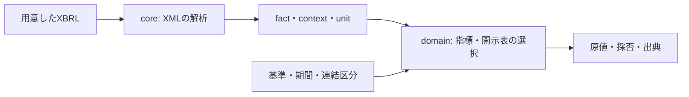

# 全体の仕組み

edinet-tsは、XBRLを読む処理、読み取った値を解釈する処理、取得・保存・日次運用を分けています。手元の1書類を解析するだけなら、データベースやサービスの起動は不要です。

| 関心                   | 主な配置        | 入力 → 出力                                                         |
| ---------------------- | --------------- | ------------------------------------------------------------------- |
| XBRLの構造を読む       | `src/core/`     | XML文字列 → fact・期間・単位・次元・taxonomyの型                    |
| 財務・開示の意味を読む | `src/domain/`   | 解析済み書類＋選択条件 → 値・採用理由・出典、または取得できない理由 |
| 外部I/Oと運用を扱う    | `src/platform/` | API応答・ファイル・解析結果 → 保存データ、検索用世代、公開状態      |

`src/cli/` はコマンドの引数を受け取り、これらの処理を呼び出します。`src/index.ts` はライブラリの公開入口です。内部ファイルの場所と公開名は分けて扱います。

## 1書類を読む経路

例えば売上高を読むときは、数字だけでなく、会社・期間・連結区分・単位が条件に合うか確認します。値がない場合と、0と書かれている場合は別です。タグがあっても対応外の形式や複数候補なら、その理由を返します。

`EdinetXbrlParser` が返す `EdinetXbrlObject` には、従来から `selectMetric()` などの便利メソッドがあります。これらはdomainの選択処理を呼ぶ互換用の窓口です。この既存の依存は残し、便利メソッドを削除したり、別クラスへの書換えを利用者へ要求したりしません。

金融版の訂正選択には、ZIP証拠をbyte列またはファイルパスで渡す既存APIがあります。パスを指定した場合の実際のファイル読取りはplatformの専用処理が行い、domain側は選択と検査結果の組立てを担当します。

## 多数の書類を保存・検索する経路

| 保存先         | 何を残すか                                 | 主な役割                   |
| -------------- | ------------------------------------------ | -------------------------- |
| 原本SQLite     | 一覧の観測、原本XML、実際に利用できた時刻  | 原本と訂正前後の履歴を保つ |
| 解析済みSQLite | 解析条件、原値、採用・不採用と出典         | 同じ条件の解析を再利用する |
| 検索用DB       | 固定した会社・期間・基準ごとの行と指標     | 多数の書類を条件検索する   |
| 公開catalog    | 公開候補、照合記録、現在の参照先、切替履歴 | 利用者が読む世代を選ぶ     |

これらは役割の違うファイルです。取得完了、解析完了、検索世代の完成、正式公開も別の工程です。日次処理は途中から再開でき、完成した候補を照合してから公開先を切り替えます。

具体的なテーブルと1件の値の保存例は[データ構造](storage/FINANCIAL_DATA_MODEL.md)、操作は[収集から公開まで](../ops/DOCUMENT_PIPELINE.md)を参照してください。

## 法人番号連携は別の入力

国税庁の法人番号データはEDINETのXBRLとは別に、`platform/registry/` で取得・署名検査・保存・差分適用を扱います。会社情報との照合には法人番号や原名称などの根拠を使います。名称が似ているだけで会社を統合しません。

## ファイルと文書の探し方

- XMLをどう読むか、指標や開示表をどう選ぶかは、[ソース配置](SOURCE_LAYOUT.md)と `core/`・`domain/` を確認します。
- DB接続、DDL、Store、日次jobは `platform/` と [運用文書](../README.md)から探します。APIを呼ぶだけなら日次運用の設定を読む必要はありません。
- 最小の利用例は[README](../../README.md)、個々の入出力・制約は `docs/specs/`、実行・復旧手順は `docs/ops/` にあります。
- 以前の試験結果と作業ログは `docs/history/archive/`、現在の残作業は[残作業表](../plans/REMAINING_WORK.md)にあります。
