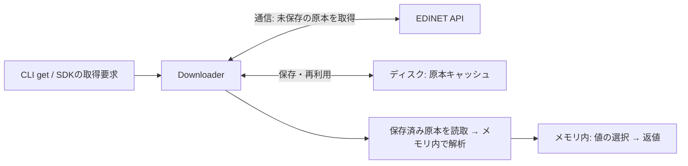
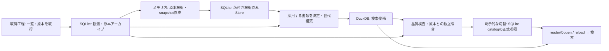
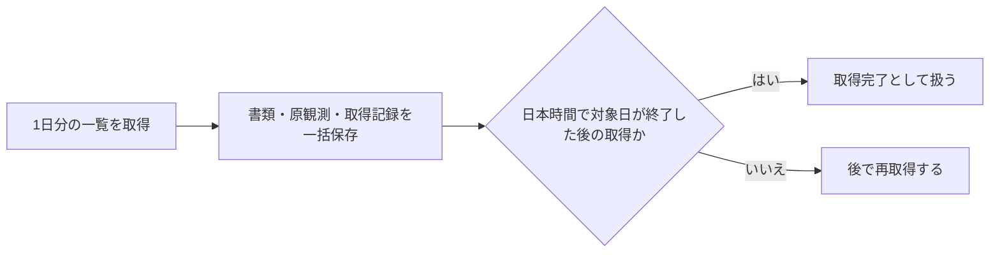
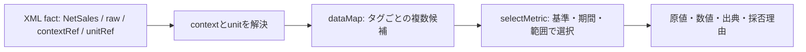

# 技術仕様

取得・解析・保存・検索がどうつながるかを説明します。APIの利用例は[README](../../README.md)、対応範囲は[提供機能と制約](REQUIREMENTS.md)を参照してください。

このページでは共通の処理と、既存の主要指標APIの選択規則を扱います。財務明細・開示表・保存APIごとの契約は、各節のリンク先を参照してください。

## 処理の全体像

3つの入口があります。図の「メモリ内」はDBへの保存を伴わない処理です。CLIが常に `Edinet` を通るわけではなく、`parse` と `get` はParserやDownloaderを直接呼びます。

### ローカル原本を解析する

`edinet-ts parse --file ...` は通信も一覧DBも必要としません。結果は標準出力へ返し、`--output` を指定した場合だけ結果ファイルへ書きます。


### 取得して解析する

`edinet-ts get --docid ...` は原本の取得・再利用後に解析します。証券コードで探す場合は一覧DBや一覧APIも使います。SDKでは `Edinet` を窓口にする使い方と、Downloader・Parserを個別に使う方法があります。



原本の保存は財務値の採用より前です。保存できても、対応する指標を必ず抽出できるとは限りません。

### 蓄積して検索する

一覧観測・原本を蓄積した後の構築経路です。固定原本からの構築自体は通信しません。解析結果と検索DBは別に保存し、候補の構築だけでは正式参照を変えません。



ファイル・テーブル・保存後の行は[財務データ構造](storage/FINANCIAL_DATA_MODEL.md)、実際の関数の呼出し順は[ソースコードの読み方](SOURCE_LAYOUT.md#代表的な2つの呼出し経路)を参照してください。

## 各クラスの役割

| クラス・機能           | 責務                                     | 主な入出力                              |
| ---------------------- | ---------------------------------------- | --------------------------------------- |
| `Edinet`               | 一覧DB・取得・解析を組み合わせる         | 証券コードや書類種別 → 書類・主要指標   |
| `EdinetXbrlDownloader` | API通信、ZIP検査、原本の保存・再利用     | 書類IDなど → XBRLファイル               |
| `EdinetRepository`     | 書類一覧と取得時点の観測を保存する       | 一覧応答 → SQLiteの書類・観測・完了記録 |
| `EdinetXbrlParser`     | XMLを検査し、context・値・単位を読み取る | XML文字列 → `EdinetXbrlObject`          |
| `ContextParser`        | 対象企業・期間・連結区分・次元を読み取る | `xbrli:context` → `EdinetContext`       |
| `EdinetXbrlObject`     | 候補値を保持し、各APIの規則で選ぶ        | タグ・条件 → 値、出典、採否理由         |
| `EdinetDataUtil`       | XMLノードの値・属性を取り出す            | ノード → 文字列や属性値                 |

`dataMap` は `ReadonlyMap<string, readonly EdinetData[]>` です。同じタグが複数の期間・範囲に現れるため、1タグに複数の値を保持します。内部の `contextMap` はcontext IDと対象企業・期間・範囲を対応させます。

## 取得とローカル一覧DB

### API通信と原本の保存

書類一覧は `/api/v2/documents.json`、原本は `/api/v2/documents/{docID}` から取得します。書類を分類する `docTypeCode` と、提出様式の `formCode` は別の値です。[書類一覧の応答仕様](edinet/DOCUMENT_LIST_VALIDATION.md)を参照してください。

取得処理には次の保護があります。

| 対象     | 動作                                                                              |
| -------- | --------------------------------------------------------------------------------- |
| 通信頻度 | レート制限が有効な場合、既定では1秒間に1回以下。本文受信完了まで並列数1の枠を保持 |
| 時間制限 | `requestTimeoutMs` を指定した場合、1回の通信の本文受信までを制限。省略時は無制限  |
| 中断     | `AbortSignal` で待ち行列・再試行待ち・受信を中断                                  |
| ZIP      | 名前・形式・件数・宣言サイズを確認し、上限付きで展開                              |
| 保存     | 一時フォルダで完了させてから公開。既存の書類フォルダは置換しない                  |

XBRLの探索は `PublicDoc` 内、ルート直下、サブディレクトリの順です。監査書類などを優先して読まないための規則であり、書類内容そのものの完全な妥当性検証ではありません。詳細は[取得・展開・保存の保護](edinet/DOWNLOAD_SAFETY.md)を参照してください。

### 一覧の保存と取得完了の判定

`saveDocumentList(docs, date)` は、1日分の一覧・取得日時・件数・各書類の原観測JSONを同じトランザクションで保存します。途中で失敗した場合はまとめて取り消します。



- 0件の日も記録します。日本時間で対象日が終了した後に取得した一覧は `hasCompleteListForDate()` で完了と判定します。
- `insertDocument()` / `insertBatch()` は個別の保存です。その日全体の取得完了とは扱いません。`hasMetadataForDate()` は書類の存在確認です。
- 旧DBには完了記録がないため、一覧を一度取り直す必要があります。既存の書類行は従来どおり上書きしません。
- 原観測は取得時点ごとのJSONとして保持します。`getDocumentObservations()` の `afterSequence` を再開位置に使えます。`knownAt` はタイムゾーン付き日時、`limit` は1〜10,000です。
- 読取専用ではテーブルを追加しません。旧DBに観測表がなければ空を返し、過去の観測を復元したことにはしません。

### 高水準APIでの検索範囲

| API                      | 一覧の補完                                 | 検索する範囲                                                                        |
| ------------------------ | ------------------------------------------ | ----------------------------------------------------------------------------------- |
| `getFinancialHistory()`  | 一覧DBは事前に準備する                     | DBで対象書類を選び、原本はキャッシュまたはAPIから取得。`years` 引数は書類件数の上限 |
| `findDocumentsByType()`  | 指定期間の未完了日を補う                   | 指定書類種別・開始日以降                                                            |
| `findDocumentsByFiler()` | 直近 `days` 日の未完了日を補う（既定30日） | 保存済みDBの全期間から提出者名を検索                                                |

補完の通信失敗は警告にして保存済みの範囲で続行する場合があります。中断などのエラーは呼び出し元へ返します。一覧に記録があることと、検索対象をすべて取得できたことは区別してください。

## XML解析とcontextの扱い

公開 `parse()` はUTF-8換算64MiB（67,108,864byte）以下の文字列を受け付けます。解析前に構造・文字を検査し、DOCTYPE宣言を拒否します。通常の文字参照、BOM、コメント、CDATAは扱います。

解析には `fast-xml-parser` を使い、複数ルート・未宣言文字参照・XML 1.0の不正文字などを補助検査します。この検査は、すべてのXML仕様への完全準拠や、タクソノミに照らしたXBRLの完全な妥当性検証ではありません。入力サイズ上限だけで解析時間や入れ子の深さまで制限するものでもありません。

contextを値より先に読み、次を区別します。

| 記載                     | 意味             | 例                 |
| ------------------------ | ---------------- | ------------------ |
| `startDate` と `endDate` | 期間（Duration） | 1年間の売上        |
| `instant`                | 時点（Instant）  | 期末の総資産       |
| `NonConsolidatedMember`  | 単体の範囲       | 提出会社のみ       |
| 部門などの追加次元       | 特定の内訳       | 全社合計とは別の値 |

基本の分類では単体指定がなければ連結と扱います。厳密選択では、それに加えて名前空間・対象企業・期間・次元・単位などを検査します。context IDの名前だけで意味を確定しません。

### 1つの値を候補から選ぶ例

次は架空の企業 `TEST` の売上です。XMLのfact（タグに付いた値）は、contextを通じて対象企業・期間・範囲に、unitを通じて通貨に結び付きます。Parserは3候補とも保持し、この時点では売上を1つに決めません。



ここでは3つとも日本基準の標準 `NetSales` タグ、単位は `iso4217:JPY`、対象企業は同じです。XMLのfactとunitの抜粋は次の形です。context定義の内容は下表に示します。

```xml
<xbrli:unit id="money"><xbrli:measure>iso4217:JPY</xbrli:measure></xbrli:unit>
<jppfs_cor:NetSales contextRef="current" unitRef="money" decimals="INF">100</jppfs_cor:NetSales>
<jppfs_cor:NetSales contextRef="prior" unitRef="money" decimals="INF">80</jppfs_cor:NetSales>
<jppfs_cor:NetSales contextRef="solo" unitRef="money" decimals="INF">60</jppfs_cor:NetSales>
```

| context参照 | 期間                   | 範囲               | 原値    | 下の条件での採否               |
| ----------- | ---------------------- | ------------------ | ------- | ------------------------------ |
| `current`   | 2024-04-01〜2025-03-31 | 連結・追加次元なし | `"100"` | 採用                           |
| `prior`     | 2023-04-01〜2024-03-31 | 連結・追加次元なし | `"80"`  | `context-mismatch`: 期間が違う |
| `solo`      | 2024-04-01〜2025-03-31 | 単体               | `"60"`  | `context-mismatch`: 範囲が違う |

```ts
const selected = xbrl.selectMetric("netSales", {
  accountingStandard: "J-GAAP",
  scope: "Consolidated",
  period: { startDate: "2024-04-01", endDate: "2025-03-31" },
});
// status: "selected", raw: "100", safeNumber: 100, reason: "selected"
// source.contextRef: "current", source.unit: "iso4217:JPY"
```

`xbrl` は上の候補を含むXMLを `EdinetXbrlParser.parse()` で解析した結果です。[同梱の合成fixture](../../test/fixtures/metric-boundaries.ts)の `fact()`・`context()`・`instance()` で上表の3候補を作り、[厳密選択テスト](../../test/metric-selection.test.ts)と同じようにParserと `selectMetric()` を呼ぶことで再現できます。この条件で原値100の採用と残る2候補の不採用理由を実行確認しています。context IDの `current` という名前で採用したのではなく、実際の日付と範囲を照合しています。これは `selectMetric()` の例であり、次節の既存一括取得APIが同じ値を選ぶことを示す例ではありません。

保存用snapshotでは値に原本・書類・期間などの根拠を加えます。その後の[原本から検索DBまでの値の流れ](storage/FINANCIAL_DATA_MODEL.md)は別の工程です。

<a id="32-主要指標抽出ロジック-getkeymetrics"></a>

## 主要指標の選択規則（getKeyMetrics）

`getKeyMetrics()` は既存の探索規則で主要18指標を返します。`getKeyMetricsWithSources()` も同じ規則を使い、採用元を付けます。条件を固定する `selectMetric()` とは選択方法が異なります。

### 金額・キャッシュフローの探索範囲

対象は `netSales`、`operatingIncome`、`ordinaryIncome`、`netIncome`、`netAssets`、`totalAssets`、`operatingCashFlow`、`investingCashFlow`、`financingCashFlow`、`cashAndEquivalents` です。

次の順で候補を絞ります。

| 順序                          | 処理                                                                          |
| ----------------------------- | ----------------------------------------------------------------------------- |
| 1. 期間と時点を分ける         | `Duration` と `Instant` を独立に探索する                                      |
| 2. 全社の値に絞る             | 連結は次元なし、単体は `NonConsolidatedMember` のみ。部門などの追加次元は除く |
| 3. 提出日を除く               | `FilingDateInstant` を財務値の期間・範囲の判定に使わない                      |
| 4. 連結・単体の範囲を固定する | 対象の連結contextがあればその中だけを使い、なければ単体を使う                 |
| 5. 日付とタグの順に探す       | 選んだ範囲の最新日から180日未満の候補を、新しい順・既定のタグ順で調べる       |
| 6. 結果を返す                 | 0は有効な値。対象タグがない・空・変換不能などで候補を使い切ったら `undefined` |

連結の探索で値が見つからなくても、単体へ切り替えません。日付の絞り込みで候補がなくなった場合も、別の範囲へ戻って探し直しません。

**context定義がない入力との互換性:** 対象となる期間・時点のcontextがどちらの範囲にもない場合だけ、`CurrentYearDuration` / `CurrentYearInstant` と各 `_NonConsolidatedMember` を順に調べます。定義がなく、実データが参照している最初のIDに範囲を固定します。そのIDに対象外のタグしかなくても次の範囲へ移りません。定義が存在して期間・次元条件で除外されたIDを、この処理で復活させることもありません。

### 1株指標などの代替探索

`earningsPerShare`、`bookValuePerShare`、`equityToTotalAssetsRatio`、`rateOfReturnOnEquity`、`priceEarningsRatio`、`payoutRatio`、`numberOfIssuedShares`、`dividendPaidPerShare` は、連結、単体、固定IDの順に候補を探します。特に発行済株式数や配当など、同梱テストデータでは単体コンテキストから取得する項目があるためです。この代替探索は既存APIとの互換性のための規則です。会計上、すべての項目で単体値への代替が適切だと保証するものではありません。

このため、`KeyMetrics` 全項目が同じ連結区分・期間にそろう保証はありません。同じ区分・期間の厳密な比較には、`getDataByContextRef()` 等で明示的に指定してください。

### 制限と検証例

たとえば同梱のYahoo原本では、単体の `OperatingIncome` はあっても、連結の営業利益は標準候補にない企業拡張タグにあります。この場合、`getKeyMetrics().operatingIncome` は `undefined` です。単体値を連結値として返すことはしません。

期間・時点、ゼロ、複数候補、180日の境界、追加次元、固定IDなどは `test/key-metrics-scope.test.ts` で検証します。これらは同梱データでの確認であり、提出原本との独立照合や全市場の保証ではありません。

年度・四半期・累計の対応、過去連結から現在単体への移行、任意のメタデータcontext、未知の企業拡張タグの会計上の意味は、この既定探索では一般解決しません。

## 条件を指定するAPIと自動判定

似た名前でも、入力と選択の責任範囲が違います。以下の解析・snapshot作成・検索は、それだけでは原本取得やDB保存を行いません。保存・索引構築は別操作です。

| 入口                                                                  | 入力                             | 期間・範囲を決める主体                                       | 訂正書類の選択                                                   | 返値                                                             |
| --------------------------------------------------------------------- | -------------------------------- | ------------------------------------------------------------ | ---------------------------------------------------------------- | ---------------------------------------------------------------- |
| `getKeyMetrics()`                                                     | 解析済みの1原本                  | 既定の探索規則。指標全体で同じ期間・範囲とは限らない         | 行わない                                                         | 主要18指標の数値・未取得は `undefined`                           |
| `getKeyMetricsWithSources()`                                          | 同上                             | `getKeyMetrics()` と同じ規則                                 | 行わない                                                         | 同じ主要指標＋採用元。出典を付けても選択規則は変わらない         |
| `selectMetric()`                                                      | 解析済みの1原本＋指標ID・条件    | 呼出元が基準・期間・範囲を指定                               | 行わない                                                         | `selected / missing / unsupported / ambiguous`、原値・出典・理由 |
| `createAutomaticFinancialSnapshots()`                                 | 1原本XML＋書類ID等               | `resolveFinancialReportingBasis()` がDEIと実contextから判定  | 行わない                                                         | 判定結果とBS・明細snapshot、未抽出理由                           |
| `createObservedFinancialSnapshots()`                                  | 一覧観測＋原本・hash・取得時点等 | 観測と原本のDEI・期間を照合                                  | cutoff等から対象原本を選ぶ。親の値との合成はしない               | 選択根拠と、選択原本の直接値のsnapshot                           |
| `screenFinancialSnapshots()`                                          | 呼出元が渡すsnapshot配列         | 配列内の書類種別・cutoff等で限定し、銘柄ごとの最新書類を選ぶ | 一覧観測や訂正系列を検証しない                                   | 条件・並び順・件数を適用した行と診断                             |
| `FinancialSearchIndex.screen()` / `DuckFinancialSearchIndex.screen()` | 構築済み世代＋cohort・検索条件   | 構築時の採用履歴と検索時の基準・期間・範囲を使う             | 構築時に固定した観測・採用結果を検索。検索時に原本を選び直さない | 検索行と診断。SQLiteは同期、DuckDBはPromise                      |

通常の観測付きsnapshotと、検証済み金融版根拠を使う `createSourceBackedObservedFinancialSnapshots()`（financial-v2）は別の契約です。すべての訂正を合成できるわけではありません。索引も構築方式ごとの採用根拠を保持するため、JSON配列の「最新書類」と同じ意味だとみなさないでください。

代表テストは[主要指標の範囲](../../test/key-metrics-scope.test.ts)、[厳密選択](../../test/metric-selection.test.ts)、[自動判定](../../test/financial-reporting-basis.test.ts)、[観測付きsnapshot](../../test/observed-financial-snapshots.test.ts)、[JSON検索](../../test/financial-screening.test.ts)、[SQLite索引](../../test/financial-search-index.test.ts)、[DuckDB索引](../../test/duck-financial-search-index.test.ts)です。

単純通貨単位はISO 4217の名前空間URIから解決し、`unitRef` の文字列だけでは推測しません。原値と安全に変換できた数値を分けて保持します。

半期一覧は原本DEIの事業年度または半期累計の開始日・終了日との完全一致を要求します。保存済み実一覧には両方の記録例があり、どちらにも一致しない場合は保留します。Q2/Q3の四半期一覧は確認できた単四半期contextと照合し、財務値の抽出は年度初めからの累計を保ちます。確認できない期間を推測で通しません。

詳細は[指標選択](financial/METRIC_SELECTION.md)、[自動判定](financial/FINANCIAL_REPORTING_BASIS.md)、[一覧と原本の接続](../ops/DOCUMENT_PIPELINE.md)を参照してください。

## 保存済みデータの検索と公開

`screenFinancialSnapshots()` は、書類種別・cutoffで対象を限定し、銘柄ごとの最新書類を選びます。その後にAND条件、並べ替え、`offset` / `limit` を適用します。計算指標はcontext・期間・範囲・通貨が揃う場合だけ作ります。[入力形式と制約](../guide/EDINET_DB_COMPARISON.md)を参照してください。

<a id="current-storage"></a>

### 現行のSQLite＋DuckDB構成

継続運転では、SQLiteに一覧観測・原本アーカイブ・解析済みStore・公開catalogを保存し、検索用の財務行と指標値をDuckDBに構築します。DuckDBを導入してもSQLiteをすべて置き換える構成ではありません。

[固定原本からの構築](../ops/DUCK_FINANCIAL_CYCLE.md)で検索候補を作り、品質検査と[独立した原本照合](../ops/DUCK_FINANCIAL_VERIFICATION.md)を通過した後、明示的にcatalogの正式参照を切り替えます。[DuckDB reader](storage/DUCK_FINANCIAL_SEARCH_INDEX.md)は非同期です。公開readerの `DuckFinancialPublicationReader` は、正式参照に一致する固定snapshotを開きます。catalogを切り替えただけでは開いているreaderは変わらず、`reload()` または新しいreaderのopenが必要です。

### 継続提供する同期SQLite API

`FinancialSearchIndex` と `PublishedFinancialIndex` は引き続き同期SQLite APIとして使えます。既存SQLite索引を読む用途を残し、DuckDB側と検索条件・品質検査の共通処理を共有します。DuckDBの非同期APIを呼ぶ際には `await` が必要です。[SQLite索引](storage/FINANCIAL_SEARCH_INDEX.md)と[公開世代の管理](storage/FINANCIAL_INDEX_PUBLICATION.md)は、この互換APIとcatalogの仕組みを調べる入口です。

移行日・照合件数・稼働runtimeの更新記録は[本番運用記録](../ops/DUCK_FINANCIAL_PRODUCTION.md)、移行工程の履歴は[導入計画](../history/archive/plans/SQLITE_DUCKDB_IMPLEMENTATION_PLAN.md)を参照してください。上の説明は現行の責務分担を示し、過去の検証件数を現行API全体の保証として扱いません。

### ローカル原本を読むCLIの上限

`screen-bs` などのローカル原本コマンドでは、入力を有限の範囲で読み取ります。

| 入力                 | 上限・検査                                                            |
| -------------------- | --------------------------------------------------------------------- |
| 原本一覧（manifest） | 2MiB以下のJSON配列、100件以下                                         |
| 個々の原本           | 64MiB以下                                                             |
| 原本の合計           | 256MiB以下                                                            |
| ファイル内容         | 不正UTF-8を置換して続行しない。通常ファイルを読み、読取中の変更を検査 |

元ファイルへ書き込みません。symlinkを一律禁止する仕組みではなく、ネットワーク取得や全キャッシュ走査の上限を示すものでもありません。

[ドキュメント案内へ戻る](../README.md)
